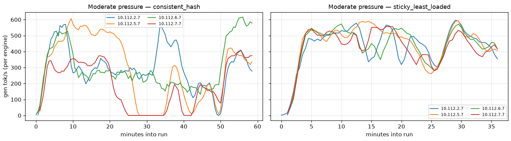

# Load Balancing Policies

The vLLM Router supports multiple load balancing policies for distributing requests across backend workers. Each policy is designed for different use cases and can be configured based on your deployment requirements.

Worker URLs may be `http(s)://` or `grpc://`. Examples below use HTTP;
the policy is the same for `grpc://host:port`.

## Available Policies

| Policy | Best For | Session Affinity | Load Aware |
|--------|----------|------------------|------------|
| `round_robin` | General purpose, even distribution | No | No |
| `random` | Simple deployments | No | No |
| `consistent_hash` | Multi-turn conversations, KV cache reuse | Yes | No |
| `power_of_two` | Load-sensitive workloads | No | Yes |
| `cache_aware` | Prefix caching optimization | Yes (cache-based) | Yes |
| `kv_aware` | KV reuse and stage-aware load scoring | No | Yes |
| `sticky_least_loaded` | Many concurrent multi-turn sessions, async RL | Yes | Yes (active sessions) |

---

## Consistent Hash

The `consistent_hash` policy routes requests with the same session/user identifier to the same backend worker. This is essential for:

- **Multi-turn conversations**: Ensures conversation history stays on the same worker
- **KV cache reuse**: Maximizes cache hits by routing related requests together
- **Session affinity**: Maintains user-specific state on a single worker

### Configuration

```bash
# Using CLI
vllm-router --policy consistent_hash --worker-urls http://worker1:8000,http://worker2:8000

# Using Python
from vllm_router import Router
router = Router(
    policy="consistent_hash",
    worker_urls=["http://worker1:8000", "http://worker2:8000"]
)
```

### Hash Key Priority

The consistent hash policy extracts a routing key in the following priority order:

| Priority | Source | Header/Field | Example |
|----------|--------|--------------|---------|
| 1 | HTTP Header | `X-Session-ID` | `X-Session-ID: session-abc-123` |
| 2 | HTTP Header | `X-User-ID` | `X-User-ID: user-456` |
| 3 | HTTP Header | `X-Tenant-ID` | `X-Tenant-ID: tenant-xyz` |
| 4 | HTTP Header | `X-Request-ID` | `X-Request-ID: req-789` |
| 5 | HTTP Header | `X-Correlation-ID` | `X-Correlation-ID: corr-001` |
| 6 | HTTP Header | `X-Trace-ID` | `X-Trace-ID: trace-002` |
| 7 | Request Body | `session_params.session_id` | `{"session_params": {"session_id": "..."}}` |
| 8 | Request Body | `user` | `{"user": "..."}` (OpenAI format) |
| 9 | Request Body | `session_id` | `{"session_id": "..."}` (legacy) |
| 10 | Request Body | `user_id` | `{"user_id": "..."}` (legacy) |
| 11 | Fallback | Request body hash | Hash of entire request body |

### Usage Examples

#### Recommended: Using HTTP Headers

HTTP headers are the **recommended approach** for session affinity because:
- No JSON body parsing required (faster routing)
- Works with any request format
- Compatible with standard infrastructure tools (Nginx, Envoy, K8s Ingress)

```bash
# Using X-Session-ID header (recommended)
curl -X POST http://router:8000/v1/chat/completions \
  -H "X-Session-ID: conversation-12345" \
  -H "Content-Type: application/json" \
  -d '{
    "model": "llama-3",
    "messages": [{"role": "user", "content": "Hello!"}]
  }'

# Using X-User-ID header for user-based routing
curl -X POST http://router:8000/v1/chat/completions \
  -H "X-User-ID: user-67890" \
  -H "Content-Type: application/json" \
  -d '{
    "model": "llama-3",
    "messages": [{"role": "user", "content": "Hello!"}]
  }'
```

#### Alternative: Using Request Body

For backward compatibility, you can also include session information in the request body:

```bash
# Using session_params.session_id in body
curl -X POST http://router:8000/v1/chat/completions \
  -H "Content-Type: application/json" \
  -d '{
    "model": "llama-3",
    "session_params": {"session_id": "conversation-12345"},
    "messages": [{"role": "user", "content": "Hello!"}]
  }'

# Using OpenAI user field
curl -X POST http://router:8000/v1/chat/completions \
  -H "Content-Type: application/json" \
  -d '{
    "model": "llama-3",
    "user": "user-67890",
    "messages": [{"role": "user", "content": "Hello!"}]
  }'
```

### Behavior

- **Consistency**: Same session ID always routes to the same worker
- **Unhealthy fallback**: If the target worker is unhealthy, falls back to the first healthy worker
- **Virtual nodes**: Uses 160 virtual nodes per worker for even distribution
- **DP-aware routing**: Supports data-parallel worker URLs (e.g., `http://worker:8000@0`)

---

## Sticky Least Loaded

The `sticky_least_loaded` policy keeps every request of a session on one worker, like `consistent_hash`, but places each *new* session on the worker with the fewest active sessions instead of on a hash-determined worker. It is built for workloads with many concurrent multi-turn sessions, such as async RL rollouts, where hashing alone can leave some workers overloaded while others are idle.

### Configuration

```bash
vllm-router --policy sticky_least_loaded \
  --worker-urls http://worker1:8000 http://worker2:8000 \
  --sticky-least-loaded-session-ttl-secs 7200
```

In P/D mode, use it as `--prefill-policy` and/or `--decode-policy`; prefill and decode track sessions independently.

### Session lifecycle

- **Session id**: resolved from the request's stable identity, the same one `kv_aware` session affinity uses. The first source present wins:

  | Source | Session id |
  |---|---|
  | Body `vllm_xargs.agentic_context` | its `task_id`, else its `session_id`, else its `program_id` (all agents of a task share the session) |
  | Body `agent_hint.session_id` | that value |
  | Header `x-claude-code-session-id`, `session-id` (Codex) or `X-Session-ID` | the header value |
  | Body `session_params.session_id`, then `session_id` | that value |

  Values are trimmed. Header, `agent_hint` and `agentic_context` ids are limited to 256 bytes. An invalid identity (an empty id, an id that is neither a string nor an integer, an over-long id, or a malformed `session_params`, `agent_hint` or `agentic_context`) means the request has no session. `user`, `user_id`, `X-User-ID`, `X-Request-ID` and `X-Trace-ID` do not create sessions.
- **New session**: assigned to the worker with the fewest active sessions; ties are broken by rendezvous hashing.
- **Existing session**: routed to its worker. If that worker is unhealthy or removed, the session is reassigned.
- **Finish**: `POST /finish_session` with the same identity headers or body fields as the session's requests releases it. Sessions without a request for `--sticky-least-loaded-session-ttl-secs` (default 2 hours) are released automatically.
- **No session id**: the request goes to the least-loaded worker and is not tracked.

```bash
curl -X POST http://router:8000/finish_session -H "X-Session-ID: traj-42"

curl -X POST http://router:8000/finish_session -H "Content-Type: application/json" \
  -d '{"vllm_xargs": {"agentic_context": {"task_id": "traj-42"}}}'
# {"status":"ok","session_id":"traj-42","released":true}
```

`released` is `false` when no policy held the session. A request without an identity, or with an invalid one or a body that is not JSON, gets a 400.

Session state lives in the router process, so it is lost on restart, and multiple router replicas need ingress stickiness.

### Benchmark in SkyRL

Fully async RL on the [Apex Agents](https://www.mercor.com/blog/training-frontier-knowledge-work-agents-a-397b-rl-training-guide-with-skyrl) dataset (multi-turn agentic tasks, about 40 turns) with GLM 4.7 on 4 engines (TP 8, 8xB200 each), `max_concurrency=132` and a simulated 60 s training step. KV cache pressure is varied with `gpu_memory_utilization` (moderate = 0.75). Per-engine generation throughput at moderate pressure:



With `consistent_hash`, some engines sit idle for several minutes while others are saturated; with `sticky_least_loaded` the engines stay close to each other. At moderate pressure with `max_staleness=4`:

| policy | traj/s | preemptions | p90 trajectory latency (s) |
|---|---|---|---|
| `consistent_hash` | 0.110 | 32 | 3013 |
| `sticky_least_loaded` | 0.212 | 6 | 1636 |

With `max_staleness=2`, results are mixed: throughput is about the same at low pressure, higher at moderate pressure (0.183 vs. 0.133 traj/s) and lower at high pressure (0.084 vs. 0.099 traj/s). See [SkyRL PR #1791](https://github.com/NovaSky-AI/SkyRL/pull/1791) for the full results.

---

## Round Robin

The `round_robin` policy distributes requests evenly across all healthy workers in sequential order.

### Configuration

```bash
vllm-router --policy round_robin --worker-urls http://worker1:8000,http://worker2:8000
```

### Behavior

- Cycles through workers: worker1 → worker2 → worker3 → worker1 → ...
- Skips unhealthy workers automatically
- Simple and predictable distribution
- No session affinity (each request may go to a different worker)

### Best For

- Stateless workloads
- Single-turn requests
- When even distribution is more important than cache locality

---

## Random

The `random` policy selects a random healthy worker for each request.

### Configuration

```bash
vllm-router --policy random --worker-urls http://worker1:8000,http://worker2:8000
```

### Behavior

- Uniform random selection among healthy workers
- No session affinity
- Statistically even distribution over many requests

### Best For

- Simple deployments
- When you want to avoid any sequential patterns
- Testing and development

---

## Power of Two Choices

The `power_of_two` policy randomly selects two workers and routes to the one with lower load. This provides good load distribution with minimal coordination overhead.

### Configuration

```bash
vllm-router --policy power_of_two --worker-urls http://worker1:8000,http://worker2:8000,http://worker3:8000
```

### Behavior

1. Randomly pick two healthy workers
2. Query their current load (pending requests)
3. Route to the worker with lower load

### Best For

- Load-sensitive workloads
- When request processing times vary significantly
- Avoiding hot spots without full load tracking overhead

### Note

Requires at least 2 workers. With only 1 worker, behaves like direct routing.

---

## Cache Aware

The `cache_aware` policy optimizes for prefix caching by maintaining an approximate radix tree of request prefixes per worker.

### Configuration

```bash
vllm-router --policy cache_aware \
  --cache-threshold 0.5 \
  --balance-abs-threshold 32 \
  --balance-rel-threshold 1.1 \
  --worker-urls http://worker1:8000,http://worker2:8000
```

### Parameters

| Parameter | Default | Description |
|-----------|---------|-------------|
| `cache_threshold` | 0.5 | Minimum prefix match ratio over the full input |
| `balance_abs_threshold` | 32 | Absolute load difference threshold for load balancing |
| `balance_rel_threshold` | 1.1 | Relative load ratio threshold for load balancing |
| `eviction_interval_secs` | 30 | Interval for cache eviction |
| `max_tree_size` | 33,554,432 (`2^25`) | Character budget per worker per model |

Trees are trimmed to `max_tree_size` during periodic eviction and may grow beyond it between cycles. This character budget is not a memory limit; actual memory usage also includes tree overhead and scales with the number of workers and models.

### Behavior

1. **Balanced mode** (when load is even):
   - Find worker with highest prefix match for the request
   - If match rate > `cache_threshold`: route to that worker (cache hit)
   - Otherwise: route to worker with lowest load

2. **Imbalanced mode** (when load is skewed):
   - Route to worker with lowest load (shortest queue)
   - Still updates the tree to maintain cache state

### Best For

- Workloads with repeated prompt prefixes (system prompts, few-shot examples)
- When prefix caching is enabled on vLLM workers
- Multi-tenant deployments with distinct prompt patterns

---

## KV Aware

`kv_aware` uses KV cache reuse and worker load to route requests. It suits workloads with repeated prompt prefixes and supports HTTP, [gRPC](../backend/grpc.md), and P/D disaggregation over HTTP or gRPC.

HTTP Completion uses the existing [Direct/Worker input preparation](http_completion_kv.md), without local tokenizer assets. Unmodeled identities and unqualified targets stay routable without cache credit.

```bash
vllm-router --policy kv_aware \
  --worker-urls grpc://worker1:8000 grpc://worker2:8000
```

Enable KV events on the workers. HTTP text requests also need a render endpoint or, for simple prompts, `/tokenize`. Without usable KV information, routing falls back to load.

For regular pools without event discovery, configure `--kv-event-source WORKER_URL=tcp://HOST:PORT` per worker, plus matching `--kv-event-model` and `--kv-event-block-size`.

### P/D disaggregation

```bash
vllm-router --vllm-pd-disaggregation \
  --prefill http://prefill:8000 --decode http://decode:8000 \
  --prefill-policy kv_aware --decode-policy kv_aware
```

Prefill selection considers reusable KV and current work. Decode selection favors the least busy worker. Both stages inherit `--policy` unless overridden.

Configure the engines' P/D connector and enable prefix caching and KV events on prefill workers. For native Python vLLM metadata discovery, set `VLLM_SERVER_DEV_MODE=1`.

If event discovery is unavailable, add `--pd-kv-events http://prefill:8000=tcp://prefill:5557` for each prefill worker.

### Session affinity

Affinity is off by default. Add `--kv-aware-session-affinity-ttl-secs 1800` to retain bindings for 30 minutes of inactivity.

Send the same `x-session-id` header or `session_params.session_id` on each turn; agent metadata and framework session headers take precedence.

In P/D mode, affinity applies only to decode. A busy decoder may be replaced by a less busy one; prefill is selected independently for each request.

Multiple router replicas need ingress stickiness to preserve affinity.

---

## Choosing a Policy

```
                                    ┌─────────────────────┐
                                    │  Need session       │
                                    │  affinity?          │
                                    └─────────┬───────────┘
                                              │
                              ┌───────────────┴───────────────┐
                              │                               │
                             Yes                              No
                              │                               │
                              ▼                               ▼
                    ┌─────────────────┐             ┌─────────────────┐
                    │  Multi-turn or  │             │  Load-sensitive │
                    │  KV cache reuse?│             │  workload?      │
                    └────────┬────────┘             └────────┬────────┘
                             │                               │
                 ┌───────────┴───────────┐       ┌───────────┴───────────┐
                 │                       │       │                       │
                Yes                      No     Yes                      No
                 │                       │       │                       │
                 ▼                       ▼       ▼                       ▼
        ┌────────────────┐     ┌────────────────┐ ┌────────────────┐ ┌────────────────┐
        │ consistent_hash│     │  cache_aware   │ │  power_of_two  │ │  round_robin   │
        │                │     │                │ │                │ │  or random     │
        └────────────────┘     └────────────────┘ └────────────────┘ └────────────────┘
```

### Quick Reference

| Scenario | Recommended Policy |
|----------|-------------------|
| Chat applications with conversation history | `consistent_hash` |
| Many concurrent multi-turn sessions (e.g. async RL rollouts) | `sticky_least_loaded` |
| Batch inference with no state | `round_robin` |
| Variable request complexity | `power_of_two` |
| Repeated system prompts / few-shot | `cache_aware` |
| Simple testing / development | `random` |

---

## PD (Prefill-Decode) Mode

In prefill-decode disaggregated mode, you can configure separate policies for prefill and decode workers:

```bash
vllm-router \
  --mode pd \
  --prefill-policy consistent_hash \
  --decode-policy round_robin \
  --prefill-workers http://prefill1:8000,http://prefill2:8000 \
  --decode-workers http://decode1:8000,http://decode2:8000
```

This allows optimizing each stage independently:
- **Prefill**: Use `consistent_hash` for cache locality
- **Decode**: Inherits the main policy; override with `--decode-policy` (for example `round_robin`)

`grpc://` prefill and decode workers must run vLLM ≥ 0.30.0. The router
warns at startup when a worker reports an older `engine_version`, and
`power_of_two` uses the router's local load counts for them. See
[gRPC P/D disaggregation](../backend/grpc.md#pd-disaggregation).
