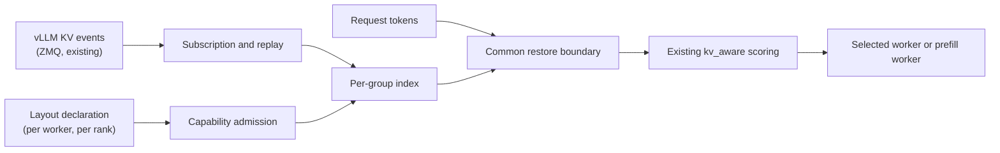
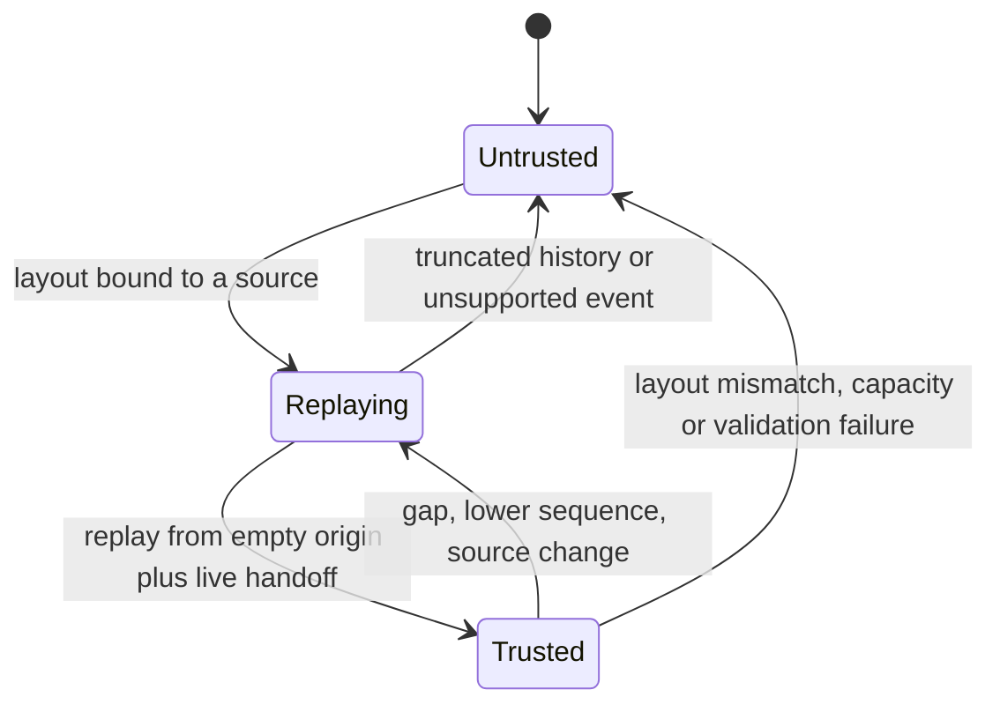

# RFC: KV-aware prefix reuse routing for hybrid attention models

**Status: design.** Tracking issue [#489](https://github.com/vllm-project/router/issues/489) · Parent RFC [#294](https://github.com/vllm-project/router/issues/294) · Reference implementation [PR #493](https://github.com/vllm-project/router/pull/493) · Implementation notes: [`hybrid-kv-aware-handoff.md`](hybrid-kv-aware-handoff.md)

## 1. Summary

`kv_aware` selects workers by estimated prefill work: it indexes cached prefixes from vLLM KV events, credits the tokens a worker can reuse, and scores `estimated prefill = input tokens - credited tokens` together with load. The estimate is sound for full-attention models, where a resident attention block is exactly the state a prefix needs.

Hybrid-attention models — Qwen3.5/3.6/3.8/4 and DeepSeek V4-class — keep additional per-prefix state: GDN/Mamba checkpoints, compressed MLA state, sliding-window rings. That state is not implied by attention residency, and parts of it are valid only at particular offsets. This RFC extends `kv_aware` with a per-rank group model:

- the deployment declares the **complete** group layout of each rank — an operator assertion, not an inference from events;
- the existing KV event stream supplies per-group residency;
- a prefix is credited only up to the **common restore boundary**: the largest offset where every declared group is simultaneously restorable on that worker and DP rank;
- anything unproven — unknown layout, undeclared group, stream discontinuity, unsupported hash contract — yields **zero hybrid credit** and leaves the worker on the existing load path.

Router remains the only component that changes. It consumes the KV events and the optional `/kv_event_sources` route that upstream vLLM already provides; no engine patch, event field, or connector protocol is added. Router credit is a routing estimate, never a reservation: vLLM performs the cache check and the inference.

## 2. Motivation

### 2.1 What the existing index assumes

The KV-aware index is keyed by attention block hash and answers one question: *which tokens of this request are resident as attention KV on this target?* For a full-attention model that answer is complete, because the attention KV is the whole prefix state.

### 2.2 What hybrid models cache instead

| Group family | Engine state | Restore semantics |
|---|---|---|
| `full_attention` | Dense attention KV | Valid at every block boundary |
| `mla_attention` | Compressed MLA state | Valid at block boundaries; may retain fewer states than tokens (`tokens_per_state`) |
| `sliding_window`, `sliding_window_mla` | Windowed KV ring | Only the resident window is restorable; a hit rewinds the window and recomputes the tail |
| `mamba` | GDN/Mamba recurrence checkpoint | Valid only at aligned offsets; may be retained sparsely |
| `CircularBufferSpec` | Per-request scratch | Not shareable prefix state at all |

A hybrid rank therefore holds several independently-evicted states per prefix, each with its own granularity and validity rule.

### 2.3 Why attention credit alone is unsafe

1. **Under-estimated prefill.** Crediting resident attention groups makes a worker look cheap. It wins the request, then recomputes the missing recurrent state, so TTFT regresses with no error surfaced anywhere.
2. **Wrong restore offset.** Checkpoints and compressed state exist only at some offsets. The credit must stop at the largest offset valid for *all* groups, not at the largest per group.
3. **Stale residency.** Events are asynchronous and blocks can be evicted after dispatch. Credit informs selection; it cannot promise residency.

### 2.4 The design rule

Hybrid credit is all-or-nothing per group set: a rank receives credit only when its layout is declared *and* its event stream is trusted, and then only up to the common boundary. There is no single-group fallback for hybrid models — the legacy path rejects nonzero-group events rather than misreading group 0 as full attention. Under-crediting costs a better choice of worker; over-crediting costs TTFT and hides the cause.

## 3. Goals and scope

| | Contents |
|---|---|
| Goals | Per-group residency, common boundary, credit wired into existing scoring, fail-closed defaults, P/D and session-affinity integration |
| Supported inputs | Text requests with exact tokens; colocated and disaggregated deployments |
| Non-goals | Changing vLLM operators, event format or transfer protocol; inferring layouts; cross-worker or cross-tier prefix composition; multimodal, LoRA, speculative decoding; content-based similarity |

## 4. Architecture



| Component | Responsibility | Location |
|---|---|---|
| Discovery | Bind a worker URL to a layout; resolve event endpoints statically or via `/kv_event_sources` | `kv_index/discovery.rs` |
| Admission | Reject layouts that are incomplete, inconsistent with the source topic, or use an unsupported hash contract | `kv_index/hybrid_capability.rs` |
| Subscription | Replay from a known-empty origin per rank, then hand off to the live stream | `kv_index/hybrid_stream.rs` |
| Index | Track residency per `(source, rank, group)`; revoke on discontinuity | `kv_index/hybrid_events.rs` |
| Matcher | Intersect group residency into one boundary, subtract replay, align down | `kv_index/hybrid.rs` |
| Policy | Consume the boundary as a `TieredMatchProvider` hit; retain health, load, reservation, retry | `policies/kv_aware.rs` |
| P/D | Bind prefill layouts to allowed decode workers; validate handoff | `routers/http/pd_*` |

The existing single-group index stays in place and keeps serving full-attention models; the hybrid index is a second provider consulted only for ranks with a declared layout.

## 5. Layout model

### 5.1 Configuration, not inference

A layout is a versioned configuration artifact written for one engine build and one model artifact. It is the operator's assertion of the complete group set, and Router validates its shape rather than trying to reconstruct it:

- observed events prove that a group **exists**, never that no other group is required;
- a required group with no events is a miss, not an absence;
- a layout whose `topic` or `root_hash` disagrees with the engine is rejected, because it describes a different boot or different weights.

Making the layout explicit keeps the trust boundary auditable: every credit decision traces back to a declaration a reviewer can read.

### 5.2 Shape

```json
{
  "http://127.0.0.1:8000": {
    "schema_version": 1,
    "ranks": [{
      "rank": 0,
      "model": "qwen3.5-4b",
      "weight_version": "v1",
      "publisher_topic": "kv-hybrid",
      "instance_topic": true,
      "hash_algorithm": "sha256_cbor",
      "root_hash": "9bd96a485ad84efdafb72ee48a1d7a69bcead0f8f0433173941b276b9581eef0",
      "full_hashes": true,
      "hash_block_size": 576,
      "hash_lookahead_tokens": 0,
      "speculative_tokens": 0,
      "prefix_caching": true,
      "groups": [
        {"group_idx": 0, "kind": "mamba", "spec_type": "MambaSpec", "block_size": 576,
         "prefix_cacheable": true, "prefix_replay_tokens": 0, "mamba_cache_mode": "align"},
        {"group_idx": 3, "kind": "full_attention", "spec_type": "FullAttentionSpec",
         "block_size": 576, "prefix_cacheable": true, "prefix_replay_tokens": 0}
      ]
    }]
  }
}
```

Rank-level requirements: `rank` equals the event source's `dp_rank`; `model` equals the served model; `weight_version` and `publisher_topic` are non-empty; `instance_topic` marks a per-instance topic; `hash_algorithm` is `sha256_cbor` with `full_hashes`; `prefix_caching` is enabled; `hash_lookahead_tokens` and `speculative_tokens` are zero, since lookahead would credit tokens the engine has not stored.

### 5.3 Groups

| `kind` / `spec_type` | Restore rule | Declared fields |
|---|---|---|
| `full_attention` / `FullAttentionSpec` | Continuous coverage from the prefix start | `block_size`, `prefix_cacheable`, `prefix_replay_tokens` |
| `mla_attention` / `MLAAttentionSpec` | Coverage at block boundaries | plus `tokens_per_state`, optional `cache_role: sparse` |
| `sliding_window` / `SlidingWindowSpec` | Window equality with the layout | plus `sliding_window` |
| `sliding_window_mla` / `SlidingWindowMLASpec` | Same, compressed state | plus `sliding_window` |
| `mamba` / `MambaSpec` | Checkpoint at an aligned offset | plus `mamba_cache_mode: "align"`, optional `prefill_checkpoint_alignment` |
| `mla_attention` / `CircularBufferSpec` | Never restorable | `prefix_cacheable: false`, `tokens_per_state: "1"`; excluded from the index |

### 5.4 Invariants enforced at admission

1. At least two groups, at least one attention group, at least one state or replay group.
2. `hash_block_size` divides every group's `block_size`: the rank hashes one chain at one granularity, and every group's pages must tile that chain.
3. All replay groups declare the **same** `prefix_replay_tokens`: the engine rewinds one window per hit, so mixed windows cannot be expressed by one boundary.
4. Scratch groups are admitted only as non-cacheable `CircularBufferSpec` with `tokens_per_state: "1"`; they never contribute credit.
5. `tokens_per_state`, `prefill_checkpoint_alignment` and `sliding_window` divide or match the group block as declared.
6. Rank indices are unique per worker, and one topic belongs to one rank.
7. A layout with no discoverable endpoint is valid configuration but earns no credit.

### 5.5 Endpoints and discovery

Endpoints may be declared explicitly (`--kv-event-source`, `--kv-event-replay-source`) or omitted. With no endpoints, Router asks the engine: on vLLM 0.31+ `GET /kv_event_sources` returns `{"<rank>": {"publisher": "zmq", "endpoint": "tcp://*:5557", "replay_endpoint": "tcp://*:5560", "topic": "kv-hybrid", ...}}`. Absent `encoding` and `schema_version` mean the documented `zmq`/msgpack/schema-1 contract; a conflicting declaration is rejected. Bind wildcards (`tcp://*:5557`, `0.0.0.0`, `[::]`) resolve to the worker host. A topic that differs from `publisher_topic` is a different boot and is rejected. Static endpoints are cross-checked against the engine when the route answers, and used as declared when it does not, since the route's presence depends on the vLLM frontend.

### 5.6 Hash contract

The supported contract is full `sha256_cbor` block hashes, with `VLLM_KV_EVENTS_USE_INT_BLOCK_HASHES=0` set on the engine. Without it, vLLM publishes 64-bit integer block hashes that no CBOR layout reproduces, and Router would credit nothing while the engine reports hits — a silent mismatch, which is why the setting is part of the contract rather than a deployment note. Default `sha256` (which pickles a tuple) and 0.28-era integer hashes are out of contract.

## 6. Event model

Router consumes the existing ZMQ stream: a MessagePack payload `[timestamp, [event, ...]]` on the declared topic, carrying `BlockStored`, `BlockRemoved` and `AllBlocksCleared` with `group_idx`, `kv_cache_spec_kind`, `block_size`, `block_hashes`, `parent_block_hash` and `token_ids`.

| Group kind | Required shape |
|---|---|
| Attention (full or compressed) | `len(block_hashes) * block_size == len(token_ids)` |
| Mamba checkpoint | `len(block_hashes) * block_size <= len(token_ids)`, including zero |
| Sliding window | Event window equals the declared window; hashes cover at most the stored range |

A sliding-window group keeps only its resident tail, so its events name the whole stored range and publish just the blocks that survived (`len(block_hashes) * block_size <= len(token_ids)`, including zero when nothing new is stored). Because the store carries its tokens and its parent digest, the index extends the chain from that parent over the stored range and claims every block the store spans; the published hashes must be the block boundaries of that chain, or the store falls back to claiming what it published. That keeps the tail-only publication honest: a store that spans the prefix proves the prefix, and a store that spans only its tail proves only its tail (§8 rejects a boundary those blocks cannot support). One group index may also publish several page sizes; the layout indexes the declared one and treats the smaller pages as the same group's sub-block detail rather than a second group.

Events are applied per batch and atomically: one malformed or contradictory event rejects the batch, and the rank's credit is revoked until a clean replay succeeds. Events for undeclared groups are not evidence and cannot contribute; events for a group whose declared block size does not divide the hash block are rejected as a layout error, not a data error.

Sequence numbers are tracked per rank. A lower sequence after the live handoff means the publisher restarted onto the same topic: credit is revoked and replay restarts. Topics and sequences identify a stream, not an instance generation (§9).

## 7. Residency index

State is keyed by `(source, rank, group)` and holds the resident token ranges derived from the hash chain, updated per store and remove. Two properties matter more than the data structure:

- **No partial views.** The index is queryable only after a complete replay from a known-empty origin plus a live handoff. A truncated replay is not a snapshot; it hides all groups for that source rather than exposing a subset.
- **Atomic revocation.** Disconnect, restart, gap, unknown event, topic change, layout change or capacity overflow revokes every group of that source at once, so a request can never see a boundary assembled from a partly-invalid view.

Batches containing many prompts are evaluated independently: each prompt's boundary comes from its own token hashes, and nothing is shared across prompts, ranks or views.

## 8. Boundary and credit

For request tokens on a candidate `(worker, rank)`:

1. For each declared group, find the longest prefix that group's own restore rule accepts, and round it down to that group's block size.
2. Take the minimum across groups: that is the hit each group is measured against.
3. Cap at `len(tokens) - 1`, because the engine recomputes the final token.
4. Re-check every group at that boundary, sliding windows included. A cumulative group must still restore it from its oldest retained state; a sliding group supports it when a run of `ceil((window - 1) / block_size)` contiguous resident blocks sits below it, and when no such run exists only the resident run anchored at block zero counts, however short it is. A group that cannot support the reduced boundary drops the credit to zero, and the pass repeats until the boundary stops moving.
5. Subtract `prefix_replay_tokens`, then align down to `hash_block_size`.

Worked example: 2,048 tokens, `hash_block_size` 576, all groups resident to 1,728, replay window 0. Credit is 1,728 (three blocks); estimated prefill is 320 tokens. With a 576-token replay window the same boundary credits 1,152.

A layout with unequal block sizes shows why step 1 is per group: on a 1,024-token prompt DeepSeek-V4 keeps 64-token sliding tails at 896–1,024, 8-token tails at 1,016–1,024 and 256-token compressed blocks from the root. The sliding groups report 1,024, the compressed group reports 1,024, the last-token cap makes it 1,023, and the compressed group's 256-token granularity pulls the credit to 768 — which is what the engine restores and reports as its hit. Step 4 keeps that number: each sliding group's store spans the whole prefix, so the run it needs below 768 is proven even though only its tail was published. Had the group been evicted down to that tail, step 4 would return zero and the credit would be zero, which is what the engine's coordinator computes for the same layout.

The result is returned as one local-GPU match `segments: [(0, blocks)]`, and existing scoring computes `new_prefill_tokens = input_tokens - blocks * hash_block_size`. The cost model is unchanged by design: only the credited-token input moves, so hybrid routing composes with load, reservation and retry exactly as the full-attention path does, and no second accounting path exists to drift.

Two consequences are inherent, not defects:

- **Credit is a lower bound.** Events arrive after the request that produced them, so the first dispatch of a prefix usually credits nothing while the engine already hits. The router under-credits by construction.
- **Credit converges to the engine's own count.** Over repeats, credited tokens equal `vllm:prefix_cache_hits_total` for the same request, which is the invariant the design is validated against (§14).

## 9. Trust and lifecycle



Credit exists only in `Trusted`. The distinction between *stream identity* and *instance identity* is deliberate: topic plus sequence detects restarts that reuse a topic with a lower sequence, but cannot prove a publisher did not restart from a higher sequence. A deployment that needs residency bound to one process lifetime supplies a trusted generation — a fresh topic per boot, or an identifier checked out of band. The design's safety claim is therefore exact: **credit survives only continuous, verifiable streams**, and any discontinuity drops it rather than guessing.

## 10. Routing integration

**Colocated.** The hybrid provider is one input to `kv_aware`. Health filtering, load, reservation, affinity and retry are untouched; a worker without a layout, with an incomplete layout, or with an untrusted stream simply contributes no credit.

**Tools and reasoning requests.** Such requests often arrive without exact tokens because upstream exposes no `/render` or `/tokenize`. With `--kv-aware-session-affinity-ttl-secs`, Router maintains an advisory affinity keyed by an explicit session identity: the first turn binds, later turns follow, and the decision reports zero KV credit. Affinity never reduces estimated prefill and never inspects request content — it is a stickiness hint, not a cache claim.

**Disaggregated P/D.** `--pd-hybrid-config` declares each prefill worker's layout and the decode workers it may pair with. P credit reduces estimated prefill work only; it says nothing about transfer volume. Hybrid credit is enabled per pair, not globally: model and weight artifact, vLLM version, connector, state layout and TP/PP are pinned by the deployment, because the engine has no way to verify them at request time. Handoff validation is unchanged — a prefill reply without transfer parameters fails with 502 before decode dispatch, and a decode failure after a valid handoff is recorded, counted and returned. Hybrid P/D is incompatible with Program scheduling.

## 11. Layout families

A model family is expressible when its engine publishes one hash chain per group at a single `hash_block_size` and its restore windows agree. This is a property of the engine's publication, not of the model name.

| Family | Groups | Expressible |
|---|---|---|
| Qwen3.5 / Qwen3.6 / Qwen3.8 | 3 Mamba checkpoints + full attention, one block size | Yes |
| Qwen4 (QSA) | 3 Mamba + compressed MLA + per-request scratch ring | Yes; the ring is declared non-cacheable and excluded |
| DeepSeek V4 | Sparse-attention sliding windows with per-group page sizes (4, 8, 64, 256) and window-anchored publication | Yes at `hash_block_size` 4 |
| DeepSeek V4.1 | The same pages plus a bounded replay window on every sliding group | Yes; the replay window is charged to the layout |

For the first two families the layout is a direct description of what the engine maintains. V4-class engines need a hash granularity that divides every page size, which is why the layout declares `hash_block_size` 4 for a 4/8/64/256 layout: group hashes are then the chain hash at each group block's end, exactly the view the engine publishes. Their sliding groups publish only the tail blocks they keep, and one group index also publishes smaller pages next to the declared ones; both are handled by the event contract in §6, and the per-group hits in §8 are what makes the credit match the engine's own count.

V4.1 keeps pages of 32, 32, 32, 32, 32, 128 and 8, but only the 128-token compressed group is prefix cacheable: the sliding groups run bounded replay, publish nothing, and are excluded from the index. The granularity is therefore the smallest *publishing* page — 128, not 8 — and the layout declares that. Its hit ratio follows the same shape as the other V4 engines, `align_down(tokens - 1, hash_block_size)`, with the declared replay window subtracted from the credit because the engine recomputes that window even though it counts it as cached.

One chain per layout is enough, and deliberately so. Because every declared group's page is a multiple of `hash_block_size`, the chain at that granularity already passes through every group boundary; a per-group chain would be the same sequence read at a different stride, and the per-group hit in §8 is what turns it into per-group residency. The store's `parent_block_hash` is authenticated as a well-formed digest and is not required to be resident, so a bounded tail publication indexes correctly even when the engine has already evicted the blocks in front of it.

## 12. Compatibility and failure behaviour

| Situation | Behaviour |
|---|---|
| Feature off, or no layout | Existing routing; nonzero-group events are rejected, so a hybrid model cannot inherit group-0 credit |
| Full-attention model | Existing KV-aware path, byte-for-byte unchanged |
| Declared layout, trusted stream | Smallest per-group hit, minus the replay window |
| Unknown layout, missing group, untrusted stream, unsupported hash | Zero hybrid credit, load-based routing |
| Layout/topic/root-hash mismatch | Source rejected, credit zero, reason logged |
| P/D pair not declared compatible | Hybrid credit disabled for that pair |

Rollout is by configuration: the layout flag turns the feature on per worker, so a deployment can enable it for one model whose layout the operator has checked, while other workers keep the existing path. Observability is part of the design rather than an afterthought: every decision exposes the credited tokens, the boundary, the limiting group, and a reason when credit is zero, so an operator can tell "no events yet" from "layout rejected".

## 13. Alternatives considered

| Alternative | Why rejected |
|---|---|
| Credit from attention groups only, with a penalty for hybrid models | Over-credits by construction; the failure (recomputation) is invisible in router metrics |
| Infer the layout from observed events | Events prove presence, never completeness; a missing group would be silently treated as not required |
| Trust engine-reported hit counts | Reported after execution; routing needs a per-candidate estimate before dispatch |
| Force one small hash block to fit every group | Rejected in the first version: it does not fix window-anchored publication, and it inflates hash work and index size. A window layout does need a granularity that divides every page size, which is why V4 declares 4 rather than reusing its request block |
| Per-group hash chains | Not needed: one chain at the finest granularity already carries every group's view, and the engine computes the same view |

## 14. Validation

The design is validated against an invariant rather than a proxy: for a request dispatched to a hybrid rank, credited tokens must equal the engine's `vllm:prefix_cache_hits_total` contribution for that request, once the prefix's events have been received. A round trip that sends a prompt several times and compares Router credit with the engine counter is the acceptance test for every layout family §11 declares expressible.

| Layer | What it must establish |
|---|---|
| Unit and property tests | Admission invariants (§5.4), event shape rules (§6), boundary arithmetic including replay subtraction and capping, atomic revocation |
| Engine integration | Credit equals the engine counter for each expressible family; per-replay equality rather than aggregate |
| Negative paths | Group missing, eviction, restart with lower sequence, truncated replay, wrong hash contract, DP isolation between ranks |
| Routing modes | Colocated selection, advisory affinity with zero credit, P/D handoff success and both failure legs |
| Performance | Feature on/off TTFT and hit rate at fixed load, Router CPU and memory per event and per query |

## 15. Future work

- **Generation fencing.** Bind residency to a process lifetime from a deployment-supplied identity instead of inferring it from topics and sequences.
- **Cross-worker and cross-tier composition.** Credit a prefix assembled from several holders, once transfer cost can be modelled.
- **Snapshot recovery.** Repair a truncated replay from a later snapshot instead of revoking a source until a clean replay succeeds.
