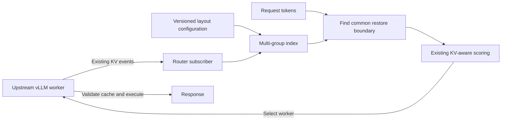
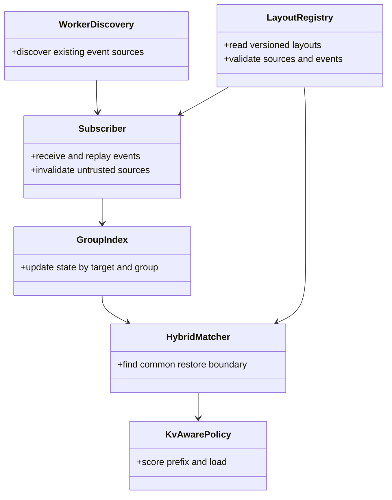
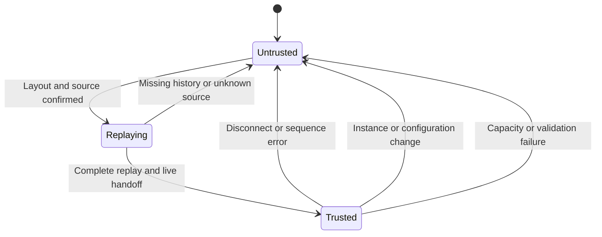
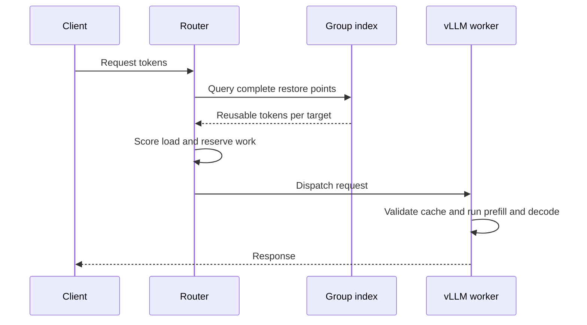
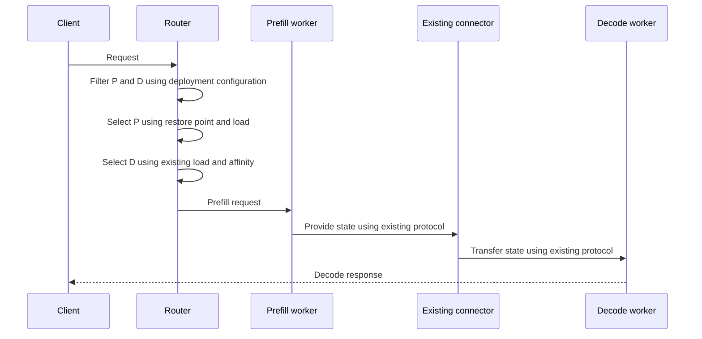

# RFC: Router-only KV-aware routing for hybrid attention

**Status: design draft.** [Design issue #489](https://github.com/vllm-project/router/issues/489) · [Parent RFC #294](https://github.com/vllm-project/router/issues/294) · [Router prototype PR #493](https://github.com/vllm-project/router/pull/493)

## 1. Goal and scope

Consume existing KV events from upstream vLLM main. In Router, track cache groups per worker/rank, estimate the common restorable prefix, and combine it with existing load-aware routing.



Changes are confined to Router. No new vLLM API, event format, or connector protocol is required. A Router hit is a **routing estimate**; vLLM determines the actual hit. Untrusted state receives zero hybrid credit and must not fall back to a single-group estimate.

| Scope | Contents |
|---|---|
| Initial | One worker/rank, local GPU, text inputs; colocated and verified P/D deployments |
| Later | Cross-tier or cross-worker composition; multimodal, LoRA, unknown salt and speculative decoding |
| Non-goals | Change vLLM, transport tensors, modify model operators or implement model-internal sparse indexers |

Target models include Qwen3.5, Qwen3.6, Qwen3.8, Qwen4, and DeepSeek V4/V4.1. A **model name is not proof of a layout**: validate each engine version and layout separately.

## 2. Inputs

| Input | Source | Router behavior |
|---|---|---|
| Event endpoints | Existing `/kv_event_sources` or static configuration | Subscribe per worker/rank; zero credit when unavailable |
| Store/remove/clear | Existing ZMQ KV events and replay | Track event group, type, block size, hash and sequence per source |
| Layout and restore rules | Versioned Router configuration | Match vLLM version, model artifact, hash, groups, block sizes and restore rules; otherwise zero credit |
| Request tokens | Existing request preprocessing | Use the worker-equivalent tokens; unknown identity or input gets zero credit |
| P/D compatibility | Deployment configuration and existing connector capabilities | Pin verified model, weights, connector and parallel layout; engine handles transfer |

Events describe changes that occurred; **observed groups do not prove the full set of required groups**. Router configuration must describe the complete layout. A required group without events is a miss. Validate event fields, hashing and restore semantics against real samples for each engine version.

An initial contract can use full `sha256_cbor` event hashes: worker and Router must use consistent, verified root-hash and configuration values; set `VLLM_KV_EVENTS_USE_INT_BLOCK_HASHES=0` on vLLM for full hashes. Other hash modes require separate verification. Configuration is an operator assertion, not automatic proof of identical weights.

## 3. Existing architecture



These are responsibilities, not mandatory new classes. Reuse `kv_index`, `TieredMatchProvider`, `kv_aware`, and existing admission and retry paths.

| Component | Router change |
|---|---|
| Discovery | Reuse endpoint discovery and static sources; read layout and deployment identity |
| Subscriber/index | Track `(worker, rank, generation, group)`; hide credit until replay completes |
| Matcher | Apply versioned group restore rules to each candidate |
| Policy | Estimate new prefill tokens from the common boundary; retain health, load and retry behavior |

## 4. Common restorable prefix

```text
Token boundary    0       32       64       96       128
                  |--------|--------|--------|---------|
Full attention KV [==========================)
GDN checkpoints            ●        ●
                                    ↑
Common restore boundary = 64; estimated new prefill = 128 - 64 = 64 tokens
```

Find the largest boundary satisfying every required group, engine alignment and final-token recomputation rules. Never combine state across workers, ranks or generations. Evaluate each prompt in a batch independently.

| State | Router rule |
|---|---|
| Full attention | Require continuous coverage from the start to the boundary |
| Mamba/GDN | Apply checkpoint and alignment rules verified for that version |
| Compressed attention | Apply verified token/state ratios and boundary rules |
| Sliding window/replay | Verify the window, dependencies and recomputation cost; otherwise zero credit |
| Per-request scratch | Exclude only after confirming it is not persistent prefix state |

Qwen3.5's observed 528-token block is an example, not a universal constant. Validate Qwen4 compressed MLA and DeepSeek V4/V4.1 sliding, compressed and shared state separately.

## 5. Lifecycle and trust



A normal ZMQ topic, brief health check, or sequence number alone **does not prove** a publisher has not restarted. Bind the view to an instance generation confirmed by the deployment system; without a trusted lifecycle signal, do not credit the old view. On disconnect, restart, gaps, unknown events, layout changes or capacity failure, atomically revoke all groups for that source.

Replay must cover a known-empty starting state through a live handoff point. Truncated history or an unproven handoff stays at zero credit; partial replay is not a snapshot. Recovery without new live events requires further validation. Events are asynchronous; a block can be evicted after dispatch and vLLM checks actual state.

## 6. Colocated serving



Retain existing health, session affinity, admission and release behavior. A hybrid worker with an unmatched layout can still route through the existing load path, with zero hybrid prefix credit.

For tools or reasoning requests without exact token inputs, use a separate advisory affinity based on available session identity or text similarity. It may influence selection but never adds KV credit or reduces estimated prefill work. Apply existing load and health safeguards; do not persist raw request text.

## 7. Disaggregated P/D serving



P credit reduces estimated P work; it does not imply reduced transfer. Reuse `PdKvState`, `PdLoadManager` and existing connector dispatch. Do not add a worker handshake or assume `kv_transfer_params` proves every compatibility condition.

Enable hybrid credit only for P/D combinations pinned by the deployment and validated end to end: matching model/weight artifacts, vLLM version, connector, state layout and TP/PP. Configuration cannot replace engine and connector checks. If P's index is untrusted but deployment compatibility remains established, use zero P credit. If compatibility is unknown or invalid, zero credit does not make transfer safe: exclude that hybrid pair or use another explicitly configured, verified path. Retain existing failure, retry and cancellation lifecycles.

## 8. Compatibility and rollout

| Case | Behavior |
|---|---|
| Feature disabled | Preserve existing routing and configuration |
| Non-hybrid model | Preserve existing KV-aware path |
| Configured hybrid layout and trusted source | Use the multi-group common boundary |
| Unknown layout, missing events or identity | Zero hybrid credit; do not use group 0 as a substitute |
| Colocated and P/D pools | Use independent configurations and validation results |

Add a default-off Router switch and versioned layout configuration covering model artifact, vLLM version, required groups, restore rules, event/hash contract and instance-generation source. Final configuration shape, memory budgets and lease policy require implementation review.

Roll out by validating version/layout, shadow scoring, and a small opt-in deployment before expansion; disable the switch to revert. Reuse existing metrics and add low-cardinality reasons for unsupported layouts, untrusted sources and replay failure. Do not log prompt contents or hashes.

## 9. Validation and open questions

| Area | Coverage |
|---|---|
| Correctness | Missing/removed/restored groups, alignment, compressed and sliding state, batches, rank/instance isolation |
| Events | Real MessagePack samples, gaps, reordering, truncated replay, restart and recovery without new events |
| Compatibility | Upstream vLLM main, feature off, non-hybrid models and existing HTTP/gRPC paths |
| Colocated | Two-worker cold/warm selection; compare actual engine hits and output with caching disabled |
| P/D | Complete handoff, failures and retries for explicitly configured version/model/connector matrices |
| Performance | Feature on/off TTFT, throughput, actual cache hit rate, Router CPU and memory |

End-to-end model tests against upstream vLLM and validation of DeepSeek and target P/D combinations remain required.

Open questions: how deployment supplies trusted instance generations; whether upstream events and replay reconstruct each target layout completely; and how to maintain auditable versioned layouts. Unknown conditions retain zero credit.
