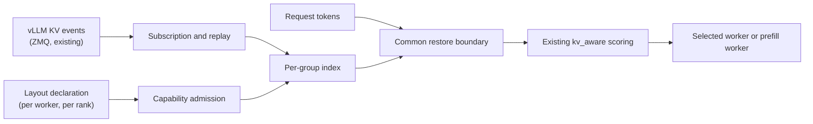
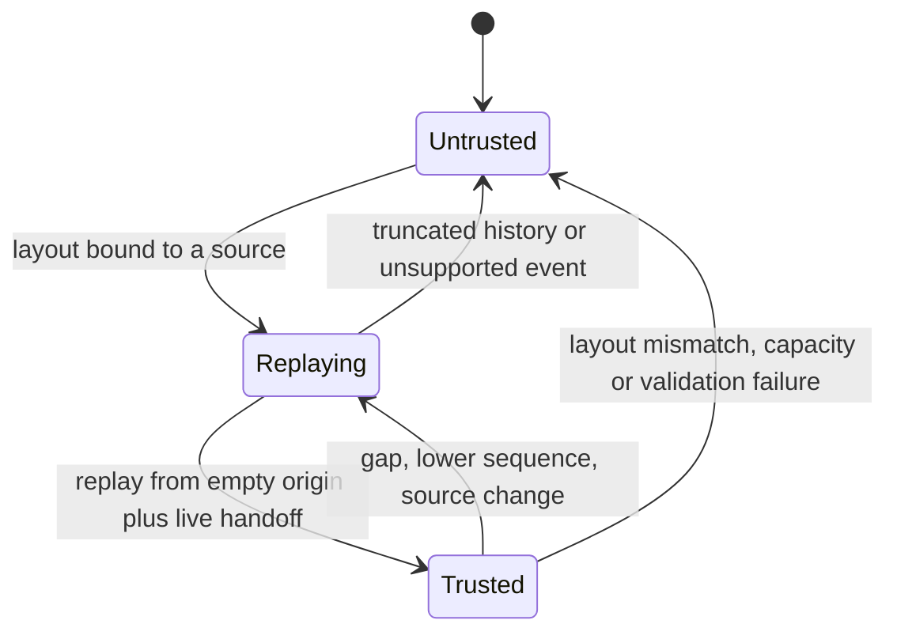

# RFC: KV-aware prefix reuse routing for hybrid attention models

**Status: draft for review.** Tracking issue [#489](https://github.com/vllm-project/router/issues/489) · Parent RFC [#294](https://github.com/vllm-project/router/issues/294) · Reference implementation [PR #493](https://github.com/vllm-project/router/pull/493) · Implementation notes and raw measurements: [`hybrid-kv-aware-handoff.md`](hybrid-kv-aware-handoff.md)

## 1. Summary

`kv_aware` already routes on estimated prefill work: it indexes cached prefixes from vLLM KV events, credits the tokens a worker can reuse, and scores `estimated prefill = input tokens - credited tokens` together with load. That estimate assumes a prefix is reusable when its attention blocks are resident.

Hybrid-attention models break that assumption. Qwen3.5/3.6/3.8/4 and DeepSeek V4/V4.1 keep additional per-prefix state — GDN/Mamba checkpoints, compressed MLA state, sliding-window rings — and some of it is only valid at particular offsets. A resident attention block can therefore coexist with missing recurrent state, and crediting it would under-estimate prefill and send traffic to the wrong worker.

This RFC adds a per-rank group model to Router:

- the deployment declares the **complete** group layout of each rank (an operator assertion, not an inference);
- per-group evidence from the existing KV event stream says which offsets are resident;
- a prefix is credited only up to the **common restore boundary** where every declared group is simultaneously restorable on that worker and DP rank;
- anything unverified — unknown layout, missing group, gap in the event stream, unsupported hash contract — yields **zero hybrid credit**, and the worker falls back to the existing load-based path.

No vLLM change is required: Router consumes the KV events and the optional `/kv_event_sources` route that already exist upstream. Router credit is a routing estimate; vLLM performs the real cache check and inference.

## 2. Why a single-group hit is not enough

| Model family | Groups observed on vLLM 0.33 | Consequence |
|---|---|---|
| Qwen3.5 / Qwen3.6 / Qwen3.8 | 3 Mamba checkpoints + full attention | A checkpoint exists only at aligned boundaries; attention residency alone proves nothing |
| Qwen4Exp (QSA) | 3 Mamba groups + compressed MLA + per-request scratch ring | The scratch ring is not shareable state and emits no events; the compressed group has its own token/state ratio |
| DeepSeek V4 / V4.1 | 2 sparse-attention sliding-window groups + compressed MLA + indexer + compressor | Sliding-window groups publish only their resident window, and windows differ per group |

Three failure modes motivate the strict default:

1. **Under-estimated prefill.** Crediting attention groups alone makes a worker look cheap, so it wins the request and then recomputes the missing recurrent state. TTFT regresses with no visible error.
2. **Wrong restore point.** Checkpoints and compressed state are valid only at some offsets. Credit must stop at the largest offset valid for *all* groups, not the largest for each.
3. **Stale residency.** Events are asynchronous and blocks can be evicted after dispatch. Router credit is a hint for selection, never a reservation.

A hybrid worker therefore receives no credit unless its layout is declared *and* its event stream is trusted. There is no "best effort" single-group mode for hybrid models: the legacy path rejects nonzero-group events rather than treating group 0 as full attention.

## 3. Design



| Stage | Responsibility |
|---|---|
| Discovery | Bind each worker URL to a layout; obtain event endpoints statically or from `/kv_event_sources` |
| Admission | Reject a rank whose layout is incomplete, inconsistent with the source topic, or uses an unverified hash contract |
| Subscription | Subscribe per rank, replay history from a known-empty origin, then hand off to the live stream |
| Index | Track residency per `(source, rank, group)`; drop credit on gaps, unknown events or capacity limits |
| Matcher | Intersect group residency into one boundary, subtract replay, align down to the hash block |
| Policy | Consume the boundary as a `TieredMatchProvider` hit; keep existing health, load, reservation and retry logic |

Implementation lives in `kv_index/{discovery,hybrid_capability,hybrid_events,hybrid_stream}.rs`, with the policy hook in `policies/kv_aware.rs` and the P/D wiring in `routers/http/pd_*`.

## 4. Layout contract

A layout is configuration: it must be written for a specific engine build and model artifact, and it is the operator's assertion that these are the groups the engine maintains. Router validates the shape, then trusts it as the group set.

```json
{
  "http://127.0.0.1:8000": {
    "schema_version": 1,
    "ranks": [{
      "rank": 0,
      "model": "qwen3.5-4b",
      "weight_version": "v1",
      "publisher_topic": "kv-hybrid",
      "instance_topic": true,
      "hash_algorithm": "sha256_cbor",
      "root_hash": "9bd96a485ad84efdafb72ee48a1d7a69bcead0f8f0433173941b276b9581eef0",
      "full_hashes": true,
      "hash_block_size": 576,
      "hash_lookahead_tokens": 0,
      "speculative_tokens": 0,
      "prefix_caching": true,
      "groups": [
        {"group_idx": 0, "kind": "mamba", "spec_type": "MambaSpec", "block_size": 576,
         "prefix_cacheable": true, "prefix_replay_tokens": 0, "mamba_cache_mode": "align"},
        {"group_idx": 3, "kind": "full_attention", "spec_type": "FullAttentionSpec",
         "block_size": 576, "prefix_cacheable": true, "prefix_replay_tokens": 0}
      ]
    }]
  }
}
```

Rank fields that admission checks: the rank index must match the event source's `dp_rank`, `model` must equal the served model, `weight_version` and `publisher_topic` must be non-empty, `instance_topic` must identify a per-instance topic, `hash_algorithm` must be `sha256_cbor` with `full_hashes`, `prefix_caching` must be on, and lookahead/speculative tokens must be zero. `hash_block_size` must divide every group's block size.

| `kind` / `spec_type` | Meaning | Additional rules |
|---|---|---|
| `full_attention` / `FullAttentionSpec` | Dense attention KV | No sliding window; coverage must be continuous from the prefix start |
| `mla_attention` / `MLAAttentionSpec` | Compressed MLA state | `tokens_per_state` must divide the group block; `cache_role` may be `sparse` |
| `sliding_window` / `SlidingWindowSpec`, `sliding_window_mla` / `SlidingWindowMLASpec` | Windowed state | `sliding_window` required and must equal the configured replay window |
| `mamba` / `MambaSpec` | GDN/Mamba checkpoint | `mamba_cache_mode: "align"`; optional `prefill_checkpoint_alignment` must divide the block |
| `mla_attention` / `CircularBufferSpec` | Per-request scratch (for example the Qwen4 QSA ring) | Only admitted with `prefix_cacheable: false` and `tokens_per_state: "1"`; excluded from the index |

Cross-group rules: at least two groups, at least one attention group, and at least one state or replay group; **all replay groups must declare the same `prefix_replay_tokens`**, because the engine rewinds one window per hit. A group whose `block_size` is smaller than `hash_block_size` is rejected — the index hashes one chain at `hash_block_size` for every group.

**Event endpoints.** A layout may carry explicit endpoints (`--kv-event-source`, `--kv-event-replay-source`), or none, in which case Router asks the engine: on vLLM 0.31+ `GET /kv_event_sources` returns `{"<rank>": {"publisher": "zmq", "endpoint": "tcp://*:5557", "replay_endpoint": "tcp://*:5560", "topic": "kv-hybrid", ...}}`. Missing optional fields (`encoding`, `schema_version`) mean the documented `zmq`/msgpack/schema-1 contract; a different declared encoding or schema is rejected. A bind wildcard (`tcp://*:5557`, `0.0.0.0`, `[::]`) is resolved to the worker's host. If the engine reports a topic different from the layout's `publisher_topic`, the source is rejected: it is a different boot. Layout-only configuration with no discoverable endpoint gets no credit and stays on the load path.

**Hash contract.** The validated contract is full `sha256_cbor` block hashes with `VLLM_KV_EVENTS_USE_INT_BLOCK_HASHES=0` on the engine; otherwise vLLM publishes 64-bit integer hashes that no CBOR layout can reproduce, and Router credits nothing while the engine still reports hits. Default `sha256` (which pickles a tuple) and 0.28-era integer hashes are unsupported.

## 5. Event contract

Router consumes the existing ZMQ stream: a MessagePack payload of `[timestamp, [event, ...]]` on the declared topic, with `BlockStored`, `BlockRemoved` and `AllBlocksCleared` events carrying `group_idx`, `kv_cache_spec_kind`, `block_size`, `block_hashes`, `parent_block_hash` and `token_ids`.

| Group kind | What the event must look like |
|---|---|
| Attention (full or compressed) | `len(block_hashes) * block_size == len(token_ids)`: one hash per block of the stored range |
| Mamba checkpoint | `len(block_hashes) * block_size <= len(token_ids)`, possibly zero: sparse retention may keep fewer states than tokens |
| Sliding window | Window size in the event must equal the layout; hashes must cover the stored range |

A batch is applied atomically: if any event in it is malformed, describes an unknown group or kind, or contradicts the layout, the whole batch is rejected and the rank's credit is revoked until a clean replay succeeds. Events for groups the layout does not declare are not evidence and cannot contribute.

The engine's sequence numbers are checked per rank. A lower sequence after the live handoff means the publisher restarted and reused its topic: credit is revoked and replay starts again. Sequence numbers and topics identify a stream, not an instance generation; see §7.

## 6. Common restore boundary and credit

For a request's tokens and a candidate `(worker, rank)`:

1. For each declared group, find the longest resident prefix of the request's token hashes.
2. Take the minimum across groups; nothing beyond that offset is restorable for all groups.
3. Cap at `len(tokens) - 1` (the engine recomputes the last token).
4. Subtract the layout's replay window, then align down to `hash_block_size`.

The result is returned as one local-GPU match `segments: [(0, blocks)]`, and the existing policy computes `new_prefill_tokens = input_tokens - blocks * hash_block_size`. The scoring formula itself does not change: only the credited-token input does. Credit is per request and per candidate; batches are evaluated independently, and state is never combined across workers, ranks or event views.

Two properties follow from the contract and show up in practice:

- **The first request after a store may credit nothing.** Events arrive after the request that produced them, so a prompt's first dispatch (and often its first repeat) sees an empty index while the engine itself already hits. Credit is a lower bound, and the router under-credits rather than over-credits.
- **Credit tracks the engine when the layout is right.** On vLLM 0.33 the router's credited tokens equal the engine's own `vllm:prefix_cache_hits_total` for the repeats that happen after the events land (§9).

## 7. Trust and lifecycle



Credit is only exposed after a complete replay from a known-empty origin followed by a live handoff. Partial replay is not a snapshot and stays hidden. On disconnect, restart, gap, unknown event, topic or layout change, and capacity failure, all groups for that source are revoked atomically; the worker keeps serving on the existing load path with zero hybrid credit.

Topic names and sequence numbers do not by themselves prove that a publisher has not restarted. A deployment that supplies a trusted instance generation — a fresh topic per boot, or a generation identifier checked out of band — is the only way to bind residency to one process lifetime. Without it, the safety property is "credit is dropped on any discontinuity", not "credit is impossible to reuse across restarts".

## 8. Routing modes

**Colocated.** The hybrid provider is one input to `kv_aware`; health filtering, load, reservation, affinity and retry are unchanged. A worker whose layout is missing, incomplete or whose stream is untrusted simply contributes no credit.

**Tools and reasoning requests.** These often arrive without exact tokens (`/render`, `/tokenize` unavailable upstream). With `--kv-aware-session-affinity-ttl-secs`, Router keeps a separate advisory affinity keyed by an explicit session identity: the first turn binds, later turns follow the binding, and every such decision reports zero KV credit. Affinity never reduces estimated prefill and never uses request content.

**Disaggregated P/D.** `--pd-hybrid-config` declares each prefill worker's layout and which decode workers it may pair with. P credit reduces estimated prefill work only; it says nothing about transfer size. Hybrid credit is enabled only for pairs the deployment pins and validates end to end (model and weight artifact, vLLM version, connector, state layout, TP/PP). Handoff validation is unchanged: a prefill reply without transfer parameters fails with 502 before decode dispatch, and a decode failure after a valid handoff is recorded, counted and returned. Hybrid P/D is not compatible with Program scheduling.

## 9. Model and version support

A model name is not a layout. Each entry below was measured against a real engine; anything not listed is unverified and gets no credit.

| Model | Engine | Verified behaviour |
|---|---|---|
| Qwen3.5-4B | 0.29.0, DP=2 | Credit equals engine hits per repeat (528-token blocks, 601-token prompt, `prefix_cache_hits_total` 2640 across repeats) |
| Qwen3.5-4B, Qwen3.5-35B-A3B, Qwen3.6-35B-A3B, Qwen3.8-27B | 0.33.0 | Credit equals engine hits per repeat (blocks 576 / 1088 / 1088 / 832) |
| Qwen4Exp (QSA, reduced dummy weights) | 0.33.0 | Credit equals engine hits: 576 credited per repeat, 1152 total over two repeats; scratch ring excluded from the layout |
| DeepSeek-V4-Flash (real weights, TP=2) | 0.33.0 | Engine reuses prefixes, Router credits 0: the layout and event shape are unsupported (§10) |
| DeepSeek-V4.1-Flash | — | Not runnable on the available hardware: 510.3 GB of weights in 48 shards need at least six H20-3e cards |

## 10. Compatibility, limits and non-goals

| Case | Behaviour |
|---|---|
| Feature off, or no layout declared | Existing routing unchanged; nonzero-group events are rejected, so a hybrid model cannot inherit group-0 credit |
| Non-hybrid model | Existing KV-aware path unchanged |
| Declared layout with a trusted stream | Multi-group common boundary |
| Unknown layout, missing group, untrusted stream, unsupported hash | Zero hybrid credit, load-based routing |
| Colocated and P/D pools | Independent layout declarations and validation |

Limits of this design, stated explicitly:

- **One hash chain per rank.** Every group is hashed at `hash_block_size`, so a group cannot publish pages smaller than that. DeepSeek-V4-Flash needs per-group chains (pages 4/8/64/256) and publishes only its resident sliding window (`window/block` hashes, anchored at `parent_block_hash`, sometimes zero hashes) — neither is supported, which is why it credits 0.
- **No automatic layout inference.** Router never guesses groups from observed events; a missing declaration is a miss, not a discovery.
- **No cross-worker or cross-tier composition.** A prefix is servable only from the single target that holds it.
- **Out of scope:** multimodal, LoRA, speculative decoding, unknown cache salts, generation fencing without a deployment-supplied identity, and any change to vLLM's operators or transfer protocol.

## 11. Validation and open questions

| Area | Coverage |
|---|---|
| Unit and contract tests | Layout admission, event shape and replay rejection, boundary arithmetic, lifecycle revocation |
| Engine integration | Qwen3.5 (0.29 DP), Qwen3.5/3.6/3.8 and Qwen4Exp (0.33), credit compared with engine hit counters |
| Routing modes | Colocated, advisory affinity, P/D handoff success and failure cases against stub backends |
| Negative paths | Missing groups, eviction, restart, replay truncation, wrong hash contract, DP isolation |
| Performance | Feature on/off, TTFT and hit rate at fixed load, Router CPU and memory |

Open questions:

1. **Generation fencing.** How a deployment supplies a trusted instance generation, so that residency can be bound to one process lifetime without relying on topics and sequence numbers.
2. **Per-group hash chains.** Whether to accept per-group block sizes and bounded publications anchored at `parent_block_hash`, which is what DeepSeek V4-class engines require.
3. **Layout auditing.** How to make versioned layouts reviewable and checkable against a real engine, rather than a hand-written assertion.
4. **Recovery without new events.** Whether replay truncation can be repaired from a later snapshot instead of revoking credit entirely.

Until these are answered, every unknown condition keeps zero credit and the existing load path.
