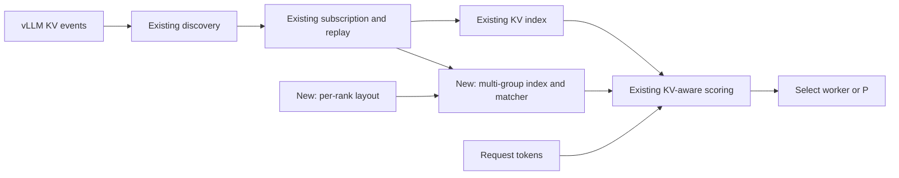
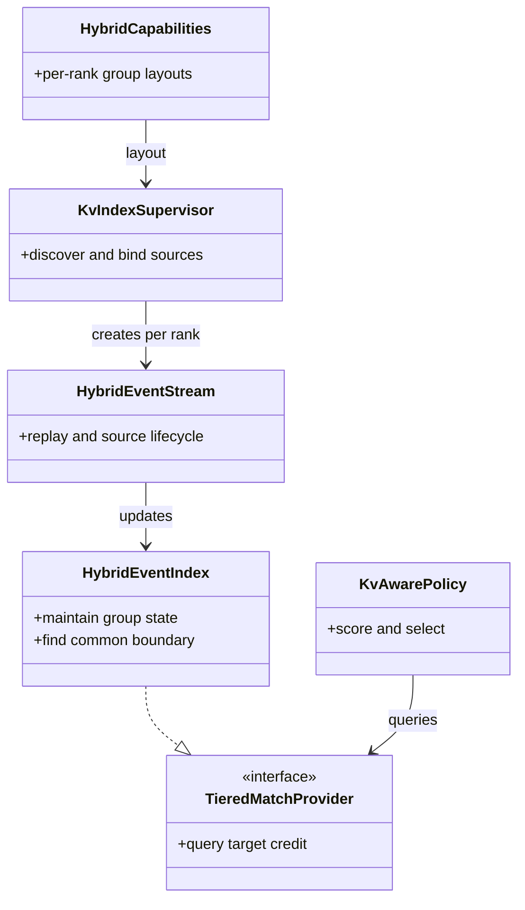
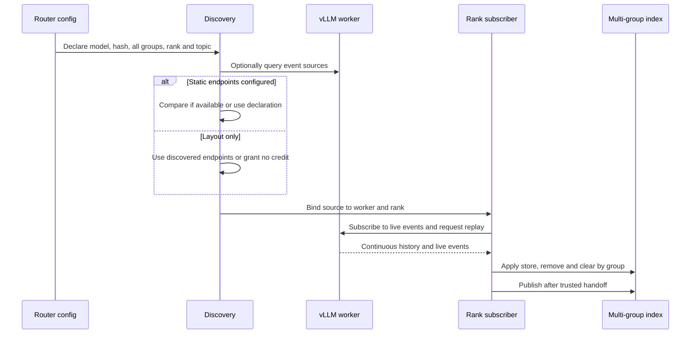
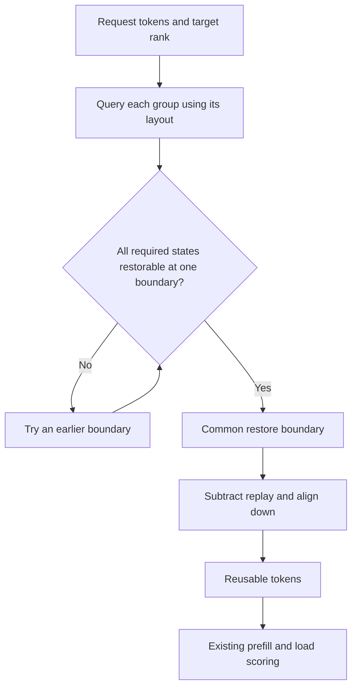
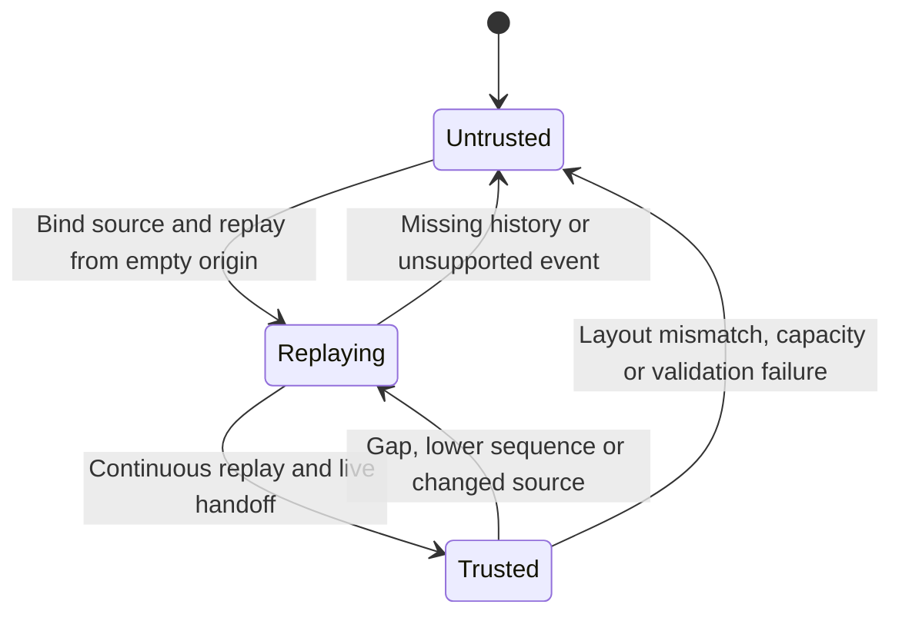
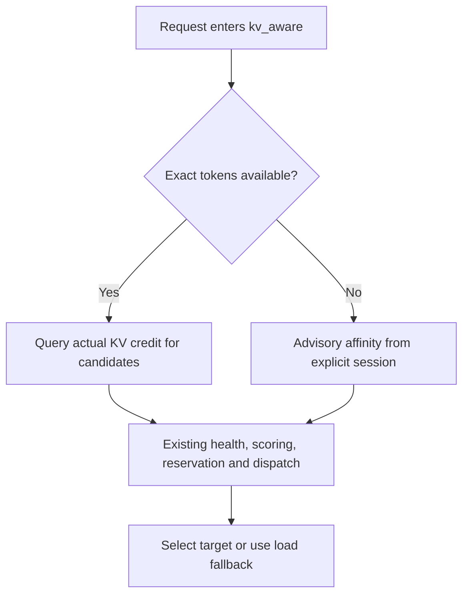

# RFC: Extend KV-aware routing for hybrid-attention prefixes

Status: draft. Implementation reference: [PR #493](https://github.com/vllm-project/router/pull/493) at `484b29a`. Related: design [#489](https://github.com/vllm-project/router/issues/489) and parent RFC [#294](https://github.com/vllm-project/router/issues/294).

## 1. Problem and approach

Existing `kv_aware` builds a prefix index from KV events and selects a worker using estimated prefill work and load. A hybrid prefix can depend on attention KV, Mamba/GDN checkpoints and sliding-window state. **One group hit does not prove that the entire prefix is restorable.**

Router finds a common restore boundary across required groups on the same worker and DP rank, then passes it to existing scoring. vLLM determines the actual hit and performs inference.

## 2. Changes to the existing path

| Component | Existing responsibility | Hybrid change |
|---|---|---|
| Discovery | Find worker event sources | Bind a complete declared layout and event source per rank |
| Subscriber | Receive, replay and sequence events | Build a trusted view and revoke credit on errors |
| Index / matcher | Match cached prefixes | Track groups and find their common restore boundary |
| `TieredMatchProvider` | Return target matches to policy | Return local GPU credit for the common boundary |
| `kv_aware` | Estimate prefill work and select by load | Consume the provider; retain scoring and reservations |
| P/D | Select P and D and invoke the connector | Use P's common boundary and configured compatible pairs |

The components connect as follows:

Implementation locations: `kv_index/discovery.rs`, `hybrid_events.rs`, `hybrid_stream.rs`, `hybrid.rs`, `policies/kv_aware.rs` and `routers/http/pd_*`.

## 3. Layout and events

- `--kv-hybrid-layout` declares a layout. Event endpoints can be explicit or discovered when the worker exposes them; P/D uses `--pd-hybrid-config`. Discovery availability varies by vLLM version and frontend.
- Explicit static sources remain usable when discovery is unavailable; a reported mismatch rejects the source. Layout-only configuration without discovered endpoints gets no credit.
- Deployment supplies the complete group list, model/weights, hash root, block sizes, topic and restore rules. **Partial events cannot prove that no other required groups exist.**
- The validated contract uses full `sha256_cbor` hashes and `VLLM_KV_EVENTS_USE_INT_BLOCK_HASHES=0`; other contracts require separate validation.

## 4. Common restore boundary

| State | Check |
|---|---|
| Full attention | Continuous coverage from prefix start |
| Mamba/GDN | Checkpoint at the boundary with required alignment |
| Compressed attention | Declared token/state ratio and block boundaries |
| Sliding window | Required window is present; charge any replay |
| Scratch | Exclude only when the layout proves it is not persistent prefix state |

A checkpoint event may contain no hashes. It adds no checkpoint hit, and another group's hashes cannot fill the gap. Never combine state across workers, ranks or event views; evaluate batched prompts independently.

For 2,048 tokens and 576-token blocks, a common boundary of 1,728 with no replay yields 1,728 credited and 320 new prefill tokens. Actual values depend on the layout and engine rules.

## 5. Credit lifecycle

Partial replay remains hidden. A lower sequence can trigger invalidation and replay when a publisher reuses a topic, but **topic and sequence do not independently prove publisher generation**. Trusted lifecycle management is still required. Credit is an asynchronous estimate, not a reservation.

Without a configured hybrid layout, the legacy path rejects nonzero group events; a group-0 event alone cannot prove full attention. Automatic identification and generation fencing remain open.

## 6. Compatibility and routing modes

- **Colocated:** A declared and validated hybrid layout uses the multi-group provider; existing full-attention and other policy paths remain available.
- **Tools/reasoning:** Without exact tokens, an explicit session can retain separate advisory affinity; affinity itself grants no KV credit. Content-derived similarity is not implemented.
- **P/D:** P credit reduces estimated P computation, not transfer size. `--pd-hybrid-config` declares P layouts and allowed D workers. Model, weights, connector and TP/PP compatibility remain deployment assertions. Hybrid P/D cannot currently run with Program scheduling.
- **Handoff:** Missing or invalid P transfer parameters prevent D dispatch. A D failure after P handoff is recorded and returned as an error; the real-connector failure matrix still requires validation.

## 7. Scope and acceptance

| Area | Status |
|---|---|
| Qwen3.5 | PR reports H20, TP1, real-weight colocated validation; other deployments remain |
| Qwen4 | Reduced dummy model tested colocated and NIXL 1P1D; real weights and multi-node remain |
| Qwen3.6 / 3.8 | Target models without real-layout and end-to-end validation |
| DeepSeek V4 / V4.1 | Sliding-window and bounded-replay code exists; compressed/shared state and real event contracts remain unverified |
| Regression and performance | Validate feature-off, full attention, gRPC, DP, missing groups, eviction, restart, replay, output equivalence and load performance |

The PR attributes its full test results to `a4cef28`; they do not establish that reference commit `484b29a` was retested. Final acceptance requires tests at the selected commit and a verified model/connector matrix.
