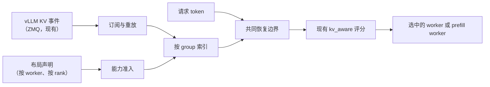
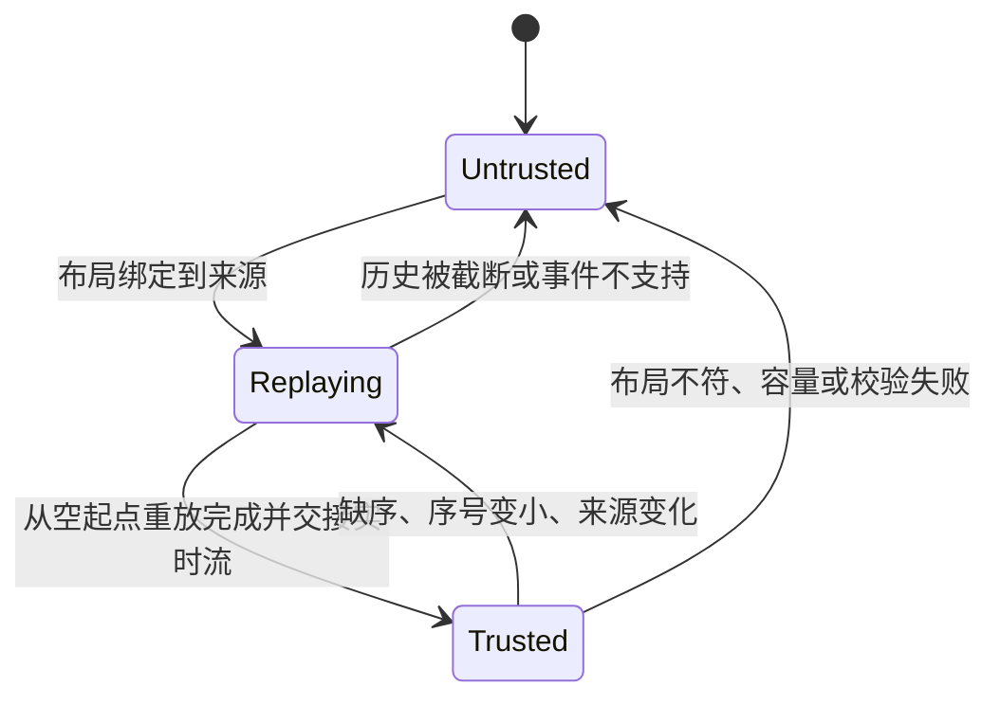

# RFC：混合注意力模型的前缀复用路由

**状态：设计。** 跟踪 issue [#489](https://github.com/vllm-project/router/issues/489) · 上层规划 [#294](https://github.com/vllm-project/router/issues/294) · 参考实现 [PR #493](https://github.com/vllm-project/router/pull/493) · 实现细节：[`hybrid-kv-aware-handoff.md`](hybrid-kv-aware-handoff.md)

## 1. 概要

`kv_aware` 按预计 prefill 工作量选 worker：从 vLLM KV 事件建立前缀索引，扣掉 worker 可复用的 token，再结合负载给 `预计 prefill = 输入 token - 复用 token` 打分。这个估算对全注意力模型是成立的，因为 attention 块驻留就等于前缀所需的状态。

混合注意力模型——Qwen3.5/3.6/3.8/4 和 DeepSeek V4 系——为每段前缀额外保存 GDN/Mamba checkpoint、压缩 MLA 状态、滑窗环形缓冲。这些状态不由 attention 驻留蕴含，且其中一部分只在特定 offset 有效。本 RFC 为此在 `kv_aware` 中引入按 rank 的 group 模型：

- 部署方声明每个 rank 的**完整** group 布局——这是运维断言，不是从事件推断；
- 复用已有 KV 事件流提供每个 group 的驻留情况；
- 只有到**共同恢复边界**为止才授予信用，即所有声明 group 在同一 worker、同一 DP rank 上同时可恢复的最大 offset；
- 任何未获证明的情况——布局缺失、group 未声明、事件流不连续、hash 契约不支持——一律**零混合信用**，该 worker 留在原有负载路径上。

只改 Router：消费上游 vLLM 已有的 KV 事件和可选 `/kv_event_sources` 接口，不新增引擎补丁、事件字段或 connector 协议。Router 的信用只用于选路提示，永远不是预留；缓存检查与推理由 vLLM 完成。

## 2. 动机

### 2.1 现有索引的前提

KV-aware 索引以 attention 块哈希为键，回答一个问题：*这个请求的哪些 token 在该目标上以 attention KV 形式驻留？* 对全注意力模型这是完整答案，因为 attention KV 就是前缀状态的全部。

### 2.2 混合模型实际缓存什么

| group 类型 | 引擎状态 | 恢复语义 |
|---|---|---|
| `full_attention` | 稠密 attention KV | 每个块边界都有效 |
| `mla_attention` | 压缩 MLA 状态 | 块边界有效；保留数量可少于 token 数（`tokens_per_state`） |
| `sliding_window`、`sliding_window_mla` | 滑窗 KV 环 | 只有驻留窗口可恢复；命中时回退窗口并重算尾部 |
| `mamba` | GDN/Mamba 循环 checkpoint | 只在满足对齐的 offset 有效；可稀疏保留 |
| `CircularBufferSpec` | 每请求 scratch | 完全不是可共享的前缀状态 |

因此一个混合 rank 对同一段前缀持有多个可独立淘汰的状态，各自的粒度和有效性规则都不同。

### 2.3 只按 attention 计费为何不安全

1. **低估 prefill。** 只给驻留的 attention 组计费会让 worker 显得便宜：它赢下请求，然后补算缺失的循环状态，TTFT 变差且任何地方都不报错。
2. **恢复 offset 选错。** checkpoint 与压缩状态只在部分 offset 存在。信用必须停在「对所有 group 同时有效」的最大 offset，而不是各组各自的最大值。
3. **驻留信息过期。** 事件是异步的，块在派发后仍可能被淘汰。信用只影响选择，不能承诺驻留。

### 2.4 设计规则

混合信用对 group 集合是整体性的：只有布局已声明**且**事件流可信，并且不超过共同边界时，才授予信用。混合模型没有单 group 兜底——旧路径会拒绝非零 group 事件，而不是把 group 0 误读成全注意力。少算的代价是选错 worker；多算的代价是 TTFT 变差且原因被掩盖。

## 3. 目标与范围

| | 内容 |
|---|---|
| 目标 | 按 group 的驻留、共同恢复边界、接入现有评分、默认 fail-closed、P/D 与 session 亲和集成 |
| 支持的输入 | 带精确 token 的文本请求；混部与分离式部署 |
| 非目标 | 改动 vLLM 算子、事件格式或传输协议；推断布局；跨 worker 或跨层级拼接前缀；多模态、LoRA、投机解码；基于内容的相似度 |

## 4. 架构



| 组件 | 职责 | 位置 |
|---|---|---|
| Discovery | 把 worker URL 绑定到布局；事件端点可静态配置或经 `/kv_event_sources` 解析 | `kv_index/discovery.rs` |
| 准入 | 拒绝不完整、与来源 topic 不一致、或 hash 契约不支持的布局 | `kv_index/hybrid_capability.rs` |
| 订阅 | 每个 rank 从已知空起点重放，再交接实时流 | `kv_index/hybrid_stream.rs` |
| 索引 | 按 `(来源, rank, group)` 维护驻留；不连续时撤销 | `kv_index/hybrid_events.rs` |
| 匹配 | 各组驻留求交得到唯一边界，扣除 replay 后向下对齐 | `kv_index/hybrid.rs` |
| 策略 | 作为 `TieredMatchProvider` 命中消费边界；保留健康、负载、预留、重试 | `policies/kv_aware.rs` |
| P/D | 把 prefill 布局绑定到允许的 decode worker；校验交接 | `routers/http/pd_*` |

原有单 group 索引保留，继续服务全注意力模型；混合索引是仅在「已声明布局的 rank」上查询的第二个 provider。

## 5. 布局模型

### 5.1 配置，而非推断

布局是为某个引擎版本和某个模型产物编写的版本化配置。它代表运维方对完整 group 集合的断言，Router 校验其形状而不会尝试重建它：

- 观察到的事件只能证明某 group **存在**，永远不能证明不需要其他 group；
- 缺少事件的必需 group 是 miss，不是「不存在」；
- `topic` 或 `root_hash` 与引擎不符的布局会被拒绝，因为它描述的是另一次启动或别的权重。

把布局显式化，信任边界才可审计：每个信用决策都能追溯到一份可评审的声明。

### 5.2 形状

```json
{
  "http://127.0.0.1:8000": {
    "schema_version": 1,
    "ranks": [{
      "rank": 0,
      "model": "qwen3.5-4b",
      "weight_version": "v1",
      "publisher_topic": "kv-hybrid",
      "instance_topic": true,
      "hash_algorithm": "sha256_cbor",
      "root_hash": "9bd96a485ad84efdafb72ee48a1d7a69bcead0f8f0433173941b276b9581eef0",
      "full_hashes": true,
      "hash_block_size": 576,
      "hash_lookahead_tokens": 0,
      "speculative_tokens": 0,
      "prefix_caching": true,
      "groups": [
        {"group_idx": 0, "kind": "mamba", "spec_type": "MambaSpec", "block_size": 576,
         "prefix_cacheable": true, "prefix_replay_tokens": 0, "mamba_cache_mode": "align"},
        {"group_idx": 3, "kind": "full_attention", "spec_type": "FullAttentionSpec",
         "block_size": 576, "prefix_cacheable": true, "prefix_replay_tokens": 0}
      ]
    }]
  }
}
```

rank 级要求：`rank` 等于事件源的 `dp_rank`；`model` 等于实际服务模型；`weight_version` 与 `publisher_topic` 非空；`instance_topic` 标识每实例 topic；`hash_algorithm` 为 `sha256_cbor` 且 `full_hashes` 为真；`prefix_caching` 开启；`hash_lookahead_tokens` 与 `speculative_tokens` 为 0，否则会把引擎没有存储的 token 计入信用。

### 5.3 group 类型

| `kind` / `spec_type` | 恢复规则 | 声明字段 |
|---|---|---|
| `full_attention` / `FullAttentionSpec` | 从前缀起点连续覆盖 | `block_size`、`prefix_cacheable`、`prefix_replay_tokens` |
| `mla_attention` / `MLAAttentionSpec` | 块边界覆盖 | 另加 `tokens_per_state`，可选 `cache_role: sparse` |
| `sliding_window` / `SlidingWindowSpec` | 与布局窗口一致 | 另加 `sliding_window` |
| `sliding_window_mla` / `SlidingWindowMLASpec` | 同上，压缩状态 | 另加 `sliding_window` |
| `mamba` / `MambaSpec` | 对齐 offset 上的 checkpoint | 另加 `mamba_cache_mode: "align"`，可选 `prefill_checkpoint_alignment` |
| `mla_attention` / `CircularBufferSpec` | 永不可恢复 | `prefix_cacheable: false`、`tokens_per_state: "1"`；不进入索引 |

### 5.4 准入强制的不变量

1. 至少两个 group，至少一个 attention 组，至少一个状态或 replay 组。
2. `hash_block_size` 整除每个 group 的 `block_size`：每个 rank 只有一条该粒度的哈希链，各组的页必须能铺满它。
3. 所有 replay 组声明**相同**的 `prefix_replay_tokens`：引擎每次命中只回退一个窗口，混合窗口无法用单一同意边界表达。
4. scratch 组只能以不可缓存的 `CircularBufferSpec` 且 `tokens_per_state: "1"` 声明，永不贡献信用。
5. `tokens_per_state`、`prefill_checkpoint_alignment`、`sliding_window` 按声明整除或匹配组块。
6. 同一 worker 内 rank 唯一，一个 topic 只属于一个 rank。
7. 无法发现端点的布局是合法配置，但不产生信用。

### 5.5 端点与发现

端点可显式声明（`--kv-event-source`、`--kv-event-replay-source`），也可省略。省略时 Router 询问引擎：vLLM 0.31+ 的 `GET /kv_event_sources` 返回 `{"<rank>": {"publisher": "zmq", "endpoint": "tcp://*:5557", "replay_endpoint": "tcp://*:5560", "topic": "kv-hybrid", ...}}`。缺失 `encoding` 与 `schema_version` 表示既定的 `zmq`/msgpack/schema 1 契约，与声明冲突则拒绝。绑定通配地址（`tcp://*:5557`、`0.0.0.0`、`[::]`）解析为 worker 主机地址。topic 与 `publisher_topic` 不同意味着另一次启动，拒绝该来源。静态端点在接口可用时与引擎核对，接口不可用时按声明使用——该路由是否存在取决于 vLLM 前端。

### 5.6 Hash 契约

支持的契约是完整 `sha256_cbor` 块哈希，且引擎侧设置 `VLLM_KV_EVENTS_USE_INT_BLOCK_HASHES=0`。否则 vLLM 发布 64 位整数块哈希，任何 CBOR 布局都无法复现，结果是引擎报命中而 Router 计零——这种静默不一致正是把该设置写进契约、而不是留作部署备注的原因。默认 `sha256`（对元组做 pickle）与 0.28 时代的整数哈希不在契约内。

## 6. 事件模型

Router 消费现有 ZMQ 流：在声明的 topic 上接收 MessagePack 负载 `[timestamp, [event, ...]]`，包含 `BlockStored`、`BlockRemoved`、`AllBlocksCleared`，字段有 `group_idx`、`kv_cache_spec_kind`、`block_size`、`block_hashes`、`parent_block_hash`、`token_ids`。

| group 类型 | 必须满足的形状 |
|---|---|
| attention（全量或压缩） | `len(block_hashes) * block_size == len(token_ids)` |
| Mamba checkpoint | `len(block_hashes) * block_size <= len(token_ids)`，可为 0 |
| 滑窗 | 事件窗口等于声明窗口；哈希覆盖存储区间 |

事件按批原子生效：任一事件形状错误或与布局矛盾，整批被拒，该 rank 的信用被撤销，直到一次干净重放成功。未声明 group 的事件不是证据，不能参与计算；声明块大小不能整除哈希块的事件按布局错误拒绝，而不是当作数据错误吞掉。

序号按 rank 跟踪。实时交接后出现更小序号，说明发布端在同一 topic 上重启：撤销信用并重新重放。topic 与序号标识一条流，不标识实例代次（见 §9）。

## 7. 驻留索引

状态以 `(来源, rank, group)` 为键，保存由哈希链导出的驻留 token 区间，按 store 与 remove 更新。比数据结构更重要的是两条性质：

- **不存在部分视图。** 只有「从已知空起点完整重放 + 实时交接」之后索引才可查询。被截断的重放不是快照：此时对该来源隐藏全部 group，而不是暴露子集。
- **原子撤销。** 断连、重启、缺序、未知事件、topic 变化、布局变化或容量溢出，一次性撤销该来源的所有 group，请求不可能看到由部分失效视图拼出的边界。

包含多个 prompt 的批各自独立求值：每个 prompt 的边界来自它自己的 token 哈希，不跨 prompt、rank 或视图共享任何状态。

## 8. 边界与信用

对请求 token 和候选 `(worker, rank)`：

1. 对每个声明的 group，求请求 token 哈希在该组的最长驻留前缀；
2. 取各组最小值：超过该 offset 至少有一个 group 缺失；
3. 上限取 `len(tokens) - 1`，因为引擎会重算最后一个 token；
4. 减去 `prefix_replay_tokens`，再向下对齐到 `hash_block_size`。

示例：2,048 token、`hash_block_size` 576、各组驻留到 1,728、replay 窗口为 0，信用为 1,728（三块），预计 prefill 为 320 token；若 replay 窗口为 576，同一边界下信用为 1,152。

结果以「本地 GPU 命中、`segments: [(0, blocks)]`」返回，现有评分计算 `new_prefill_tokens = input_tokens - blocks * hash_block_size`。成本模型按设计保持不变：只有复用 token 输入变化，因此混合路由与负载、预留、重试的组合方式和全注意力路径完全一致，也不存在第二条会漂移的计费通路。

由此有两个固然后果，不是缺陷：

- **信用是下界。** 事件在产生它的请求之后才到，因此某段前缀的首次派发通常计零，而引擎其实已命中。Router 在设计上宁少不多。
- **信用会收敛到引擎计数。** 跨重复请求，复用 token 数等于同一请求的 `vllm:prefix_cache_hits_total`，这正是设计被验证的不变量（§14）。

## 9. 信任与生命周期



信用只存在于 `Trusted`。这里刻意区分**流身份**与**实例身份**：topic 加序号能发现「复用 topic 且序号变小」的重启，但无法证明发布端没有从更大序号重启。需要把驻留绑定到单一进程生命周期的部署，自行提供可信代次——每次启动换新 topic，或用带外渠道校验的标识。因此设计的安全声明是精确的：**信用只在连续、可验证的流上存活**，任何不连续都撤销而不是猜测。

## 10. 选路集成

**混部。** 混合 provider 只是 `kv_aware` 的一个输入。健康过滤、负载、预留、亲和与重试都不变；没有布局、布局不完整或事件流不可信的 worker，就是不贡献信用。

**tools / reasoning 请求。** 这类请求常常没有精确 token，因为上游没有 `/render` 或 `/tokenize`。开启 `--kv-aware-session-affinity-ttl-secs` 后，Router 维护按显式 session 标识的 advisory 亲和：首轮绑定、后续跟随，且该决策报零 KV 信用。亲和既不会减少预计 prefill，也从不读取请求内容——它是粘性提示，不是缓存声明。

**分离式 P/D。** `--pd-hybrid-config` 声明每个 prefill worker 的布局和允许配对的 decode worker。P 的信用只减少预计 prefill 计算，与传输量无关。混合信用按配对启用而非全局启用：模型与权重产物、vLLM 版本、connector、状态布局、TP/PP 均由部署方固定，因为引擎在请求时无法自证这些。交接校验不变——prefill 回复缺少传输参数时在派发 decode 之前返回 502；交接成功后 decode 失败会被记录、计数并返回。混合 P/D 与 Program scheduling 不兼容。

## 11. 布局族

一个模型族「可表达」的条件是：引擎对每个 group 发布同一 `hash_block_size` 下的一条哈希链，且各组的恢复窗口一致。这是引擎发布方式的性质，不是模型名的性质。

| 族 | group 构成 | 可表达 |
|---|---|---|
| Qwen3.5 / Qwen3.6 / Qwen3.8 | 3 个 Mamba checkpoint + full attention，统一块大小 | 是 |
| Qwen4（QSA） | 3 个 Mamba + 压缩 MLA + 每请求 scratch 环 | 是；scratch 环声明为不可缓存并排除 |
| DeepSeek V4 系 | 稀疏 attention 滑窗，且各组页大小不同（4、8、64、256），发布被窗口截断并以 `parent_block_hash` 为锚 | 否——见下表后的说明 |

前两族的布局就是对引擎维护内容的直接描述。V4 系引擎有两条发布性质落在模型之外：页小于哈希块（单条链承载不了），以及发布只覆盖驻留窗口而非存储区间。要表达它们需要按组哈希链并以 `parent_block_hash` 为锚，属于后续工作（§15），不是运维今天能写出的布局。

## 12. 兼容性与失效行为

| 情况 | 行为 |
|---|---|
| 功能关闭或未声明布局 | 现有选路；非零 group 事件被拒绝，混合模型不会继承 group 0 的信用 |
| 全注意力模型 | 现有 KV-aware 路径逐字节不变 |
| 已声明布局、事件流可信 | 多 group 共同边界 |
| 布局未知、group 缺失、事件流不可信、hash 不支持 | 零混合信用，按负载选路 |
| 布局/topic/root hash 不匹配 | 拒绝来源，信用为零，记录原因 |
| P/D 配对未声明兼容 | 该配对不启用混合信用 |

上线方式是配置驱动：布局开关按 worker 打开，因此可以只对某个布局已核对的模型启用，其余 worker 继续走原路径。可观测性属于设计的一部分而非事后补充：每次决策都输出复用 token 数、边界、起限制作用的 group，以及信用为零时的原因，使运维能区分「事件还没到」和「布局被拒绝」。

## 13. 备选方案

| 方案 | 不采用的原因 |
|---|---|
| 只按 attention 组计费，对混合模型加惩罚系数 | 结构上必然多算，而补算的后果在路由指标里不可见 |
| 从观察到的布局推断 group | 事件只能证明存在，不能证明完整；缺失的 group 会被静默当作不需要 |
| 直接信任引擎回报的命中数 | 那是执行后的事实，选路需要派发前的按候选估算 |
| 强制一个足够小的哈希块来容纳所有 group | 无法解决有界发布与窗口锚点；并且让常见场景的哈希与索引开销成倍增加 |
| 立即实现按组哈希链 | 只有 V4 系引擎需要，而它的发布又被窗口截断，仅有链并不能让事件可表达 |

## 14. 验证

设计以不变量验证，而不是以代理指标：对一个派发到混合 rank 的请求，一旦该前缀的事件已收到，Router 的复用 token 数必须等于引擎 `vllm:prefix_cache_hits_total` 中该请求的贡献。多次发送同一 prompt、对比 Router 信用与引擎计数，是 §11 中每个可表达族的验收测试。

| 层次 | 必须证明的内容 |
|---|---|
| 单元与性质测试 | 准入不变量（§5.4）、事件形状规则（§6）、边界算术（含 replay 扣除与封顶）、原子撤销 |
| 引擎集成 | 每个可表达族的信用等于引擎计数；按每次重放相等，而非聚合相等 |
| 负向路径 | group 缺失、淘汰、序号变小的重启、重放截断、错误 hash 契约、rank 间 DP 隔离 |
| 选路模式 | 混部选择、零信用的 advisory 亲和、P/D 交接成功与两条失败腿 |
| 性能 | 功能开关下的 TTFT 与命中率（固定负载）、每事件与每查询的 Router CPU 与内存 |

## 15. 后续工作

- **按组哈希链。** 接受按组页大小、以及以 `parent_block_hash` 为锚的发布——这是 V4 系布局变得可表达的前提。
- **代次保护。** 用部署方提供的标识把驻留绑定到进程生命周期，而不是从 topic 与序号推断。
- **跨 worker 与跨层级拼接。** 在能对传输成本建模之后，允许多个持有者共同承担一段前缀。
- **快照恢复。** 用后续快照修复被截断的重放，而不是撤销来源直到干净重放成功。
