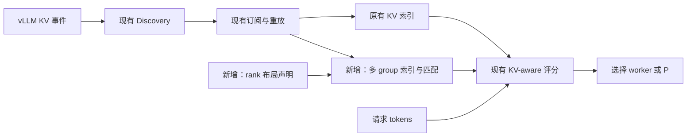
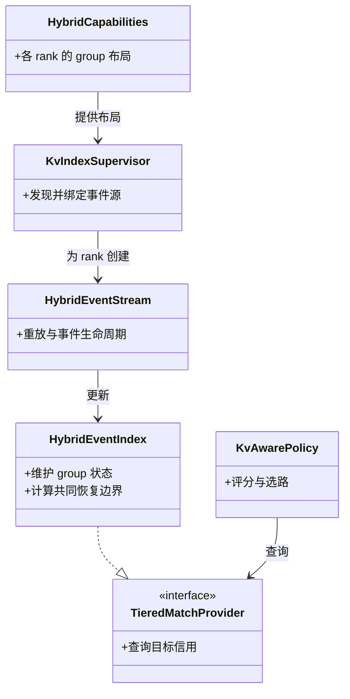
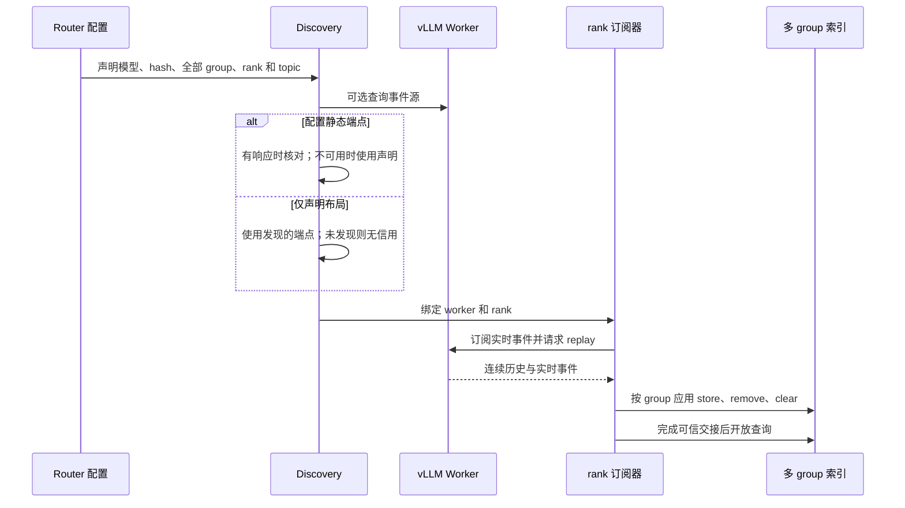
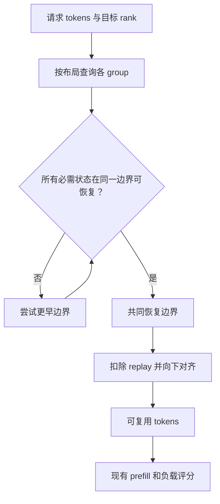
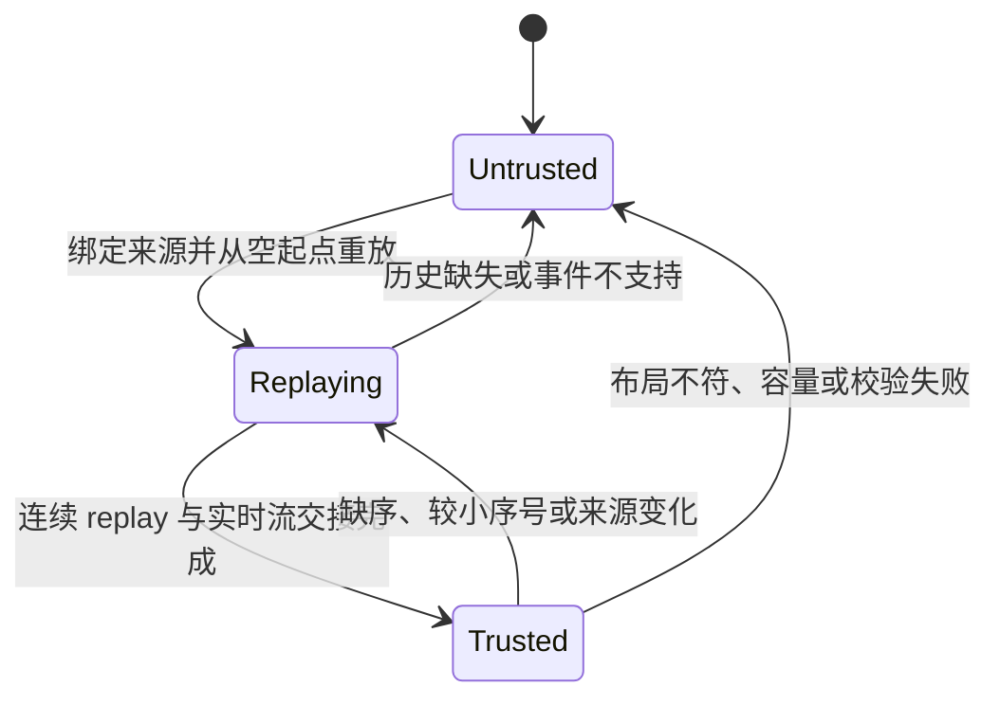
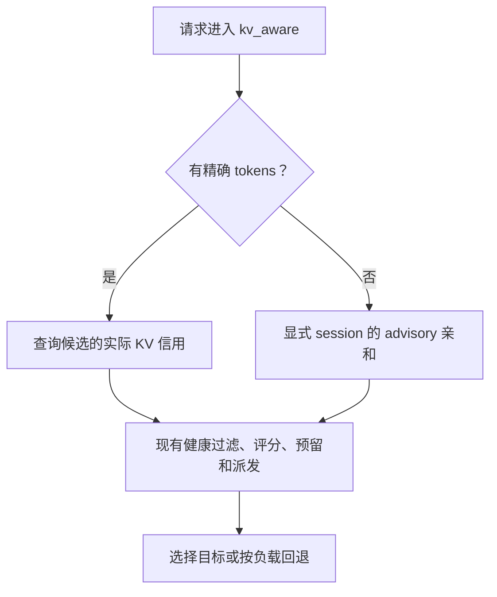

# RFC：扩展现有 KV-aware，支持混合注意力前缀路由

状态：设计草案。以 [PR #493](https://github.com/vllm-project/router/pull/493) 的 `484b29a` 为代码参考；关联设计 [#489](https://github.com/vllm-project/router/issues/489) 和上层规划 [#294](https://github.com/vllm-project/router/issues/294)。

## 1. 问题与方案

现有 `kv_aware` 从 KV 事件建立前缀索引，结合预计 prefill 工作量和负载选择 worker。混合模型的前缀可能同时依赖 attention KV、Mamba/GDN 和滑窗状态，**一个 group 命中不能证明整段前缀可恢复**。

在 Router 内按同一 worker、同一 DP rank 匹配所有必需 group，计算共同恢复边界，再交给现有评分；vLLM 负责确认实际命中和执行推理。

## 2. 改动现有链路

| 位置 | 现有职责 | 本次改动 |
|---|---|---|
| Discovery | 发现 worker 事件源 | 按 rank 绑定完整布局和事件源 |
| Subscriber | 接收、重放及序号检查 | 建立可信视图，异常时撤销该来源信用 |
| Index / matcher | 查询前缀缓存 | 按 group 保存状态，计算共同恢复边界 |
| `TieredMatchProvider` | 返回各目标的缓存匹配 | 返回共同边界对应的本地 GPU 信用 |
| `kv_aware` | 估算 prefill、结合负载选路 | 消费新 provider，沿用现有评分和预留 |
| P/D | 选择 P、D 并调用 connector | P 使用共同边界，筛选配置允许的配对 |

类的连接关系如下：

对应代码：`kv_index/discovery.rs`、`hybrid_events.rs`、`hybrid_stream.rs`、`hybrid.rs`、`policies/kv_aware.rs`、`routers/http/pd_*`。

## 3. 布局与事件

- `--kv-hybrid-layout` 声明布局，事件端点可显式配置，也可在 worker 提供接口时发现；P/D 使用 `--pd-hybrid-config`。发现接口是否可用取决于 vLLM 版本和前端。
- 静态端点在发现接口不可用时按部署声明使用；发现结果与声明冲突则拒绝该来源。只有布局但无法发现端点时不授予信用。
- 完整 group 清单、模型/权重、hash 根值、块大小、topic 和恢复规则由部署侧提供。**部分事件不能证明没有其他必需 group。**
- 已验证路径使用完整 `sha256_cbor` 哈希和 `VLLM_KV_EVENTS_USE_INT_BLOCK_HASHES=0`；其他契约须单独验证。

## 4. 共同恢复边界

| 状态 | 判断 |
|---|---|
| Full attention | 从起点到边界连续覆盖 |
| Mamba/GDN | 边界处有符合对齐要求的 checkpoint |
| 压缩 attention | 满足声明的 token/state 比例及块边界 |
| Sliding window | 必需窗口完整；存在 replay 时计入重算 |
| Scratch | 仅在布局证明非持久前缀状态时排除 |

checkpoint 事件可以有空 hash 列表：它不产生 checkpoint 命中，也不能用其他 group 的 hash 补足。禁止跨 worker、rank 或事件视图拼接状态；batch 中各 prompt 独立计算。

示例：2,048 tokens、块大小 576，共同边界为 1,728、无需 replay 时，信用为 1,728，预计新 prefill 为 320。实际值取决于布局和引擎规则。

## 5. 信用生命周期

重放期间不暴露部分结果。重启复用 topic 时，较小序号可触发失效和重放，但 **topic 和序号不能独立证明实例代次**；仍需部署侧的可信生命周期管理。Router 信用是异步估算，不是缓存预留。

未配置混合布局时，旧路径会拒绝非零 group 事件；但只看到 group 0 仍不能证明模型为全注意力。未知混合布局不能依赖单 group 信用，自动识别和代次保护仍待完成。

## 6. 兼容现有选路

- **混部：** 已声明并验证的混合布局使用多 group provider；现有全注意力路径及其他策略沿用。
- **tools/reasoning：** 无精确 tokens 时可按显式 session 保留独立 advisory 亲和，亲和本身不计 KV 信用；基于文本相似度生成身份尚未实现。
- **P/D：** P 信用只减少预计 P 计算，不表示传输量减少。`--pd-hybrid-config` 声明 P 布局和允许的 D；模型、权重、connector、TP/PP 兼容性仍由部署方确认。当前不能与 Program scheduling 同时启用。
- **交接：** P 返回的传输参数缺失或校验失败时不派发 D；P 交接成功后 D 失败时记录并返回错误。真实 connector 异常矩阵仍需验证。

## 7. 当前范围与验收

| 对象 | 状态 |
|---|---|
| Qwen3.5 | PR 记录 H20、TP1、真实权重混部验证；其他部署版本待测 |
| Qwen4 | 缩小模型和 dummy 权重已测试混部、NIXL 1P1D；真实权重和多节点待测 |
| Qwen3.6 / 3.8 | 目标模型，真实布局和端到端验证待完成 |
| DeepSeek V4 / V4.1 | 已有滑窗和有界 replay 代码；压缩、共享状态及真实事件契约尚未验证，不代表完整支持 |
| 回归和性能 | 验证功能关闭、全注意力、gRPC、DP、缺失 group、淘汰、重启、重放、输出一致性及负载性能 |

PR 正文中的完整测试数据标注于 `a4cef28`，不能自动视为参考提交 `484b29a` 已重跑；最终以选定提交的测试结果和模型/connector 矩阵为准。
