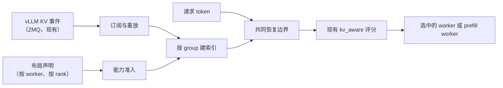
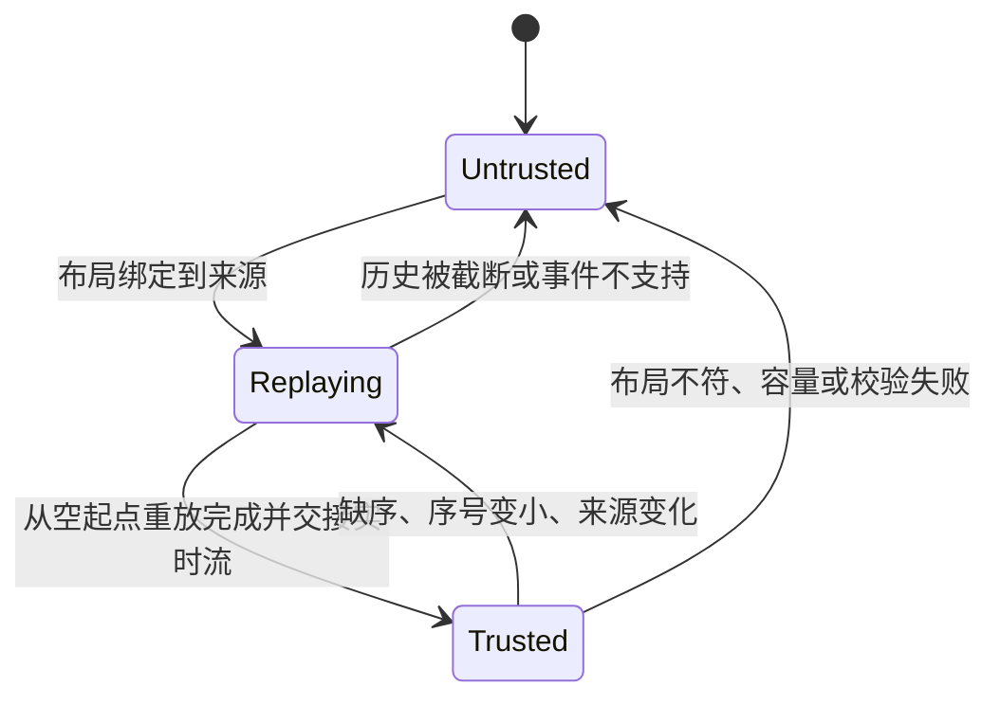

# RFC：混合注意力模型的前缀复用路由

**状态：设计草案，待评审。** 跟踪 issue [#489](https://github.com/vllm-project/router/issues/489) · 上层规划 [#294](https://github.com/vllm-project/router/issues/294) · 参考实现 [PR #493](https://github.com/vllm-project/router/pull/493) · 实现细节与原始测量值：[`hybrid-kv-aware-handoff.md`](hybrid-kv-aware-handoff.md)

## 1. 概要

`kv_aware` 按“预计 prefill 工作量”选路：从 vLLM KV 事件建立前缀索引，扣掉 worker 可复用的 token，再结合负载给 `预计 prefill = 输入 token - 复用 token` 打分。这个估算隐含一个前提：只要 attention 块还在，前缀就可复用。

混合注意力模型打破了这个前提。Qwen3.5/3.6/3.8/4 和 DeepSeek V4/V4.1 会为同一段前缀额外保存状态——GDN/Mamba checkpoint、压缩后的 MLA 状态、滑窗环形缓冲——其中一部分只在特定 offset 上有效。因此「attention 块在」和「这段前缀可恢复」是两件事；按前者计费会低估 prefill，把请求送到错误的 worker。

本 RFC 在 Router 内引入**按 rank 的 group 模型**：

- 部署方声明每个 rank 的**完整** group 布局（这是运维断言，不是路由器推断）；
- 复用现有 KV 事件流，得到每个 group 的驻留情况；
- 只有在同一 worker、同一 DP rank 上所有声明 group 都能同时恢复的那个 offset 之前，才授予信用（**共同恢复边界**）；
- 任何无法验证的情况——布局缺失、group 缺失、事件流断档、hash 契约不支持——一律**零混合信用**，回落到原有按负载选路。

不需要改动 vLLM：Router 消费的是上游已有的 KV 事件和可选的 `/kv_event_sources` 接口。Router 的信用只是选路估算，真正的缓存命中与推理由 vLLM 决定。

## 2. 为什么单个 group 命中不够

| 模型族 | vLLM 0.33 上观察到的 group | 后果 |
|---|---|---|
| Qwen3.5 / Qwen3.6 / Qwen3.8 | 3 个 Mamba checkpoint + full attention | checkpoint 只在满足对齐的边界存在，attention 驻留不能证明它存在 |
| Qwen4Exp（QSA） | 3 个 Mamba group + 压缩 MLA + 每请求 scratch 环 | scratch 环不可共享、也不发事件；压缩组有自己的 token/state 比例 |
| DeepSeek V4 / V4.1 | 2 个稀疏 attention 滑窗组 + 压缩 MLA + indexer + compressor | 滑窗组只发布驻留窗口，且各组窗口大小不同 |

三种失效模式说明为什么默认必须严格：

1. **低估 prefill。** 只按 attention 组计费会让 worker 显得很便宜，赢下请求后再补算缺失的循环状态，TTFT 变差却没有任何报错。
2. **恢复点选错。** checkpoint 与压缩状态只在部分 offset 有效。信用必须停在「对所有 group 同时有效」的最大 offset，而不是各组各自的最大值。
3. **驻留信息过期。** 事件是异步的，派发后仍可能被淘汰。信用只用于选路提示，永远不是缓存预留。

因此混合 worker 只有在「布局已声明」且「事件流可信」时才可能拿到信用。混合模型没有“尽力而为”的单 group 模式：旧路径会直接拒绝非零 group 的事件，而不是把 group 0 当成全注意力。

## 3. 设计



| 阶段 | 职责 |
|---|---|
| Discovery | 把 worker URL 绑定到布局；事件端点可静态配置，也可从 `/kv_event_sources` 获取 |
| 准入 | 布局不完整、与来源 topic 不一致、或 hash 契约未经验证时，拒绝该 rank |
| 订阅 | 每个 rank 单独订阅；从已知空起点重放历史，再交接给实时流 |
| 索引 | 按 `(来源, rank, group)` 维护驻留；断档、未知事件或容量超限时撤销 |
| 匹配 | 求各组驻留的交集，扣除 replay，向下对齐到 hash 块 |
| 策略 | 作为 `TieredMatchProvider` 命中喂给现有策略，健康检查、负载、预留、重试均不变 |

代码位于 `kv_index/{discovery,hybrid_capability,hybrid_events,hybrid_stream}.rs`，策略接入点在 `policies/kv_aware.rs`，P/D 接线在 `routers/http/pd_*`。

## 4. 布局契约

布局是配置：必须针对具体引擎版本和模型产物编写，代表运维方对「引擎维护这些 group」的断言。Router 校验其形状后，把它当作权威的 group 集合使用。

```json
{
  "http://127.0.0.1:8000": {
    "schema_version": 1,
    "ranks": [{
      "rank": 0,
      "model": "qwen3.5-4b",
      "weight_version": "v1",
      "publisher_topic": "kv-hybrid",
      "instance_topic": true,
      "hash_algorithm": "sha256_cbor",
      "root_hash": "9bd96a485ad84efdafb72ee48a1d7a69bcead0f8f0433173941b276b9581eef0",
      "full_hashes": true,
      "hash_block_size": 576,
      "hash_lookahead_tokens": 0,
      "speculative_tokens": 0,
      "prefix_caching": true,
      "groups": [
        {"group_idx": 0, "kind": "mamba", "spec_type": "MambaSpec", "block_size": 576,
         "prefix_cacheable": true, "prefix_replay_tokens": 0, "mamba_cache_mode": "align"},
        {"group_idx": 3, "kind": "full_attention", "spec_type": "FullAttentionSpec",
         "block_size": 576, "prefix_cacheable": true, "prefix_replay_tokens": 0}
      ]
    }]
  }
}
```

准入会检查的 rank 字段：rank 序号必须与事件源的 `dp_rank` 一致；`model` 必须等于实际服务的模型；`weight_version` 与 `publisher_topic` 非空；`instance_topic` 标识每实例 topic；`hash_algorithm` 必须是 `sha256_cbor` 且 `full_hashes` 为真；`prefix_caching` 必须开启；lookahead 与 speculative token 必须为 0。`hash_block_size` 必须能整除每个 group 的块大小。

| `kind` / `spec_type` | 含义 | 额外规则 |
|---|---|---|
| `full_attention` / `FullAttentionSpec` | 稠密 attention KV | 不允许滑窗；必须从前缀起点连续覆盖 |
| `mla_attention` / `MLAAttentionSpec` | 压缩 MLA 状态 | `tokens_per_state` 必须整除组块大小；`cache_role` 可为 `sparse` |
| `sliding_window` / `SlidingWindowSpec`、`sliding_window_mla` / `SlidingWindowMLASpec` | 滑窗状态 | 必须声明 `sliding_window`，且等于配置的 replay 窗口 |
| `mamba` / `MambaSpec` | GDN/Mamba checkpoint | `mamba_cache_mode: "align"`；可选的 `prefill_checkpoint_alignment` 必须整除块大小 |
| `mla_attention` / `CircularBufferSpec` | 每请求 scratch（如 Qwen4 QSA 环） | 仅允许 `prefix_cacheable: false` 且 `tokens_per_state: "1"`，不进入索引 |

跨组规则：至少两个 group、至少一个 attention 组、至少一个状态或 replay 组；**所有 replay 组的 `prefix_replay_tokens` 必须相同**，因为引擎每次命中只回退一个窗口。块大小小于 `hash_block_size` 的组会被拒绝——索引对每组都使用同一条 `hash_block_size` 的 hash 链。

**事件端点。** 布局可以带显式端点（`--kv-event-source`、`--kv-event-replay-source`），也可以不带，此时 Router 向引擎询问：vLLM 0.31+ 的 `GET /kv_event_sources` 返回 `{"<rank>": {"publisher": "zmq", "endpoint": "tcp://*:5557", "replay_endpoint": "tcp://*:5560", "topic": "kv-hybrid", ...}}`。可选字段（`encoding`、`schema_version`）缺失时按既定的 `zmq`/msgpack/schema 1 契约理解；显式声明了别的编码或 schema 则拒绝。绑定通配地址（`tcp://*:5557`、`0.0.0.0`、`[::]`）会解析成 worker 主机地址。引擎报告的 topic 与布局 `publisher_topic` 不同则拒绝该来源：那是另一次启动。只有布局、又发现不到端点时，不授予信用，留在常规负载路径。

**Hash 契约。** 已验证的契约是完整 `sha256_cbor` 块哈希，并且引擎侧设置 `VLLM_KV_EVENTS_USE_INT_BLOCK_HASHES=0`；否则 vLLM 发布 64 位整数哈希，任何 CBOR 布局都无法复现，结果是引擎报命中的同时 Router 计零。默认 `sha256`（对元组做 pickle）和 0.28 时代的整数哈希都不支持。

## 5. 事件契约

Router 消费现有 ZMQ 流：在声明的 topic 上接收 MessagePack 负载 `[timestamp, [event, ...]]`，事件类型为 `BlockStored`、`BlockRemoved`、`AllBlocksCleared`，字段包含 `group_idx`、`kv_cache_spec_kind`、`block_size`、`block_hashes`、`parent_block_hash`、`token_ids`。

| 组类型 | 事件必须满足 |
|---|---|
| attention（全量或压缩） | `len(block_hashes) * block_size == len(token_ids)`：存储区间内每块一个哈希 |
| Mamba checkpoint | `len(block_hashes) * block_size <= len(token_ids)`，可以为 0：稀疏保留可能少于 token 数 |
| 滑窗 | 事件里的窗口大小必须等于布局；哈希需覆盖存储区间 |

批次原子生效：只要其中任一事件形状不合法、涉及未知 group 或 kind、或与布局矛盾，整批被拒，该 rank 的信用被撤销，直到一次干净重放成功。布局未声明的 group 的事件不构成证据，也不参与计算。

按 rank 校验序号。实时交接后出现更小的序号，说明发布端重启并复用了 topic：撤销信用并重新重放。序号与 topic 只能标识一条流，不能标识实例代次，见 §7。

## 6. 共同恢复边界与信用

对请求的 token 和候选 `(worker, rank)`：

1. 对每个声明的 group，求请求 token 哈希在该组的最长驻留前缀；
2. 取各组的最小值——超过这个 offset 的部分不能对所有组同时恢复；
3. 上限取 `len(tokens) - 1`（最后一个 token 由引擎重算）；
4. 扣除布局的 replay 窗口，再向下对齐到 `hash_block_size`。

结果以「本地 GPU 命中、`segments: [(0, blocks)]`」返回，现有策略据此计算 `new_prefill_tokens = input_tokens - blocks * hash_block_size`。评分公式本身不变，变的只是复用的 token 输入。信用按请求、按候选计算；batch 内各 prompt 独立求值，绝不跨 worker、rank 或事件视图拼接状态。

由此有两个可观察到的性质：

- **写入后的第一个请求可能拿不到信用。** 事件在产生它的请求之后才到，因此某段前缀的首次派发（往往还包括第一次重复）看到的是空索引，而引擎侧其实已经命中。信用是下界，Router 宁可少算也不多算。
- **布局正确时信用与引擎一致。** 在 vLLM 0.33 上，事件落地之后的重复请求，Router 记的复用 token 数等于引擎自己的 `vllm:prefix_cache_hits_total`（见 §9）。

## 7. 信任与生命周期



只有在「从已知空起点完整重放 + 交接实时流」之后才暴露信用；部分重放不是快照，保持隐藏。断连、重启、缺序、未知事件、topic 或布局变化、容量失败时，对该来源的所有 group 原子撤销；worker 继续以零混合信用走现有负载路径。

topic 名称和序号本身都不能证明发布端没有重启。只有部署侧提供可信的实例代次——每次启动换新 topic，或用带外渠道校验的代次标识——才能把驻留状态绑定到某个进程生命周期。没有它时，安全性只能说「任何不连续都会撤销信用」，而不是「信用不可能跨重启复用」。

## 8. 选路模式

**混部。** 混合 provider 只是 `kv_aware` 的一个输入；健康过滤、负载、预留、亲和与重试都不变。布局缺失、不完整或事件流不可信的 worker，就是没有信用。

**tools / reasoning 请求。** 这类请求常常没有精确 token（上游没有 `/render`、`/tokenize`）。开启 `--kv-aware-session-affinity-ttl-secs` 后，Router 维护一份独立的 advisory 亲和：按显式 session 标识，首轮绑定、后续跟随，且每次决策都报零 KV 信用。亲和不会减少预计 prefill，也不使用请求内容。

**分离式 P/D。** `--pd-hybrid-config` 声明每个 prefill worker 的布局以及允许配对的 decode worker。P 的信用只减少预计 prefill 计算，与传输量无关。只有部署方固定并端到端验证过的配对（模型与权重产物、vLLM 版本、connector、状态布局、TP/PP）才启用混合信用。交接校验不变：prefill 回复缺少传输参数时在派发 decode 之前返回 502；交接成功后 decode 失败会被记录、计数并返回错误。混合 P/D 不能与 Program scheduling 同时启用。

## 9. 模型与版本支持

模型名不等于布局。下表中每一项都在真实引擎上测过；未列出的组合均为未验证，不授予信用。

| 模型 | 引擎 | 已验证行为 |
|---|---|---|
| Qwen3.5-4B | 0.29.0，DP=2 | 每次重复的信用等于引擎命中（528 块，601 token 提示，多次重复的 `prefix_cache_hits_total` 共 2640） |
| Qwen3.5-4B、Qwen3.5-35B-A3B、Qwen3.6-35B-A3B、Qwen3.8-27B | 0.33.0 | 每次重复的信用等于引擎命中（块大小 576 / 1088 / 1088 / 832） |
| Qwen4Exp（QSA，缩小版 dummy 权重） | 0.33.0 | 信用等于引擎命中：每次重复 576，两次共 1152；scratch 环已从布局中排除 |
| DeepSeek-V4-Flash（真实权重，TP=2） | 0.33.0 | 引擎确实复用了前缀，Router 计 0：布局与事件形状暂不支持（§10） |
| DeepSeek-V4.1-Flash | — | 现有硬件跑不起来：510.3 GB 权重、48 个分片，至少需要 6 张 H20-3e |

## 10. 兼容性、限制与非目标

| 情况 | 行为 |
|---|---|
| 功能关闭或未声明布局 | 现有选路不变；非零 group 事件被拒绝，混合模型不会继承 group 0 的信用 |
| 非混合模型 | 现有 KV-aware 路径不变 |
| 已声明布局且事件流可信 | 使用多 group 共同边界 |
| 布局未知、group 缺失、事件流不可信、hash 不支持 | 零混合信用，按负载选路 |
| 混部与 P/D 池 | 布局声明与验证互相独立 |

本设计的限制，明确写出来：

- **每个 rank 只有一条 hash 链。** 所有 group 都按 `hash_block_size` 计算，因此任何组的页大小都不能小于它。DeepSeek-V4-Flash 需要按组的 hash 链（页大小 4/8/64/256），并且只发布驻留滑窗（`window/block` 个哈希，锚点是 `parent_block_hash`，有时为 0 个哈希）——两者都不支持，所以它计零。
- **不做布局自动推断。** Router 绝不从观察到的事件猜 group；没有声明就是没有命中，而不是“发现了”。
- **不做跨 worker、跨层级拼接。** 前缀只能由持有它的那一个目标提供。
- **非目标：** 多模态、LoRA、投机解码、未知 cache salt、无部署侧身份的代次保护，以及任何对 vLLM 算子或传输协议的改动。

## 11. 验证与待解问题

| 方面 | 覆盖 |
|---|---|
| 单元与契约测试 | 布局准入、事件形状与重放拒绝、边界算术、生命周期撤销 |
| 引擎集成 | Qwen3.5（0.29，DP）、Qwen3.5/3.6/3.8 与 Qwen4Exp（0.33），信用与引擎命中计数对比 |
| 选路模式 | 混部、advisory 亲和、P/D 交接成功与失败（对桩后端） |
| 负向路径 | 缺组、淘汰、重启、重放截断、错误 hash 契约、DP 隔离 |
| 性能 | 功能开关对比、固定负载下的 TTFT 与命中率、Router CPU 与内存 |

待解问题：

1. **代次保护。** 部署侧如何提供可信的实例代次，使驻留状态绑定到单一进程生命周期，而不依赖 topic 与序号。
2. **按组 hash 链。** 是否接受按组的块大小、以及以 `parent_block_hash` 为锚点的有界发布——这是 DeepSeek V4 系引擎的要求。
3. **布局审计。** 如何让版本化布局可评审、并能对着真实引擎核对，而不是手写断言。
4. **无新事件时的恢复。** 重放被截断时，能否用后续快照修复，而不是直接撤销信用。

在这些问题解决前，所有未知情况一律零信用，走现有负载路径。
