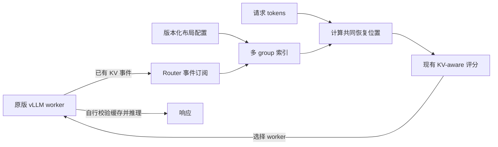
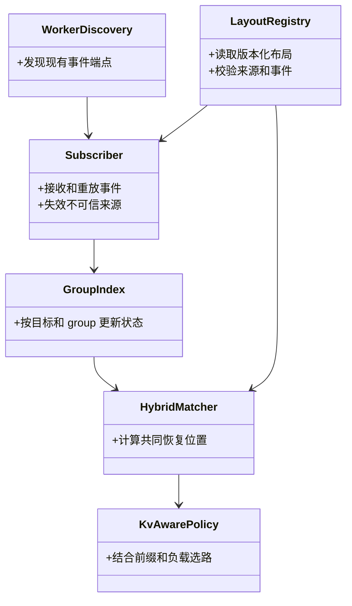
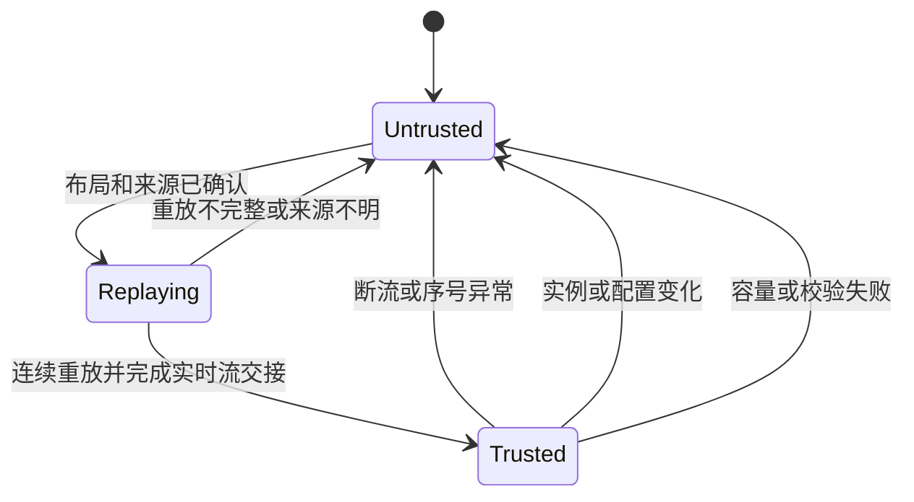
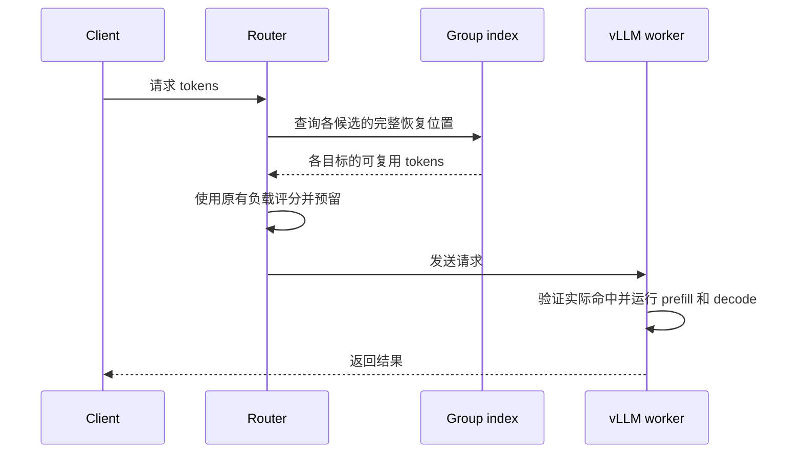
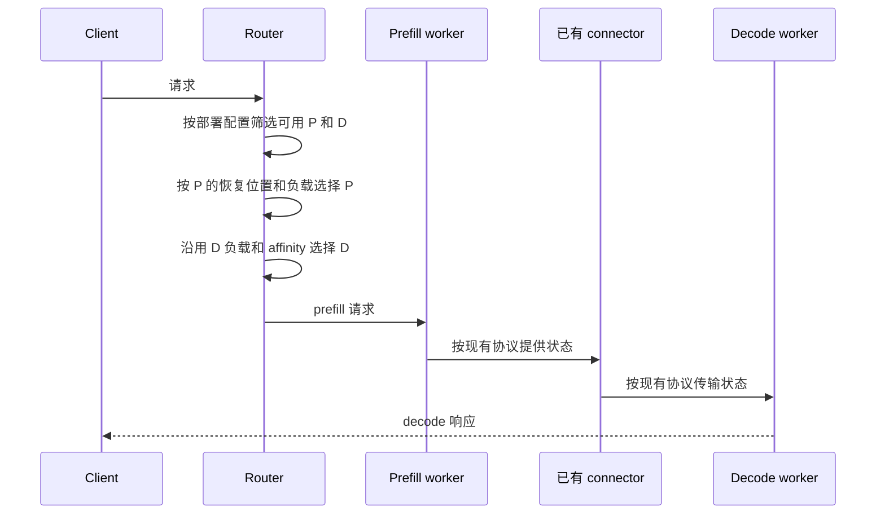

# RFC：仅修改 Router 的混合注意力 KV-aware 选路

**状态：设计草案。** [设计 issue #489](https://github.com/vllm-project/router/issues/489) · [上层 RFC #294](https://github.com/vllm-project/router/issues/294) · [Router 原型 PR #493](https://github.com/vllm-project/router/pull/493)

## 1. 目标与边界

使用原版 vLLM main 的 KV 事件，在 Router 中记录同一 worker/rank 的多组缓存状态，估算共同可恢复的前缀，再结合现有负载选路。



只修改 Router，不新增 vLLM 接口、事件格式或连接器协议。Router 的命中是**选路估计**，实际命中由 vLLM 决定。不可信时信用为 0，不能回退到单 group 的混合模型信用。

| 范围 | 内容 |
|---|---|
| 首期 | 单 worker/rank、本地 GPU；纯文本；混部和已验证的 PD 部署 |
| 后续 | 跨 tier、跨 worker 状态组合；多模态、LoRA、未知 salt；推测解码 |
| 非目标 | 修改 vLLM、传输张量、改变模型算子或实现模型内部稀疏 indexer |

目标模型包括 Qwen3.5、Qwen3.6、Qwen3.8、Qwen4 及 DeepSeek V4/V4.1；**模型名称不是能力证明**，每种布局和版本都必须单独验证。

## 2. 输入从哪里来

| 输入 | 来源 | Router 的处理 |
|---|---|---|
| 事件端点 | 现有 `/kv_event_sources` 或静态配置 | 每个 worker/rank 订阅对应源；端点不可用时零信用 |
| store/remove/clear | 现有 ZMQ KV 事件及 replay | 使用事件中的 group、类型、块大小、哈希及序号；逐源维护状态 |
| 布局与恢复规则 | Router 的版本化配置 | 匹配 vLLM 版本、模型制品、hash、group、块大小及恢复规则；不匹配则零信用 |
| 请求 tokens | 现有请求预处理路径 | 使用与 worker 一致的 token 序列；身份或输入不明则零信用 |
| P/D 兼容范围 | 部署配置及已有 connector 能力 | 固定经过验证的模型、权重、connector 和并行布局；引擎负责交接 |

事件提供已发生的变化，**不能仅凭见到的 group 推断全部必需 group**。Router 配置须列出完整布局；尚未出现事件的必需 group 视为未命中。不同版本的事件字段、哈希和恢复语义都要用真实样本验证。

首期可选择 `sha256_cbor` 的完整哈希事件：worker 和 Router 使用一致、可验证的根哈希与配置；vLLM 使用 `VLLM_KV_EVENTS_USE_INT_BLOCK_HASHES=0` 输出完整哈希。其他哈希模式须单独验证，否则不计信用。配置值是部署方声明，不是对模型权重一致性的自动证明。

## 3. 接入现有架构



图中类表示职责，不限定新增类。复用 `kv_index`、`TieredMatchProvider`、`kv_aware` 和现有 admission/重试机制。

| 部分 | Router 改动 |
|---|---|
| discovery | 复用端点发现和静态源；读取布局及部署身份配置 |
| subscriber/index | 按 `(worker, rank, generation, group)` 记录；重放未完成时不开放信用 |
| matcher | 对每个候选目标应用其版本布局，计算共同边界 |
| policy | 用共同边界估算新 prefill tokens；沿用健康过滤、负载评分和重试 |

## 4. 共同可恢复前缀

```text
token 边界       0       32       64       96       128
                 |--------|--------|--------|---------|
完整注意力 KV    [==========================)
GDN 检查点                ●        ●
                                   ↑
共同恢复位置 = 64；预计新 prefill = 128 - 64 = 64 tokens
```

按各 group 的规则计算候选边界，取所有必需状态都满足的最大位置，遵守引擎对齐及最后 token 重算规则。不能跨 worker、rank 或 generation 拼接状态；batch 的每条 prompt 独立计算。

| 状态类型 | Router 规则 |
|---|---|
| full attention | 检查从起点到边界的连续覆盖 |
| Mamba/GDN | 检查经该版本验证的 checkpoint 和对齐规则 |
| 压缩注意力 | 按验证过的 token/state 比例与边界检查 |
| 滑窗/重算 | 验证必需窗口、依赖和重算成本；无法证明时零信用 |
| 每请求 scratch | 仅在确认不属于前缀持久状态时排除 |

Qwen3.5 的 528-token 块是实测示例，不是通用常量。Qwen4 的压缩 MLA、DeepSeek V4/V4.1 的滑窗、压缩及共享状态须分别验证。

## 5. 生命周期与可信度



普通 ZMQ topic、短暂健康检查和序号本身**不能证明**发布器没有重启。Router 须绑定部署系统可确认的实例 generation；若无法获得可信生命周期信号，旧视图不能计信用。断流、重启、缺序、未知事件、布局变化或超限时，原子撤销该源所有 group 信用。

replay 必须覆盖从已知空状态到实时流交接点的连续事件；历史截断或无法建立交接边界时保持零信用，不能将部分重放当成完整快照。无新事件时的可靠恢复仍需验证。事件异步到达，派发后缓存仍可能被淘汰，vLLM 自行确认并处理。

## 6. 混部选路



保留健康检查、session affinity、admission 和释放逻辑。未匹配布局的混合 worker 可按原有负载路径选路，但混合前缀信用为 0。

tools、reasoning 等请求无法取得精确 token 时，独立使用会话标识或文本相似度提供建议亲和；它只辅助选路，不记 KV 信用，也不减少预估 prefill 工作量。仍须遵守健康和负载约束，不持久化请求原文。

## 7. PD 分离选路



P 信用只减少估算的 P 计算量，不表示传输量减少。Router 沿用 `PdKvState`、`PdLoadManager` 和现有 connector 调度；不新增 worker 握手，也不假设 `kv_transfer_params` 能证明所有兼容条件。

混合模式只对部署方固定、经端到端验证的 P/D 组合启用信用：模型与权重制品、vLLM 版本、connector、状态布局及 TP/PP 等必须匹配。配置声明不能替代引擎和 connector 的实际校验。若索引不可信但部署兼容仍有效，P 信用为 0；若兼容性未知或不满足，不把零信用当成交接安全证明，应拒绝该混合组合或选择明确配置且已验证的其他路径。重试、失败和取消沿用现有生命周期。

## 8. 兼容与上线

| 场景 | 行为 |
|---|---|
| 功能关闭 | 保留原有选路及配置行为 |
| 非混合模型 | 保留现有 KV-aware 路径 |
| 混合布局已配置且来源可信 | 使用多 group 共同恢复点 |
| 布局未知、事件缺失或身份不明 | 混合信用为 0；不借用 group 0 信用 |
| 混部与 PD 混合部署 | 各自使用独立配置与验证结果 |

增加默认关闭的 Router 开关和版本化布局配置：包含模型制品、vLLM 版本、必需 group、恢复规则、事件和哈希约束及实例 generation 来源。配置格式、索引内存上限和来源租约在实现评审中确定。

上线顺序：版本/布局验证 → 影子计算 → 小范围启用 → 扩大；关闭开关即可回退。复用现有指标，并增加低基数的布局不支持、来源不可信和重放失败分类，不记录 prompt 或哈希。

## 9. 验证与开放问题

| 验证 | 内容 |
|---|---|
| 正确性 | 多 group 缺失/移除/重加、对齐、压缩与滑窗、batch、rank/实例隔离 |
| 事件 | 真实 MessagePack 样本、缺序、乱序、截断 replay、重启及无新事件恢复 |
| 兼容 | 原版 vLLM main、功能关闭、非混合模型、已有 HTTP/gRPC 路径 |
| 混部 | 双 worker 冷热选路；对照实际命中和缓存关闭时的输出 |
| PD | 在配置固定的版本/模型/connector 矩阵中测试交接、失败和重试 |
| 性能 | 比较功能开关前后的 TTFT、吞吐、实际命中率、Router CPU/内存 |

原版 vLLM 的模型端到端测试，以及 DeepSeek 和 PD 目标组合的验证仍需完成。

开放问题：部署系统如何提供可信实例 generation；原版事件和 replay 能否完整恢复各目标布局；如何维护可审核的版本化布局配置。无法确认时保持零信用。
