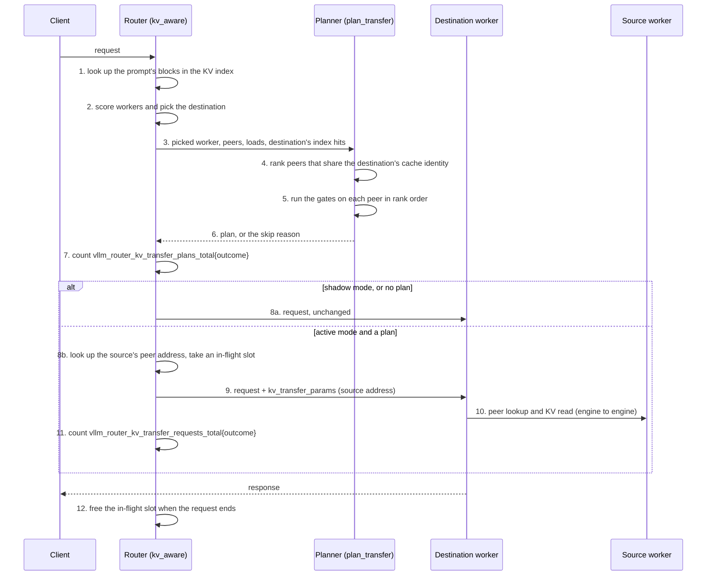

# KV transfer planning for kv_aware

## What it does

`kv_aware` picks a worker for each request. Sometimes the worker it picks is idle but has no cache, while a busy peer holds the request's prefix. The transfer planner asks one question after the pick: would it be cheaper for the picked worker to fetch the prefix from that peer than to recompute it, or than to wait on the busy peer?

- **`off`** (default): no planner, no extra work.
- **`shadow`**: the planner runs and its answer is counted. Routing and the request are unchanged.
- **`active`**: as shadow, and a planned request also carries `kv_transfer_params` so the destination engine fetches the prefix from the source.

The planner never changes which worker is picked, in any mode.

## One planning attempt



Steps 1 to 7 are the same in shadow and active mode. Steps 8b to 12 exist only in active mode.

## Decision flow

Checks run in this order. The first one that fails gives the outcome label.

**Before the planner (call site, `kv_aware.rs`):**

| Check | Outcome label |
|---|---|
| The pick came from a session binding | `session_binding` |
| The request has no token ids to match | `missing_tokens` |

**Planner, request level (`plan_transfer`, `kv_transfer.rs`):**

| Check | Outcome label |
|---|---|
| Planner disabled or its constants invalid | `disabled` |
| Picked position is outside the peer list (a router bug) | `misaligned_input` |
| Destination's cache key unknown | `unverified_identity` |
| No lookup of the destination's own prompt (no tokens, several prompts, no credit) | `unknown_destination_input` |
| No other worker shares the destination's cache identity | `no_peer` |

**Peer ranking.** Peers that share the destination's cache identity are ranked by: longest prefix of the destination's prompt first, then fewer active requests, then position. A peer's prefix is measured from the destination's own prompt lookup, so it always describes tokens the destination's prompt contains. Only `Device` blocks from block 0 count, continued by `HostPinned` segments; `Disk` and `External` are ignored.

**Planner, per peer, in rank order (`plan_from_source`):**

| # | Check | Outcome label |
|---|---|---|
| 1 | Peer was excluded for this request (retry) | `source_excluded` |
| 2 | `require_capability` is on and source cannot send to destination | `incompatible` |
| 3 | Peer's prefix is not longer than the destination's | `picked_holds_longest_prefix` |
| 4 | Peer holds fewer than `min_prefix_blocks` extra blocks | `prefix_too_short` |
| 5 | Peer has fewer than `source_load_threshold` active requests | `source_not_busy` |
| 6 | Nothing left to credit (the last prompt token is never credited) | `prefix_too_short` |
| 7 | Cost rule fails (below) | `cost_rule` |

The first peer that passes all seven is planned (`planned`).

**Which reason is reported when no peer passes.** One request produces one outcome. The planner reports the reason of the highest-ranked peer, but prefers a peer that failed an ordinary check (3 to 7) over one that failed 1 or 2. A retry exclusion or a layout mismatch on the longest holder says less about lost transfers than why the next usable holder was rejected. So the counter answers "why did the best *usable* peer not qualify", not "why did the longest holder not qualify".

## Cost rule

A plan is made only if both hold:

```
fetch_ms    < wait_ms
transfer_ms < saved_ms * margin
```

| Term | Formula | Inputs come from |
|---|---|---|
| `credited` | `min(missing_blocks * block_size, input_tokens - 1 - dest_prefix_blocks * block_size)` | KV index hits for the destination's prompt |
| `transfer_ms` | `transfer_fixed_ms + credited * transfer_us_per_token / 1000` | `--kv-transfer-fixed-ms`, `--kv-transfer-us-per-token` |
| `dest_queue_ms` | `dest.active_prefill_tokens * prefill_us_per_token / 1000` | router's in-flight accounting, `--kv-transfer-prefill-us-per-token` |
| `source_wait_ms` | `source.active_prefill_tokens * prefill_us_per_token / 1000` | same |
| `fetch_ms` | `dest_queue_ms + transfer_ms + prefill(remaining on destination after the fetch)` | remaining tokens use the routing estimate (tier credits `--kv-penalty-*`) |
| `wait_ms` | `source_wait_ms + prefill(remaining on source)` | same routing estimate |
| `saved_ms` | `prefill(destination remaining before - after the fetch)` | same |

`prefill(n) = n * prefill_us_per_token / 1000`.

**Worked example** (defaults: block size 16, 50 us/token prefill, 5 ms + 5 us/token transfer, margin 0.8). Prompt is 2,000 tokens. Destination is idle with no cache. Source holds 100 device blocks, has 4 active requests and 10,000 queued prefill tokens.

- `credited = min(100 * 16, 1999 - 0) = 1600` tokens
- `transfer_ms = 5 + 1600 * 0.005 = 13`
- `saved_ms = 1600 * 0.05 = 80`
- `dest_queue_ms = 0`, `source_wait_ms = 10000 * 0.05 = 500`
- `fetch_ms = 0 + 13 + prefill(400) = 33`
- `wait_ms = 500 + prefill(400) = 520`
- Rule: `33 < 520` and `13 < 80 * 0.8 = 64`. Planned.

## Known bias in the estimates

The planned rate from shadow mode is an upper estimate. Read it with these four facts in mind.

1. **The wait path is priced as serial time.** `source_wait_ms` treats the source's queued tokens as if they run one after another. Routing itself scores workers as `(new prefill + queued tokens) * (active requests + 1)`, so the two numbers are not on the same scale, and a batching engine drains its queue faster than the serial estimate. This overstates `wait_ms`.
2. **The source's export work is free.** `fetch_ms` has no term for the busy source serving the read. This understates `fetch_ms`.
3. **The counter counts selections, not requests.** `vllm_router_kv_transfer_plans_total` is incremented once per selection. A retried request is counted again, and there is no per-request total to divide by.
4. **Host-memory blocks are counted as sendable, but the engine serves GPU blocks only.** The planner treats a peer's `HostPinned` blocks as exportable. The vLLM NIXL peer lookup pins and serves GPU blocks only, so the destination fetches the GPU part and computes the rest. A fetch is never wrong, only slower than estimated. This overstates `saved_ms` for peers that hold much of the prefix in host memory. It goes away once the engine can pin and serve host blocks under the same lease as GPU blocks, which is the intended follow-up on the engine side.

Points 1, 2 and 4 all favour `planned`. Calibrate the constants against a measured baseline before acting on the rate.

## Modes and settings

| Mode | `require_capability` | What a plan needs | What happens to a planned request |
|---|---|---|---|
| `off` | any | (no planner) | nothing |
| `shadow` | `false` | shared cache identity only | counted, request unchanged |
| `shadow` | `true` | plus: source can export, destination can import, same connector, version and layout fingerprint | counted, request unchanged |
| `active` | forced `true` | same as above | counted; then see below |

In `active` mode a planned request goes through these checks, in order. Each failure is counted on `vllm_router_kv_transfer_requests_total{outcome}` and the request is sent unchanged.

| Check | Outcome |
|---|---|
| Destination is a gRPC worker | `grpc_destination` |
| Source or destination registration changed since planning | `registration_changed` |
| Source has no engine-reported peer address | `no_peer_endpoint` |
| Source already has `max_inflight_per_source` fetches in flight | `inflight_cap` |
| Client sent its own `kv_transfer_params` | `client_params_present` |
| Body is not a JSON object | `invalid_body` |
| Otherwise | `sent` |

**Where capabilities come from.**
- *Engine-reported:* a worker's `peer_lookup` record on `/kv_event_sources` gives both a capability and a peer address (host, port, engine id, TP/DCP/PP sizes). The record is described below.
- *Static:* `kv_transfer.capabilities` in the router config gives a capability only. It has no address, so a statically declared source can be planned in shadow mode but always ends as `no_peer_endpoint` in active mode. A static entry wins over the engine's capability for the same worker; the engine's address is still stored.

**The `peer_lookup` record.** `/kv_event_sources` returns a JSON object keyed by DP rank as a string (`"0"`, `"1"`, ...). A key that is not a number is skipped without a warning. Each rank's entry may carry a `peer_lookup` object. The router attaches to a worker the record of the worker's own DP rank, or of rank `"0"` when the worker has no DP rank.

```json
{
  "0": {
    "endpoint": "tcp://*:5557",
    "topic": "",
    "peer_lookup": {
      "enabled": true,
      "engine_id": "engine-0",
      "side_channel_host": "10.0.0.5",
      "side_channel_port": 5600,
      "tp_size": 2,
      "dcp_size": 1,
      "pp_size": 1,
      "connector": "nixl",
      "connector_version": "1",
      "layout_fingerprint": "qwen3-8b-bf16-tp2"
    }
  }
}
```

| Field | Type | Valid value | What the router does with it |
|---|---|---|---|
| `enabled` | bool | `true` | A record with `false` is dropped |
| `engine_id` | string | not blank | Sent to the destination as `remote_engine_id` |
| `side_channel_host` | string | not blank | Sent as `remote_host` |
| `side_channel_port` | integer | 1 to 65535 | Sent as `remote_port` |
| `tp_size` | integer | 1 or more | Sent as `tp_size` |
| `dcp_size` | integer | 1 or more | Sent as `dcp_size` |
| `pp_size` | integer | 1 or more | Sent as `pp_size` |
| `connector` | string | not blank | Capability: must equal the other worker's when capabilities are required (always in `active`) |
| `connector_version` | string | not blank | Capability: must equal the other worker's when capabilities are required (always in `active`) |
| `layout_fingerprint` | string | not blank | Capability: must equal the other worker's when capabilities are required (always in `active`) |

- Every field is required. A missing field reads as `false`, `""` or `0` and fails validation.
- Strings are compared and sent exactly as reported; the router does not trim them.
- An engine record gives the worker a capability that can both export and import.
- The address fields are passed through to the destination's `kv_transfer_params`, together with `"do_remote_prefill": true` and `"peer_lookup": true`. The router does not interpret the sizes.
- Unknown keys are ignored. A `null` or absent `peer_lookup` means no record.
- A record that fails a check above is dropped with a warning naming the worker, the rank and the reason.
- A `peer_lookup` value that is not an object, or that has any field of the wrong type, is read as an empty record. It is dropped like any record that fails the checks, and the warning gives the reason `not enabled`, whichever field was wrong.
- A dropped record never fails discovery. The rest of the response, and the worker's other ranks, are still used.
- Discovery reads the record when a worker is added. When it finds no valid record, the worker gets no address and any engine-reported capability it had is removed. A static capability is kept.
- A changed record is picked up only when the worker is removed and added again.

**Registration binding.** The planner checks a source's layout against the record it read. Discovery can replace a worker's record (new engine id, port or layout) for the same URL after the planner read it. So the grant fetches only if both the source and the destination still have the record and registration the planner saw, and it uses the address from that record. Otherwise the outcome is `registration_changed` and the request is sent unchanged, never with the old cache credit. Re-polling an identical record does not count as a change.

**Kill switch.** `POST /kv_transfer/peer_fetch` with `{"enabled": false}` stops peer fetches on every active-mode `kv_aware` policy of the router at once; `{"enabled": true}` resumes them.
- Routing, planning and the `planned` count on `vllm_router_kv_transfer_plans_total` continue as before. A planned request is sent without `kv_transfer_params` and is not counted on `vllm_router_kv_transfer_requests_total`, as in shadow mode.
- It takes effect for selections made after the call. Fetches already in flight finish normally.
- The state is held in memory only. A restart returns to the configured mode.
- It covers one router instance. With several router replicas, call each one.
- It is a manual switch, not a circuit breaker: the router never flips it by itself.
- It uses the same authorization as the other admin routes. Any key accepted by one of the `api_key_validation_urls` can flip it, and when none are configured the endpoint is open.

`GET /kv_transfer/peer_fetch` returns the current state. `POST /kv_transfer/peer_fetch` takes a JSON object with one boolean field:

```json
{"enabled": false}
```

Both return the state after the call:

```json
{
  "enabled": false,
  "policies": [
    {"models": ["my-model"], "default": true, "enabled": false}
  ]
}
```

| Field | Meaning |
|---|---|
| `enabled` | The switch: `true` lets active-mode policies fetch, `false` stops them |
| `policies` | Each active-mode `kv_aware` policy instance the switch covers; empty when no policy is in active mode |
| `policies[].models` | Model ids routed by this instance, sorted. Empty until a worker registers |
| `policies[].default` | Whether this instance is the router's main policy |
| `policies[].enabled` | Whether this instance fetches now; always equal to the top-level `enabled` |

| Status | When |
|---|---|
| 200 | `GET`, or a `POST` that set the state |
| 400 | The `POST` body is not a JSON object with a boolean `enabled`; the body is `{"error": "..."}` |
| 401 | API keys are configured and the request has no accepted key. Checked before the body is read |
| 409 | No policy is in active mode: `{"error": "no policy in active mode"}`. The state is not changed |

Each successful `POST` is logged at `WARN` with the new state and sets `vllm_router_kv_transfer_peer_fetch_enabled`.

**Not supported.**
- Prefill/decode (PD) routing: any mode other than `off` is rejected at startup.
- gRPC workers with `active`: rejected at startup. A gRPC worker discovered later is never asked to fetch.

## Metrics

| Metric | Labels | Meaning |
|---|---|---|
| `vllm_router_kv_transfer_plans_total` | `outcome` | One per selection: `planned` or a skip label from the tables above |
| `vllm_router_kv_transfer_requests_total` | `outcome` | Active mode only, one per planned request: `sent`, `grpc_destination`, `registration_changed`, `no_peer_endpoint`, `inflight_cap`, `client_params_present`, `invalid_body` |
| `vllm_router_kv_transfer_estimated_saved_ms` | none | `saved_ms` of each planned transfer |
| `vllm_router_kv_transfer_estimated_cost_ms` | `path` = `fetch` or `wait` | Both estimates, whenever the cost rule was evaluated |
| `vllm_router_kv_transfer_peer_fetch_enabled` | none | Gauge: 1 while the kill switch lets active-mode policies fetch, 0 while it stops them. Set at startup when the main policy is in active mode, and on each successful `POST /kv_transfer/peer_fetch` |
