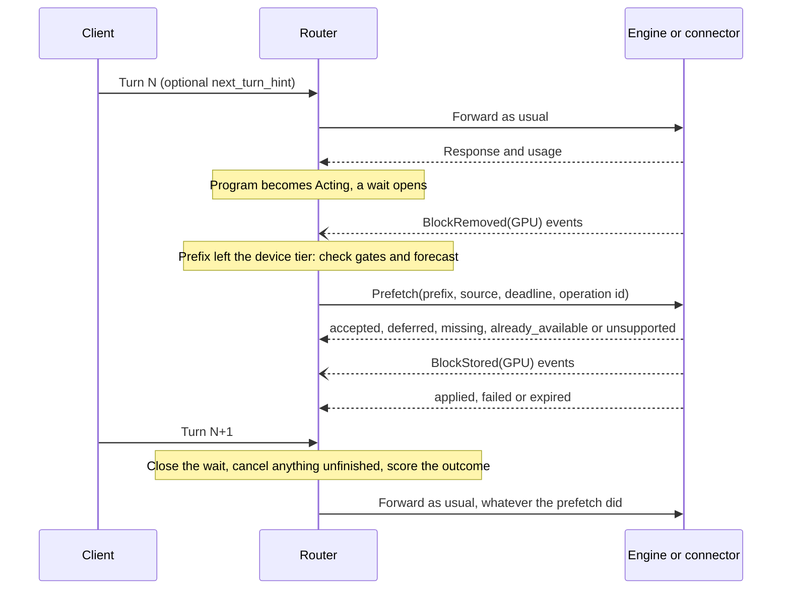

# Next-turn KV prefetch: end-to-end design

Status: design proposal for [#428](https://github.com/vllm-project/router/issues/428). Nothing here is implemented yet. It extends the [Engine KV-control boundary](program-scheduling.md#engine-kv-control-boundary), with one refinement: that section says residency accounting must not change until the engine reports `applied`. Here the placement index stays event-driven, as it is today, so neither a prediction nor an ack changes it. See [Pending and confirmed transfers](#pending-and-confirmed-transfers).

While an agent waits for a tool, other requests can push its prefix out of the GPU. If a copy survives in a lower tier, the next turn pays for a restore on its own critical path. A next-turn prefetch moves that copy back during the wait, so the restore happens inside the pause. A prefetch that lands late, or for a turn that does not come, costs bandwidth and GPU capacity that other requests needed.

This design defines how predictions and Program state trigger a prefetch, how the Router picks source and target, how pending and confirmed transfers affect routing, and how the feature stays bounded, cancelable, and behind demand restores. It keeps prediction, admission, and physical cache state separate.

Non-goals, from the RFC: executing tools or inferring control flow online, treating predicted output length as actual usage or residency, and enabling speculative work by default. Requests without Program metadata never enter this path.

## What the measurements require

| Measurement | Consequence for the design |
|---|---|
| Resuming a 16k-token prompt on one RTX 5060 Ti: 97 ms from the GPU, 509 ms restored from host RAM, 3,264 ms recomputed ([E0](https://github.com/StevenWang-CY/flatshare/blob/v1.22/docs/BENCHMARKS.md#tier-cost-model-resuming-an-agent-turn-e0)). | A restore is cheap next to a recompute. Prefetch can only win the restore cost, so its budget must be small. |
| In a calibrated simulator with a 4× write-through host tier, a prefetch timed by an oracle gains under 8% at p50 and about 28% at p90 at 1.6–2.4× KV pressure. At 3.2× and 4.4× its p90 effect is inside the seed spread (+15% and −4%; −1% and −8% on mean latencies). At 6.2–7.5× it loses 21–23% (three seeds), because prefetches share one load stream with demand restores. From 4.4× up this is outside the simulator's calibration ([E1](https://github.com/StevenWang-CY/flatshare/blob/v1.22/docs/BENCHMARKS.md#the-regime-map)). | Prefetch is a tail mechanism for moderate pressure. It must yield to demand and stop under high pressure. |
| In the same simulator, the best arm timed from session history gains 3.9% at p90 at 1.6× and loses 7–10% from 2.4× on. With tool pauses about three restores long, even the oracle gains at most 9% at p90. | A history-based forecast may never pass the gate. The design must measure this before anything is active, and leave room for a client that knows when its tool returns. |
| On one L20, an unfinished prefetch was worse than none (+20% resume TTFT), and firing at the pause kept 95–100% of the oracle's gain where fixed-lead and EWMA timing kept 5–50% ([vLLM #57103](https://github.com/vllm-project/vllm/issues/57103#issuecomment-5733975478)). | Firing early costs residency; firing late forfeits the gain. Fire as soon as the prefix is gone and a return is likely while the load stays useful. The forecast does not aim the load at the return. |
| On two A100s, long-pause predictions triggered offloads that were never restored until a current-occupancy condition was added ([vLLM #57103](https://github.com/vllm-project/vllm/issues/57103#issuecomment-6367992447)). | A completed transfer is not a useful one. Occupancy gates each operation, and usefulness is scored separately. |

These are single-setup results. They motivate the gates; they are not claims about other hardware, and each stage below has to measure its own effect.

## End-to-end flow

The request path never waits for a prefetch and never depends on one. Removing every prefetch arrow leaves today's behavior.

## Trigger: predictions and Program state

A wait opens when a turn completes successfully, the Program expects another (`expected_resume`), and nothing is in flight or queued for it. The same point starts the return-time predictor from [#402](https://github.com/vllm-project/router/issues/402). The wait closes on the next arrival, on release, or when its target goes away. A wait makes at most one active operation at a time, which is the duplicate suppression: the key is the Program generation plus the wait.

**When to evaluate.** The trigger is eviction evidence: the Program's prefix is no longer contiguous in the target's device tier but still is in a lower tier. Until that evidence exists for the Program (see [Prefix identity](#prefix-identity)), a periodic tick after `min_idle_seconds` stands in for it, since a prefix that has just been used is still resident. An engine reply of `already_available` returns the wait to evaluation, up to a small attempt limit, because the prefix may leave later in the same wait.

**Whether to fire.** All gates must pass, cheapest first:

| Gate | Input | Why |
|---|---|---|
| Prefix size | Completed prompt tokens | Below a floor a load saves nothing. |
| Fresh observation | Program scheduling's backend metrics | Stale state must not act. |
| Restore evidence | `vllm:prompt_tokens_by_source_total{source="external_kv_transfer"}` | A target that never restores has nothing to prefetch from. Once prefetches are active, their completed loads must count too, or a working prefetch turns this gate off. |
| KV usage | Referenced blocks, and logical capacity for a paused Program | A pool of mostly referenced blocks leaves a load nothing to take. This does not see idle prefixes a load would evict: see [Displacement](#displacement). |
| Demand | Native waiting requests | [Demand comes first](#how-prefetch-yields-to-demand-restores). |
| Budget | [Prefetch budget](#admission-and-budget) | Bounds the cost of being wrong. |
| Forecast | Hint or return-time profile | `P(e + L < T <= e + L + V \| T > e) >= min_useful_probability` |

Here `T` is when the next turn arrives, `e` the time waited so far, `L` the time until the load would finish including queueing, and `V` the validity window. A `no_return` observation counts as never arriving. A wait that simply stops, with no terminal signal, is censored by the predictor, so forecasts overstate returns, and the `expired` outcome shows what that costs.

**Forecast sources.** There are three, and only the first two exist in the first stage. The return-time profile needs nothing from the client. An explicit hint on the request takes precedence over it while fresh, like the existing `kv_retention_ttl` precedence:

| Hint field | Meaning |
|---|---|
| `version` | Compatibility version. An unknown version is ignored and counted; the request is unaffected. |
| `expected_return_seconds` | Time from this request's completion to the next turn's arrival. |
| `confidence`, `support` | The producer's confidence, and the samples behind it. |
| `valid_for_seconds` | Expiry. A hint past this, or past its expected return, is stale and falls back to the profile. |
| `provenance` | Who produced it. Logged, never a metric label. |

The hint travels in `vllm_xargs.agentic_context.next_turn_hint` and lives for one request. A request cannot know which tool its response will call, so a hint can only carry what is known beforehand, such as a workflow stage's typical wait.

The measurements point at tool durations, which only the harness or an API layer that runs the tool ([Agentic API #364](https://github.com/vllm-project/agentic-api/issues/364)) knows, after the response. That is the third source: a post-response update with the same fields, naming the Program and the step it refers to, on an authenticated control path. The Router drops an update whose Program generation or step no longer matches the open wait. **Until that input exists, no deployable forecast has evidence behind it.** Stage 3 needs it, unless a history-based forecast surprises Stage 1.

Output-length prediction does not trigger a prefetch. A wait starts when the turn has actually finished, so its tokens are known. Predicted output length can only refine forecasts for a parent blocked on a child that is still generating, which is also a later extension.

## Source and target

**Target.** The rank that served the completed turn (the Program's `last_target`). A paused Program has no placement, but its next turn tries that rank first, so a prefetch neither rebinds a Program nor adds a reason to stay. With `global_queue` a paused Program may resume elsewhere. No credit was given, so routing loses nothing, but a finished load served nothing, and the plan counts as `unused`. Requests routed by `kv_aware` alone have no wait and are not in scope. A peer fetch for them is [#424](https://github.com/vllm-project/router/issues/424).

**Source.** The placement index answers it, from `find_tiered_matches` on the prefix. The candidate must extend the target's contiguous device prefix, which is vLLM's two-segment reuse rule and the rule `kv_aware` already credits. In order:

| Source | Operation | First stage |
|---|---|---|
| The target's own host tier | Local copy to the device tier | Yes |
| A shared pool copy reachable from the target | Connector fetch to the device tier | After the local case has evidence |
| Another worker's copy | The transfer planner from [#424](https://github.com/vllm-project/router/issues/424), with its capability handshake and decision rule | After #424 |

Ties break toward the longer extension, then the higher `TransferCredits` tier. Credits only order candidates here: a credit is not a measured transfer time. A prefix found nowhere gets no operation. Cache identity must match exactly (model, block layout, adapter, cache salt, tenant, cache group), and a multi-group hybrid model gets `unsupported` until [#436](https://github.com/vllm-project/router/issues/436) and [#489](https://github.com/vllm-project/router/issues/489) define its groups. P/D targets the Decode rank through the same contract, but it stays out of scope until the co-located case has evidence.

### Prefix identity

The Router asks for the completed turn's prefix, which the next prompt extends if it reuses anything. It never predicts the next prompt. Under `kv_aware` the HTTP path already has exact tokens per worker, for chat too, directly or rendered by the worker, and so does a Program-bound target. A wait keeps a bounded copy of those block hashes, which gives the index query and the eviction evidence. Without tokens (another policy, or a session binding that skipped the render), the operation names the prefix by an engine-resolved selector, such as those in [vLLM #62382](https://github.com/vllm-project/vllm/pull/62382), and the Router falls back to the tick and the engine's reply. An operation always carries the turn's cache identity (model, adapter, `cache_salt`), because a session ID is client-supplied and must not reach another namespace.

### Displacement

`vllm:kv_cache_usage_perc` counts referenced blocks. An idle cached prefix is free to the allocator, so a pool full of paused Programs' prefixes reads as mostly empty, and a load's destination evicts those prefixes LRU-first. [vLLM #58198](https://github.com/vllm-project/vllm/pull/58198) leaves this as a policy question for the caller. In steady state the pool is full of such blocks, so a strict no-displacement mode would rarely fire.

This design accepts displacement and bounds it. A load is a bet that this prefix returns sooner than the blocks at the LRU tail. Under a write-through host tier a wrong bet costs one extra restore. The per-target budget caps how much is displaced, and Stage 3 must report displaced tokens and how many came back within the validity window. A backend may advertise a stricter mode (`free_blocks - reserve >= blocks`), which needs allocator support.

## Pending and confirmed transfers

Prediction never earns KV credit, and neither does a pending transfer. Only the event path changes residency.

| State | Placement index | KV credit in scoring | Capacity accounting | Effect on routing |
|---|---|---|---|---|
| Planned, submitted | Unchanged | None | Prefetch budget only | None |
| Accepted (in flight) | Unchanged | None | Prefetch budget. The Router subtracts these tokens from observed KV usage before its capacity checks, because the engine's reservation shows there. | None: the destination does not attract other requests, and a reservation cannot hold back a turn or pause a Program. |
| Applied | Changes when `BlockStored(GPU)` arrives, not on the ack | From the event | Prefetch budget, until the next turn arrives, the validity window ends, or events show the blocks evicted. | Ordinary device credit from the event |
| Already available | Unchanged: no transfer and no event follow | From existing events | Released | None. The wait returns to evaluation. |
| Deferred, missing, unsupported | Unchanged | None | Released | None. The wait may retry a deferred plan on a later tick. |
| Failed, expired, cancelled | Unchanged | None | Released | None. The next turn uses its normal path. |

The ack and the event are two independent facts, and neither stands in for the other. An `applied` (a finished transfer, not `already_available`) without an event earns nothing and counts as an ack/event mismatch. An event without an ack earns its normal credit, because the event is evidence of residency, and the operation ends as `expired` for accounting. In-flight blocks are never in the index, so a resident block and an in-flight block cannot both be credited. A route receipt reports `prefetch: none | pending | applied` so a decision stays explainable.

The Router's lifecycle uses the words the [boundary](program-scheduling.md#engine-kv-control-boundary) already defines, mapped to the [vLLM #58198](https://github.com/vllm-project/vllm/pull/58198) primitive. That primitive is an open draft, so this mapping follows it if it changes:

| When | Router state | #58198 result | Meaning |
|---|---|---|---|
| On submit | `accepted` | `ACCEPTED` | Destination reserved and load submitted; not readable yet. |
| On submit | `rejected`, retryable | `DEFERRED` | Not feasible now; nothing reserved. |
| On submit | `rejected` | `MISSING` | No loadable copy. |
| On submit | `already_available` | `ALREADY_AVAILABLE` | Every block verified on the device. Nothing was transferred, so the wait returns to evaluation. |
| On submit | `unsupported` | `UNSUPPORTED` | The Router stops planning for this target until the capability changes. |
| Eventually | `applied` | `COMPLETED` | Blocks published as reusable residency. |
| Eventually | `failed` | `CANCELLED` | The engine abandoned the load. |
| Eventually | `expired` | None yet: the deadline passed | The contract needs a deadline on each operation. |

A result may cover only part of the prefix. Its block counts (requested, already available, to load, unresolved) travel with it, and only the blocks it reports count.

## Admission and budget

A prefetch is not a request. It never enters the RequestPool, never takes a Program slot or a prefill permit, and does not appear in `active_prefill_tokens`. Its budget is separate and operator-defined:

- **Per target:** speculative tokens. A plan holds its charge from submission until the next turn arrives, the validity window ends, or events show its blocks evicted, so completed loads that nobody has used still count, and back-to-back loads cannot churn the idle cache past the budget. There is also one modeled load stream, so queued loads push their own finish time later and are judged on that.
- **Per tenant or model pool:** a share of the target budget, so one workflow cannot crowd out the rest.
- **Per engine:** the engine's feasibility rule stays authoritative. The Router's checks only avoid pointless operations, and a `deferred` is normal.

A reservation must not reach the Router's own capacity checks. `apply_observations` builds its estimate from observed KV usage, and `rank_admission_plan` and `repair_capacity` read that estimate, so the Router subtracts its accepted, in-flight tokens first. Without that, a speculative load could hold back a turn in the Router's queue, where the engine's reclaim (layer 2 below) cannot help it.

Refusal is cheap: the wait stays open, and the next tick evaluates it again. Under overload the Router stops planning, because the gates fail. It does not queue speculative work for later. A hint is untrusted client input: it can make a plan more or less likely, and the budget bounds what that costs. Each Router replica budgets alone until multi-Router state exists ([#429](https://github.com/vllm-project/router/issues/429)), and the engine's rule remains the bound.

## Cancellation and fallback

| Event | Action |
|---|---|
| Next turn arrives before the load finishes | Cancel if not started. If started, demand should join it instead of loading twice, which no merged primitive offers yet. Score `late`. |
| Next turn fails, is cancelled, or runs on another target after the load finished | Nothing to cancel. Score `unused`: the load served nothing. |
| Program terminates or is released | Cancel. Before the load would have finished, score `cancelled` and count what it already moved as waste. After, score `unused`. |
| Validity window passes with no return | Nothing to cancel. Score `expired`; the blocks are ordinary evictable cache. |
| Target removed, unhealthy, or new worker generation | Drop the operation and any ack carrying the old generation. |
| `AllBlocksCleared` | Treat in-flight operations for that owner as failed. |
| Router restarts | Every operation carries a deadline, so the engine abandons it without the Router. |
| Forecast drifts | See below. |

Operations are idempotent under `(message_id, action_id)`: a retry returns the first result, and a cancel for a finished or unknown operation is a no-op success.

**Prediction drift.** Each target keeps rolling precision per forecast source, and for hints per tenant or model pool, so one client's bad hints do not disable hints for the rest. Below a configured floor, with enough samples, that source falls back to shadow for a cool-down. It keeps scoring would-be plans during the cool-down, so it can recover without acting.

**Fallback.** A hint that is absent, stale, or unsupported, a backend without the capability, and an untrusted or missing index all lead to the same place: ordinary routing, with the next turn restoring or recomputing on demand. No failure of this path can fail a request.

## How prefetch yields to demand restores

The simulator's loss at high pressure comes from sharing one load stream. Admission control at the Router cannot fix that alone, because the Router sees demand only after the fact. Yielding has three layers:

1. **Router, before submitting.** No plan while the engine reports waiting requests or KV usage above the limit. At most one modeled load per target.
2. **Engine, while loading.** The capability this design needs from a backend: prefetch loads queue behind demand loads and are chunked, so a demand load waits for at most one chunk. A demand request that needs blocks in flight joins that load instead of starting a second one. A reservation for a prefetch is the first thing given back when a request cannot allocate.
3. **Backend, reporting.** The capability reply includes its restore cost and load-queue depth, so `L` comes from the backend and not from a static model, and the Router can skip a prefetch that cannot finish in time.

A backend that cannot provide layer 2 stays in shadow. Limiting concurrency at the Router does not stop a transfer that has already started from delaying a demand restore.

## Backend contract

The Router does not define a private protocol. The transport is the merged [`KvHintsEnvelope`](https://github.com/vllm-project/vllm/pull/53423), which does not define or execute any action. The action would be `vllm.copy_to` from the open RFC [vLLM #59708](https://github.com/vllm-project/vllm/issues/59708), with results correlated by `(message_id, action_id)`.

These remain open upstream and block any active stage:

- A request-free control entry point and a results transport.
- Capability advertisement.
- A deadline and a cancel per operation. In #58198 `CANCELLED` happens only on `reset_cache()`.
- A load that demand can join. [vLLM #57418](https://github.com/vllm-project/vllm/pull/57418) shares loads between requests, while #58198's destination blocks cannot be read until published. Only the draft [vLLM #62382](https://github.com/vllm-project/vllm/pull/62382) claims a resume can wait on a load.
- Layer 2 above.

Retention ([#427](https://github.com/vllm-project/router/issues/427)) shares the identity, generation, budget, and acknowledgement rules. Acknowledged retention does not change the trigger, because retention promises no residency: only eviction evidence does.

## Replay metrics and rollout stages

Every comparison uses the same model, hardware, trace, and pressure, following [#437](https://github.com/vllm-project/router/issues/437). A higher hit rate alone is not a result.

| Metric | Definition | Available from |
|---|---|---|
| Precision | `in_time` and `unverified` over all settled plans except `cancelled` | Stage 1 |
| Missed opportunities | Waits skipped for a forecast reason where a plan would have landed in time | Stage 1 |
| Useful-prefetch rate | Plans whose blocks served the next turn, over all waits that restored | Stage 3; bounded by Stage 1 |
| Wasted bytes and compute | Tokens in `late`, `expired`, and `unused` plans, plus what `cancelled` plans had already moved, times bytes per token; load seconds | Stage 1 (modeled), Stage 3 (actual) |
| Tool-return latency | Resume TTFT p50 and p90, and restored tokens per resume | Stage 3 |
| KV pressure | Referenced KV usage at plan time; evictions, displaced tokens, idle-before-evict, decode ITL, queue time | Stage 1 (usage), Stage 3 (all) |
| Router overhead | Tick time and memory with the shadow on | Stage 1 |

| Stage | What runs | Passing it requires |
|---|---|---|
| 0. Offline | Simulator replay with oracle and history forecasts | The oracle's gain exceeds the target's noise at the operating pressure, or the work stops here. |
| 1. Shadow | `next_turn_prefetch.mode = shadow`: read-only scoring on replay and live traffic | No decision or backend traffic changes, and the [rule below](#stage-1-pass-rule) holds for one forecast source on the target workload. |
| 2. Mock active | A fake backend with injected delays, refusals, and failures | Lifecycle conformance: duplicates, cancels, stale acks, deadlines, generations. No KV credit without an event. |
| 3. One backend | One compatible backend with layer 2, behind an explicit flag, with a small budget | Hint-on against hint-off on the same replay, at two pressures: resume p90 improves beyond run-to-run spread, and decode ITL and queue time do not regress. |
| 4. Wider | More backends or sources | Stage 3 for each one. Default stays off until a separate decision. |

### Stage 1 pass rule

`in_time` says a load would have landed in time, not that the prefix had left the GPU, so Stage 1 discounts it by how much the target actually restores. Over one replay or window, for one forecast source:

- `useful` = `in_time` and `unverified` tokens × the target's restored share, where that share is `external_kv_transfer` over `external_kv_transfer` + `local_cache_hit` in `vllm:prompt_tokens_by_source_total`.
- `wasted` = `late` + `expired` + `unused` tokens, plus what `cancelled` plans had already moved.
- Pass when `useful` exceeds `wasted`, and `useful` reaches at least 10% of the tokens the target restored.

The first condition says loads save more than they spend, valuing a token moved on the critical path the same as a token moved off it. The second says enough is at stake: a smaller share cannot move resume latency beyond run-to-run noise. Both thresholds are starting points for review.

`wasted` is an upper bound. A real load fires only for a prefix that has left the GPU, but the shadow cannot see which ones had, so every plan counts at full size. The same share does not discount it, because a plan that expires has waited longest and is more likely than most to have left. With tokens and `kv_aware`, the share can become per-prefix evidence on both sides of the rule.

A history-based forecast may stop here, and that would be a useful answer. In the first replay on a real engine ([#524](https://github.com/vllm-project/router/pull/524)), the return-time profile fails at all three load points, narrowly at one. The post-response forecast and per-prefix evidence are the paths forward.
