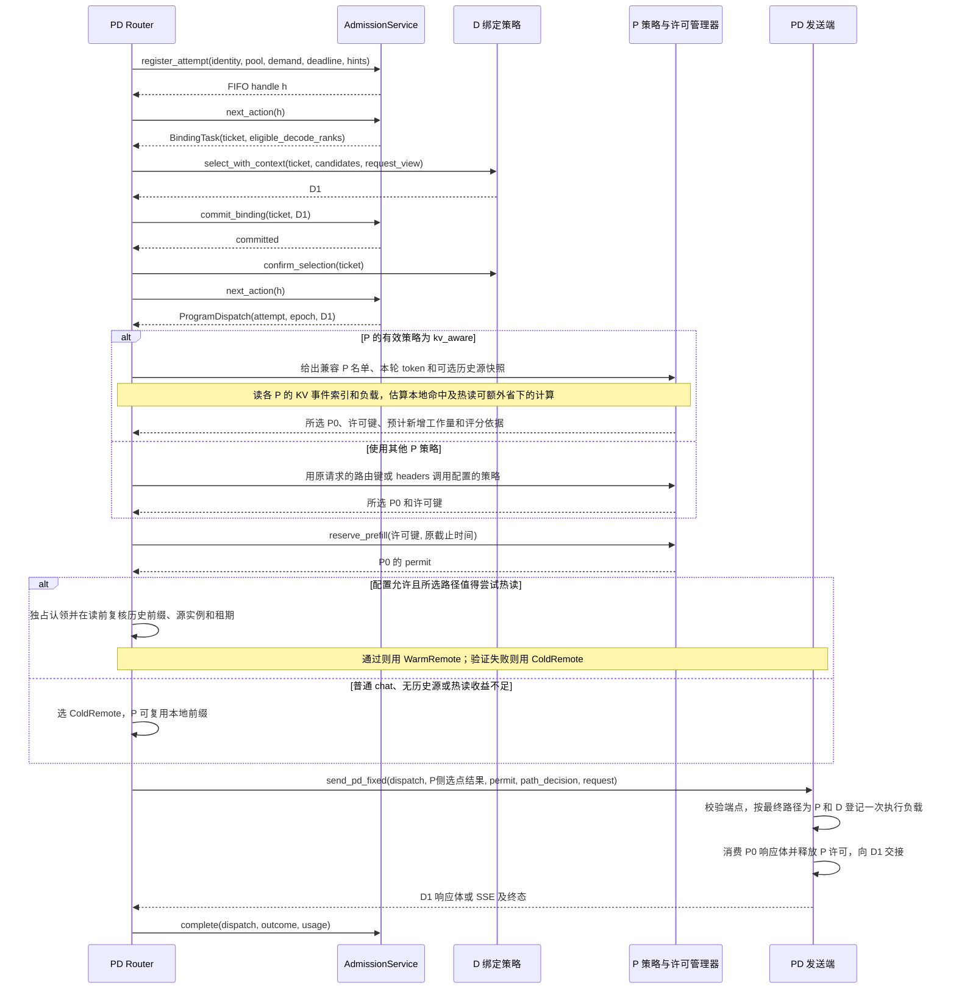

# RFC #634 扩展草案 · Prefill/Decode 分离下的会话准入

**提议的决策**：在 PD 模型池中，把 #634 的会话绑定目标具体化为 **decode 实例的 DP rank（D rank）**。准入模块按本轮需求筛选 D，绑定策略从合格集合选 D，准入模块复核并签发固定 D 的派发凭证。Router 拿到凭证后，再为本轮选择可与 D 协作的 prefill worker（P）、取得 P 并发许可，交给现有 PD 发送端。会话可以在两轮间保留 D 亲和，每轮可以使用不同的 P。

本提案也将 Program 请求接入 P 侧 `--prefill-policy kv_aware`。每一轮都可以根据各 P 已接下的工作和可复用前缀选 P。普通 chat 使用 P 本地 KV 证据；支持跨轮热读的续轮，还会估算从历史 D 多读一段前缀能额外省下多少计算。配置和接口见第 5.1 节。

例如，首轮到达时，D0 有历史前缀但容量已满，D1 有余量。策略只看见 D1，首轮通过 P0→D1 完成。第二轮到达时，若 D1 仍是有效绑定，调度器只在 D1 检查新增需求；即使这轮改由 P1 预填充，也继续发往 D1。若 D1 下线，才用队首的真实需求重新筛选 D。这样可以单独检验两件事：首绑能否避开满载 D，以及跨轮亲和能否改善整个 Program 的完成时间。

## 1. 基线和交付范围

| 依据 | 本扩展采用的部分 |
| --- | --- |
| [RFC #634](https://github.com/vllm-project/router/issues/634)（提案） | 会话身份、每代一条 FIFO、队首选点票据、锁外推荐、锁内提交、固定目标派发、按原尝试结算。原文覆盖单 Router 的混布 HTTP chat。 |
| [PD RFC #376](https://github.com/vllm-project/router/issues/376) | D 跨轮亲和，区分 Program 生命周期、逻辑准入和物理 KV 可读性。以 Program 完成时间（JCT）为主要收益指标，以请求尾延迟和公平性为约束。 |
| [已合入的 #388](https://github.com/vllm-project/router/pull/388) 和 [#461](https://github.com/vllm-project/router/pull/461) | 承接单向 P→D、每个 P 的许可、完整响应结算，以及可选的跨轮 warm read 和 Acting TTL。实现比较固定到 #634 引用的 [Router 快照 0f96d60](https://github.com/vllm-project/router/tree/0f96d605f13b5957eae5f4bb86783cf90a15d68c)。 |

首期面向单 Router、vLLM HTTP PD、完整 Program Scheduling。主入口是 `POST /v1/chat/completions`，验证冷路径。已有的 `/v1/completions` 也要验证冷路径兼容，并用它的 token-ID 请求单独验收可选 warm 路径。按模型池灰度，第一批使用 NIXL。多 Router 共同预留、gRPC、编码器分离和新增 LocalAppend/Store 或 P×D 联合优化放入后续设计。

新语义限于 #634 的会话身份。Router 沿用启用条件，在模型及凭据隔离的 PD 池内，将只有 `session_id=S` 且没有显式 Program 或当前 Agent 身份的请求解析为 `program_id=S`，即使同时有 `task_id`。显式 `program_id=S` 进入同一 FIFO。关闭调度或无身份的请求走原生 PD；显式子 Program 等已有合法身份保留原 PD Program 语义，共用调度器及对应物理 D 的容量账。客户端继续收取一次 HTTP 响应或一条 SSE 流。[#634 身份约定](https://github.com/vllm-project/router/issues/634) · [PD 入口和配置](https://github.com/vllm-project/router/blob/0f96d605f13b5957eae5f4bb86783cf90a15d68c/docs/program_scheduling/pd-program-scheduling.md)

## 2. 模块边界和资源寿命

| 谁持有 | 持有什么 | 何时取得、何时释放 |
| --- | --- | --- |
| `AdmissionService`（复用 `ProgramScheduler`） | 每代的请求 FIFO、当前 D 放置和放置版本、每个 D rank 的逻辑 Program 数与 token 占用、暂停/恢复及 TTL | 登记仅排队。成功提交时写入放置和占用，续轮只核算本轮增量。释放、暂停、迁移和已提交但未派发的取消都由同一把调度锁处理。每个 PD Program 同时至多一轮在途。 |
| Router 和绑定策略 | Router 持有请求视图；策略持有轮询游标、文本亲和等算法状态 | 首绑或失效重绑才评分；成功提交后按票据幂等确认。拓扑移除和实际放置按池有序通知。 |
| PD Router 的 prefill 策略与许可管理器 | 当轮 P、稳定的 P 许可键、该键共用的并发信号量 | 选 P 后等待许可；开始 P 请求前持有，消费完 P 响应体、出错或取消时归还。discovery 展开多个 DP rank 时沿用注册项对应的许可键。 |
| PD 发送端与 `PdLoadManager` | 实际 P/D 的一次执行负载回执 `PdAttempt` | 两端和许可就绪后，固定目标发送为本轮记一笔。选 P 时有可靠估算的请求按预计新增工作量记 P 负载，其余按未知大小记一笔。P body 结束释放 P 负载；D 从 pending 转 active，终态或 Drop 释放。原生负载策略也能看到这些请求。 |
| warm runtime 与引擎 | Router 保存可独占认领的候选及其来源；引擎持有物理 KV、租期和读取反馈 | 上一轮完整成功且证据齐全时可发布；下一轮独占认领，读前重验。执行负载、D 逻辑席位、KV 源租期各有自己的结束条件。 |

已有 PD 入口在 `PdProgramRuntime::acquire` 内解析身份、估算需求并调用 scheduler；`process_program_request` 已按签发的 D 找 worker、按轮选 P 并复用两阶段传输。本次改变 D 的**首次绑定和失效重绑时机**，让 P 等待继承剩余排队预算，并把 warm 分支当前在等 P 前取得的执行回执也推迟到许可就绪时。这样等 P 的时间可以单独观察，执行负载与真正发送的端点一致。[PD 准入入口](https://github.com/vllm-project/router/blob/0f96d605f13b5957eae5f4bb86783cf90a15d68c/src/routers/http/pd_program_adapter.rs#L258-L327) · [PD 编排入口](https://github.com/vllm-project/router/blob/0f96d605f13b5957eae5f4bb86783cf90a15d68c/src/routers/http/vllm_pd_router.rs#L1499-L1681) · [warm 路径的现有记账点](https://github.com/vllm-project/router/blob/0f96d605f13b5957eae5f4bb86783cf90a15d68c/src/routers/http/pd_warm_remote.rs#L824-L841) · [执行负载回执](https://github.com/vllm-project/router/blob/0f96d605f13b5957eae5f4bb86783cf90a15d68c/src/routers/http/pd_types.rs#L391-L444)

## 3. 一轮请求怎样执行

以下是拟议接口。**先确定本轮的 D，再选 P，最后决定是否从上一轮的 D 热读。** 图的上半段画首轮绑定；普通续轮检查原 D 的新增需求后，从领取 `ProgramDispatch` 处接着读。图的下半段展示顺序传输。跨轮热读只适用于第 5 节列出的请求和连接器。

1. **首次绑定。** 按队首请求的实际需求过滤当前池中可达、可执行本轮的 D rank。在线但全满或缺少必要新鲜观测时，保留原 handle、年龄和 deadline；没有可用 D 或所需的 P 池为空时返回 503。存在合格 D 才签发一张票。沿用 #634 的五种绑定策略；`kv_aware` 可独立接入，只在合格 D 中评分。P 前缀命中仅供 P 侧选点，D 复用证据应与 D、模型及请求身份匹配。无可靠 D 证据时在原集合按负载选 D。
2. **提交。** 锁内重查代际、当前 FIFO 队首、票据、截止时间、D 身份/放置版本、最新逻辑占用及观测。一次写入绑定和本轮所需的逻辑占用。丢失竞争的请求留在原 handle，重算或等下一次容量/拓扑变化；没有推荐时也在原期限内等待。轮询按池串行确认，每张已提交票恰好推进一次；落选票不推进。调度锁外执行分词、策略评分、许可等待和网络调用。
3. **续轮和恢复。** 在有效绑定上，普通续轮只查该 D 的增长与排队门槛，不再次调用 D 策略。已暂停者依现有 local/global resume 规则恢复，只有既有全局迁移条件满足时才把席位转移到新 D 并递增放置版本。当前 D 下线且队首待发时，在原 handle 上重走首绑；空闲会话等下一次真实请求。单独移除历史 D 只使其亲和记录和来源候选失效。
4. **P 选择和等待。** 拿到 D 凭证后，以注册表筛选同池、健康、与 D 传输兼容的 P。P 的有效策略为 `kv_aware` 时，按第 5.1 节准备候选级 token 和工作量；其他策略沿用原请求的 routing key、文本或所需 headers。每轮最多一次成功 P 选择，后续 warm→cold 沿用同一 P。评分和等待许可共用原排队期限。例如原排队预算 30 秒，D 已等 24 秒，P 侧选点和等许可合计最多还有 6 秒。这段时间保留 D 逻辑占用；取消、超时或目标下线时收尾。取得许可后再查 P、D 的注册身份与 DP rank。
5. **发送和结算。** 复用 `process_vllm_two_stage_request` 的固定 D 分支。顺序模式消费 P 的交接结果后向该 D 发送；连接器支持并发 push 时，先固定并记账两端，再并发发送，P future 自己归还许可。两种模式均禁止原生 deferred decode selection 在交接时改写 D。直到完整 D body 正常结束（SSE 还须看到成功终止标志）、失败或断流，才用对应 dispatch 结算。排队 deadline 约束等待，已经开始的传输沿用 HTTP 执行超时。[固定或延后选择 D 的分支](https://github.com/vllm-project/router/blob/0f96d605f13b5957eae5f4bb86783cf90a15d68c/src/routers/http/vllm_pd_router.rs#L2200-L2301) · [流结束和取消](https://github.com/vllm-project/router/blob/0f96d605f13b5957eae5f4bb86783cf90a15d68c/src/routers/http/pd_program_adapter.rs#L711-L842)

先取 D 的代价是 P 饱和时会有 D 席位空等。首版选择保留这个等待点：它沿用现有的 P 策略和并发上限，且等 D 的请求不会反过来占着 P。用“已获 D、尚未取得 P”的数量和等待时长判断这项取舍；若它成为主要瓶颈，再单独评估 P 可用性参与 D 预筛或联合选点。

## 4. D 容量和并发提交

从 PD 的既有容量计算中提取无副作用的评估函数，供候选预筛和提交共同调用。输入包括本轮上下文、输出预算（含多 choice 或批量 completions）、D rank 的 token 容量/水位、活动 Program 上限、后端 waiting 阈值、增长预留，以及适用的 P KV 压力保护。首绑直接按新席位核算；续轮抵扣该 Program 已记的额度，暂停恢复再执行恢复条件。PD 的 KV 使用和 waiting 观测须新鲜；forced resume 仅可依现有规则放宽增长预留，仍受 PD 即时 token、Program 数及后端排队门槛约束。[PD 容量判断](https://github.com/vllm-project/router/blob/0f96d605f13b5957eae5f4bb86783cf90a15d68c/src/program_scheduling/scheduler_admission.rs#L738-L850)

按池索引尚未绑定的各 Program 队首。容量、P/D 拓扑或新观测发生变化时，按原有优先级和排队年龄唤醒有限个队首。一个大请求暂时放不下时，继续检查其他 Program 的队首；同一 Program 内保持 FIFO。P 注册变化只更新可协作的 P 集合、对应许可和受影响的等待者；D 注册变化才经 `sync_targets` 更新绑定目标和策略亲和。用注册代际或 registry revision 防止同地址重新注册时消费旧票。

**同一份观测不能重复花掉最后的余量。** 现有 `exclusive_capacity_accounting` 可取观测原生占用和逻辑占用的较大值。当观测值更大时，仅把一个新 Program 加进逻辑总数，较大值可能完全不变。例：低水位为 100 tokens，已观测 80，逻辑占用 0，两个首轮各需 15。在同一观测上，第一笔提交之后，可用余额应从 20 降为 5，第二笔必须等待，即使还没有新的引擎样本。[现有 PD 占用计算](https://github.com/vllm-project/router/blob/0f96d605f13b5957eae5f4bb86783cf90a15d68c/src/program_scheduling/scheduler.rs#L784-L844)

拟在**同一 scheduler 的物理 D rank 账本**上记录按预留标识索引的待对账增量。筛选和提交时，用现有计量口径加上对“尚未计入观测的提交”的保护。对于重叠口径，已知未覆盖的预留应体现在“观测占用 + 未覆盖增量”的下界，并与逻辑总占用取较大值；加和口径下，已进入逻辑总额的增量只计一次。采样开始时记录账本版本，乱序样本丢弃；等待 P 的预留跨采样保留。已撤销的未发送预留可精确撤账，有在途工作的额度在终态对账。混合原生流量下，若聚合样本无法证明覆盖，保留未确认增量到对应预留解除，或采用保守加和口径。不同身份池指向同一物理 D 时也受同一余额约束。

## 5. KV 路径和 Acting TTL

### 5.1 每轮用 KV aware 选择 P

Qwen3.8-27B 的每个 P rank 同时保存注意力 KV 和线性注意力状态。一次续轮只计入两类缓存共同支持的前缀。Router 用引擎事件中的组编号、块哈希和 rank 建索引，再将预计重算的 token 和已排队的工作量一起用于选 P。比如两个 P 都保留了旧代码的注意力 KV，只有 P1 在对应位置保留了可用的线性注意力状态，就只有 P1 可以获得这一段的完整复用分。实验使用 HTTP NIXL，D 的 Program 绑定策略固定为 `consistent_hash`，普通请求的 D 策略设为 `round_robin`。两组都关闭跨轮热读、LocalAppend 和自动 TTL。

**配置。** 在已有 Program PD 配置上设置 `--prefill-policy kv_aware` 即选用该策略；未显式设置 P 策略时，沿用既有的 `--policy` 继承规则。D 首绑和失效重绑仍由 Program 的 `binding_strategy` 控制。例如可保留 D 的 `consistent_hash`，只在 P 侧打开 KV 感知。P 本地缓存评分也可用于首轮及关闭 `pd.warm_remote` 的部署。[PD 策略的配置优先级](https://github.com/vllm-project/router/blob/0f96d605f13b5957eae5f4bb86783cf90a15d68c/src/config/types.rs#L1090-L1108)

**接口改动。** 基线的 `select_program_prefill_index` 走文本、headers 通用接口，返回一个候选下标；该入口调用 `kv_aware` 时没有传入 token ID。基线的 `admit_bound` 又把实际发往 P 的请求一律记为大小未知。拟将下列改动接在领取 D 凭证之后，直接复用原生 PD 的 P 阶段实现。[Program 选 P 入口](https://github.com/vllm-project/router/blob/0f96d605f13b5957eae5f4bb86783cf90a15d68c/src/routers/http/vllm_pd_router.rs#L1754-L1785) · [通用 KV 入口](https://github.com/vllm-project/router/blob/0f96d605f13b5957eae5f4bb86783cf90a15d68c/src/policies/kv_aware.rs#L1795-L1803) · [固定目标记账入口](https://github.com/vllm-project/router/blob/0f96d605f13b5957eae5f4bb86783cf90a15d68c/src/routers/http/pd_types.rs#L391-L444)

| 环节 | 输入和结果 |
| --- | --- |
| 准备候选 | Router 持续订阅 P 引擎的 KV 事件。锁外按本轮请求在各候选 P 的模板和分词结果准备 token，逐个实例、DP rank 查询匹配前缀。按原生 PD 的模型、适配器和缓存隔离条件验证证据。索引过期或身份无法验证时，该 P 的本地覆盖按零估算。 |
| 比较并返回 | 复用 P 的 `estimate_prefill_work` 和 `pick_prefill`。以 `StageDecision` 携带所选 endpoint、预计新增计算量及回退原因，随选中 worker 返回其稳定许可键；另保留本地覆盖与远端额外覆盖，供读前复核。任一候选的输入长度或在途工作量无法用 token 比较时，整组改按负载比较。评分时仅读取负载和候选快照。 |
| 发送与释放 | 扩展 `admit_bound`，让它接收最终 P 决策及已获准的 D。许可就绪、发送前复核路径后登记预计新增的 P 工作量。若已发送的热读需要冷重试，在原 `PdAttempt` 上调整 P 的工作量差额，P 结束时退还最新账面值一次。D 的逻辑额度仍按本轮需求计算。 |

原生 PD 已提供按候选准备工作量和按成本选择 P 的基础，可分别提取其 P 侧部分。[原生 P 工作量准备](https://github.com/vllm-project/router/blob/0f96d605f13b5957eae5f4bb86783cf90a15d68c/src/routers/http/pd_kv_state.rs#L613-L686) · [P 评分与回退](https://github.com/vllm-project/router/blob/0f96d605f13b5957eae5f4bb86783cf90a15d68c/src/routers/http/pd_router.rs#L253-L321)

### 5.2 本地命中与跨轮热读

**选 P 时预估，发送前确认。** 第一版用 token 计量。对本轮输入的同一连续前缀，将匹配的完整块换算成 token 并截断到输入长度。对每个 P，取其本地覆盖量 L，再取本轮历史 D 源能够向这个 P 提供的覆盖量 H。仅在协议兼容、源元数据有效且开启热读时估算远端贡献。额外可省量为 `max(0, H − L)`；为零、证据不足或低于实测门槛时按零计。按“该 P 已接下的工作量 + 本轮输入长度 − L − 额外可省量”比较候选，评分仅读候选快照。确定 P 后，在发送前独占认领并复核源、租期、前缀及 P 实例。冷回退时按最新本地覆盖量更正同一请求的工作量回执。两条路径最终都交给本轮已获准的 D。

**同一会话的两轮。** 设首轮两台 P 都缺这段前缀，P0 手头工作较少，选中 P0 并向 D1 交接。第二轮仍由 D1 接手。假设此时两台 P 的事件索引和负载如下，本轮共 400 个 token；同一前缀的历史 D 源可供两台 P 读到第 300 个 token。下表用确定性最低成本选择说明热读何时会改变本轮的 P。

| 第二轮候选 | 已接工作量（token） | 本地前缀（token） | 只用本地时的总工作量 | 热读可用且值得传输时的总工作量 |
| --- | ---: | ---: | ---: | ---: |
| P0 | 60 | 300 | 60 + 100 = 160 | 60 + 100 = 160，本地已覆盖历史源全部前缀 |
| P1 | 0 | 200 | 0 + 200 = 200 | 0 + 100 = 100，历史源可再补 100 |

只用本地缓存时选 P0；允许热读且额外收益达到门槛时选 P1。两种结果都发往 D1。少算的 100 个 token 是本轮计算预估，传输量及实际命中由执行反馈给出。

**本轮工作量与 P 本地驻留分别对账。** 引擎的本地命中、外读和计算反馈用于核对本轮估算。其他请求要给同一 P 计入新增的本地前缀，必须已经有对应实例、rank 和块的可信驻留证据。收到块移除或全清事件时撤销相应覆盖；事件有缺口或实例重启时停止给受影响的记录计收益，等索引恢复。即便本轮热读成功，也不会仅凭请求反馈给下一轮虚增 P 本地缓存。使用已有连接器传 KV，并沿用已有事件协议；无法验证驻留的部署走保守回退。

| 路径 | 执行条件与行为 |
| --- | --- |
| **ColdRemote**（chat 首期） | P 完成本轮所需预填充，沿现有连接器把本轮 KV 交给授权的 D。P 自己的前缀缓存可以命中。即使上轮也在这个 D，仍按冷路径可执行的需求做准入。 |
| **WarmRemote**（可选） | 对符合现有协议的 token-ID `/v1/completions`，要求 `return_token_ids=true`、单 prompt、`n=best_of=1`，流式还需 `stream_options.include_usage=true`。使用具备相应能力的静态 NIXL 端点。已验证的历史 D 源可供本轮 P 读取匹配的 prompt 前缀，P 计算剩余部分后向获准的 D 交接。普通 chat、不能验证实例代际的服务发现或协议不匹配走 ColdRemote。 |

上一轮完整成功后才可发布候选，需要核对引擎来源、协议、有效期、实际 token 和使用量。下一轮独占认领，校验池/Program 代际、产生它的尝试与放置版本、相同语义身份、精确 token 前缀、引擎实例 epoch 和剩余租期；等待 P 后在读前再验。首期约定迁移或重绑后以冷路径建立新来源。KV 事件和策略预测只辅助评分或失效处理，实际外部读取量来自引擎反馈，和 P 本地命中分别统计。交接地址和 block ID 仅取自注册引擎。[WarmRemote 实现](https://github.com/vllm-project/router/blob/0f96d605f13b5957eae5f4bb86783cf90a15d68c/src/routers/http/pd_warm_remote.rs)

Acting TTL 表示工具调用期间可以保留 D 的**逻辑席位**。完整 D 响应成功且没有待发或在途续轮时，才按现有显式/自动 TTL 配置进入 Acting；TTL 到期释放活动额度并进入 Paused，后续仍可在原 D 重新准入。基于源 KV 收益计算的自动 TTL 还受剩余源租期、裕量和 `max_acting_ttl_seconds` 限制。源先失效时放弃 warm 读取，单独按调度器的席位状态判断续轮；P body 结束或 D 首 token 都不能启动工具间隙计时。[PD TTL 结算](https://github.com/vllm-project/router/blob/0f96d605f13b5957eae5f4bb86783cf90a15d68c/src/program_scheduling/scheduler_lifecycle.rs)

### 5.3 分支实现与配置

本次实现对应第 5.1、5.2 节。分支 `experiment/pd-program-kv-aware` 从 `experiment/router-program-admission` 的 `65f704a` 建立。部署中可以沿用 D 的 `binding_strategy: consistent_hash`，给 P 指定 `--prefill-policy kv_aware`。第 4 节的 D 容量账本属于单独的实施项。

首轮拿到 D 的派发凭证后，Router 查每台合格 P 上与本轮输入连续匹配的设备 KV 块，算出本轮还要做的工作，加上该 P 已接下的 token 工作量。续轮重新比较 P。配置了静态、双向 NIXL 和反馈协议，且请求是精确 token ID 的 completions 时，Router 还会估算历史 D 能补上多少。默认至少多省一个 token 才计收益，部署可通过 `pd.warm_min_extra_tokens` 提高门槛。配置了时间校准表且命中表项时，还会比较传输与冷算时间。设置门槛的单位是 token。

选定 P 后，Router 沿用本轮剩余排队时间申请该 P 的并发许可。命中估算随发送前的最新索引更新。源失效或热读失败时，冷路径沿用这台 P，在同一份回执上更正工作量。测试用 400 个输入 token 复现了第 5.2 节的两个选择，并核对热读撤回后 P、D 计数都能归零。

## 6. 失败和重试契约

| 触发点 | 对客户端和内部状态的处理 |
| --- | --- |
| 排队、选点、提交后尚未领取 dispatch | 非法身份返回 400；D 暂满直至原期限返回 429。队首取消只删除该请求；若已提交，撤销未消费的预留。后继按自己的需求重查。D 票据按其提交结果去重。 |
| 已领 D dispatch，尚在等 P | P 许可等到原期限返回 429。P/D 指定实例消失或没有可用的兼容 P，终止本次 dispatch 并返回 503；若只是 P 消失，保留健康 D 的亲和。归还已取资源并唤醒队列。D 下线则使放置失效，后续按新一轮的需求重绑。 |
| P 已完成，D 未接手或传输失败 | 归还 P 许可，关闭本次交接并按现有 connector 契约释放或等待源元数据到期。旧传输参数绑定原尝试和目标，不能转用于另一个 D。按现有 HTTP 路径返回上游拒绝；保留该路径的状态、响应体及适用响应头。 |
| Warm 候选过期，或真正 warm read 失败 | 发送前发现不可用，直接用已选 P/D 冷执行。已经尝试 warm read，只有其 5xx/传输失败且尚未向客户端输出时可冷重试一次：用 `restart_pd_attempt` 原子重查 D 容量与放置，换新的 attempt/传输 ID，清除旧读参数，沿用同一 P 及受保护的许可。原有逻辑额度与执行负载各只有一份。普通上游 4xx/429 不触发该重试。 |
| D 已输出、SSE 中断、旧回调或重复完成 | 已输出后不再拼接重放。按原凭证一次性结算成功、失败或取消；未完整成功的轮次不发布候选。旧 attempt 的迟到事件只能收尾自身持有的资源，不能释放新代席位、启动新 TTL 或覆盖新候选。 |

## 7. 实施与验收

1. **抽取与对齐。** 让 PD adapter 向 #634 的同一个准入核心登记。先固定候选、策略、到达顺序、时钟和观测，回放现有 PD Program；对照每轮 D、FIFO、P 策略输入、许可释放点、worker 负载和 SSE 字节。保留 PD 的配置校验，包括每 D rank 的 token 容量、正的 P 并发上限，以及对 `binding_only` 和未经校准的 batch gain 的限制。[现有 PD 配置校验](https://github.com/vllm-project/router/blob/0f96d605f13b5957eae5f4bb86783cf90a15d68c/src/config/validation.rs#L713-L771)
2. **启用冷路径的新语义。** 接入 D 候选预筛、票据原子提交、按需重绑和端到端排队期限。固定 D 策略、关闭热读，单独验证 P 的 `kv_aware` 选点和发送时的 P 工作量记账。以可控时钟覆盖下表，在真实传输上分别跑顺序 pull 与受支持的并发 push；静态和服务发现各测一次 DP rank 定向。
3. **接回可选 warm/TTL 并灰度。** 分开开关验证 cold、warm、warm 加自动 TTL，按池逐步切流。切换和回退均在代际边界进行，旧 `S:lead` 先排空；停止发旧票，原 dispatch 由原所有者结算，受影响的 warm 候选失效。原路径与新路径共用物理容量约束，单个尝试和拓扑事件始终只有一个处理者。

| 必测场景 | 可以直接断言的结果 |
| --- | --- |
| 1P2D，D0 热且满、D1 可用；其后 D1 满但仍在线 | 首绑策略只看到 D1。默认硬亲和的普通续轮等待 D1，D 策略调用数为零。P 选择次数按轮计。 |
| 2P1D，禁用热读，P 使用 `kv_aware`，D 使用 `consistent_hash` | 预热指定 P 的已验证前缀。等负载、确定性选点时选中该 P，派发后核对引擎实际报告的本地命中；提高该 P 的在途工作量，使另一台总成本更低，预期选择随之变化。D 始终为同一 rank。输入或在途工作量未知时，断言同组按负载选择。 |
| 两个 P 负载相近；某个 P 本地覆盖 200，历史 D 覆盖同一前缀 300，本轮长 400 | 固定 D。开关热读时该 P 的预计新增工作量分别为 100（可读且达到门槛）和 200（关闭）。提交评分后模拟源过期、P 全清、事件延迟及热读成功但未发布驻留事件：本轮按实际路径对账，下轮只认已确认驻留。覆盖完全重叠时走本地，回退沿用已选 P。 |
| 同会话 A1/A2 并发，另一会话 B1 同时争最后余额 | 同代最多一张活票、一个在途 turn；A2 不越过 A1。固定 D 观测，能容纳一笔时只有一次提交；新观测尚未覆盖也不能再花同一笔。取消 A1 后用 A2 自己的需求复核。 |
| D 已获准、P 许可耗尽或 P 在等待期间退出 | 超时走原截止时间；P 退出及时结束。等待期间执行回执为零，取消后 D 额度可用。在另一轮 D 仍流式输出期间，已完成 prefill 的 P 可服务下一轮**其他 Program**。 |
| 待发、空闲和在途时移除 D；相同 URL 重启 | 待发者保序重绑，空闲者等实际请求；在途者按旧凭证收尾。旧源 epoch 的 KV 不可读，旧完成事件不能改变新放置。 |
| Warm 前缀改写、租期届满、真实读失败、普通后端 429、SSE 输出后断流 | 分别观测直接冷执行、至多一次经重查的冷重试、透传后端拒绝和断流结算。所有分支均无重复 P 选点、无许可泄漏、无半截流发布候选。 |
| 混合原生与 Program 流量、TTL 到期、global resume | 原生负载端能看到 Program 实际 P/D 工作；逻辑席位、执行负载、KV 候选各自对账。新进入会话、子 Program 和长工具间隙会话都纳入公平性统计。 |

性能对照设三组：A 为原生按请求 PD，B 为现有 PD Program（先绑定），C 为本提案的容量优先冷路径。**C 对 B** 衡量本次重构的增量，**B 对 A** 衡量既有 PD Program 整体效果；warm 和 TTL 另做同配置消融。固定模型、引擎、工作量、到达与工具间隙、token 数及缓存初态，交错重复。在 1P2D 的 D 压力和多 P 的 P 压力两类负载下，报告相同完成工作量的 Program JCT 均值和 p95/p99、端到端 TTFT、TPOT、吞吐、429/503 和新会话最长等待。拆分 D 准入等待、已获 D 后等 P 许可、P 服务、交接及 D 执行；区分选 warm、P 本地命中、实际外读和冷回退。

单独衡量选 P 的收益时，使用至少两个 P，固定 D 放置、TTL 和 P 并发上限。先在关闭热读时对照原 P 策略与 P 侧 `kv_aware`，再固定 P 侧 `kv_aware` 比较热读开关。按轮记录 P 选点耗时、许可等待、预计新增计算量，以及引擎可提供的本地命中、外读和实际计算量；缺失的反馈标为未知。将这些数据与端到端 TTFT、Program JCT 对照，判断省下的计算是否抵得上排队和传输时间。

上线门槛是上述状态断言全部通过，并在同等成功率和吞吐下满足部署既定的 JCT、公平性及请求延迟 SLO。D 准入和长期负载的 C 对 B 对照仍待验证。以下实验单独检验本分支的 P 选点和跨轮热读。

## 8. P 侧实现的验证

代码基线为 `65f704a`。P 选点和工作量记账见 `76c1b67`，真实 HTTP 响应结束时的结算修复见 `6819a04`。在固定长度响应上，HTTP 服务端有时在发完最后一块数据后直接释放响应体，Router 因此错过首次登记 D 历史 KV 的机会。分支让跟踪响应的服务端读到流结束，再结算和发布 KV。针对同一个会话的真实 HTTP 回归用例在修复前失败，修复后通过。

三台独立的 vLLM 进程各用一张 H20，两台 P、一台 D，Qwen3-0.6B，vLLM 0.28.0，NIXL，TP=1，KV 块大小为 16。测试交替预热 P0 和 P1，D 用 `consistent_hash`，每个配置发 6 个会话、每会话 2 轮。逐轮核对 Router 的 P、D 派发计数、Program 准入计数及引擎返回的缓存 token 数。热读对照在首轮和第二轮之间清除两台 P 的本地前缀缓存，保留 D 的历史 KV。引擎反馈扩展从通过源码哈希校验的 vLLM 0.28.0 文件生成。

最终 SLURM 作业 `18133` 在 `vllm-sgp-h20-02` 完成，退出码 0。Linux Router 由作业 `18132` 构建，二进制 SHA-256 为 `49cf7987bdac1fb5fc6ff59b1d6b39779536bbe2701b398a360583f7c96dd4b0`。D 引擎和 Router 均配置每 rank 65,536 个 KV token。下表为关闭跨轮热读时的结果。

| 接口 | P 策略 | 选中预热 P 的轮数 | 引擎返回的缓存 token 合计 |
| --- | --- | ---: | ---: |
| token-ID completions | 轮询 | 6 / 12 | 3,072 |
| token-ID completions | KV aware | 12 / 12 | 6,144 |
| chat completions | 轮询 | 6 / 12 | 2,592 |
| chat completions | KV aware | 12 / 12 | 5,184 |

热读开关各测了 6 个两轮会话。清除两台 P 的本地缓存后，关闭热读的 6 次续轮返回的缓存量均为 0。开启热读后，6 次续轮均由 P 报告成功从 D 外读，Router 记录了 6 次历史源认领和 6 次 `warm_external_read`。热读路径的最终 usage 由 D 返回，外读次数取自 P 的传输反馈。作业共完成 72 次 Program 请求。这组串行小样本检验选点、缓存命中及跨卡读取，生产并发下的吞吐、JCT 和尾延迟需用业务负载另测。

本地 `cpu,ready` 配置下通过 1,507 项库测试、10 项 PD Program 集成测试和 22 项热读集成测试，3 项库测试按原有标记跳过。热读回退、源实例重启和工作量回执释放另有确定性回归用例。复现实验时，向脚本提供两台 P 的事件与 replay 地址、实际 D 容量以及与后端一致的布局。`--chat` 验证服务端模板渲染，`--verify-warm` 验证支持反馈协议的 token-ID 续轮。[逐轮数据](pd-program-prefill-h20.csv) · [实验脚本](../../scripts/bench_pd_program_prefill.py)

### 8.1 Qwen3.8-27B 的 AgentX 多轮回放

作业 `18222` 在同一台 8 卡 NVIDIA H20-3e 上运行 Qwen3.8-27B BF16、vLLM 0.29.0 和 NIXL。2 个 P 服务和 2 个 D 服务各使用 DP=2、TP=1。四个 P rank 的实际事件均显示第 0–2 组为线性注意力状态，第 3 组为全注意力 KV，各组块大小均为 784 token。每个 rank 先直接执行一次预热请求，使引擎公布真实准入指标，然后在每组回放前重置全部服务的前缀缓存。两组使用同一个 Router 二进制，先测 P 侧 `kv_aware`，再测 P 侧 `round_robin`。D 绑定、并发上限和热读开关相同。

AgentInfer 使用 `replay --trace-type agentX` 和 token-ID completions。从 393 个原始会话中，取在 256k 版本中请求签名保持一致、单请求输入加输出不超过 65,536 token、含 2–30 个请求、原始用时不超过 2 小时的全部完整会话。入选 4 个会话、5 个 Program，共 96 次请求。回放并发为 4，同一 agent 的等待间隔缩为原来的 5%。两组各完成 96/96 次，逐条核对请求 ID 及实际输入、输出长度一致，每组共 3,845,568 个输入 token 和 27,240 个输出 token。

| 指标 | P 轮询 | P KV aware | 变化 |
| --- | ---: | ---: | ---: |
| P 本地前缀命中率 | 74.90% | 91.36% | +16.45 个百分点 |
| P 实际重算的 token | 965,056 | 332,368 | −65.56% |
| 平均首 token 时间 | 6.02 秒 | 2.97 秒 | −50.59% |
| P95 首 token 时间 | 21.90 秒 | 12.87 秒 | −41.21% |
| 平均会话完成时间 | 528.60 秒 | 457.69 秒 | −13.41% |
| 整轮输出吞吐 | 37.11 token/秒 | 39.69 token/秒 | +6.94% |

命中率按四个 P rank 的引擎命中 token 总数除以查询 token 总数计算。重算量取 P 引擎处理的输入 token 减去本地缓存 token。KV aware 组 96 次选点均记录为 `prefix_cost`。P 的请求分布从 24/24/24/24 变为 5/20/42/29，D 的分布两组均为 0/22/21/53。四个会话从首个请求发出到末轮返回的时间都缩短了。整条请求的 P95 从 51.52 秒变为 51.29 秒，改善主要体现在首 token 和会话完成时间。

这次对照覆盖一个固定小样本和一个并发档位。两组均关闭从 D 远程热读，使用同一个 dev 构建。独立轮询作业 `18219` 也完成了 96 次请求，其 P 本地命中率为 73.38%。模型修订、工作负载指纹、逐 rank 计数和逐会话数据见[实测记录](pd-program-prefill-agentx-h20.json)。

本次改动在 Linux 通过 1,507 项库测试，3 项按标记跳过。macOS 通过 10 项 PD Program 和 22 项热读集成测试。macOS 上的库测试有 1 项模拟断连失败，在改动前的提交 `2d908b3` 上也复现了同一失败。
