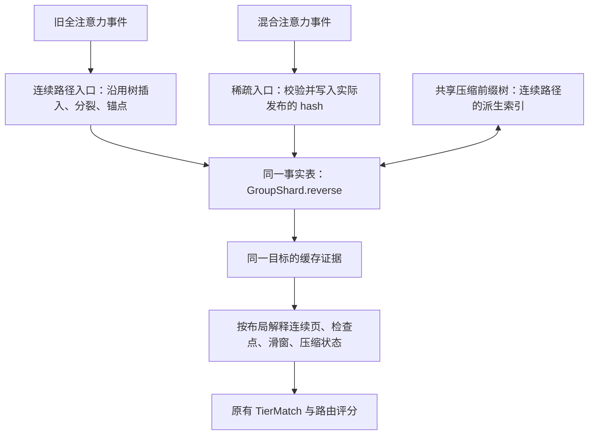
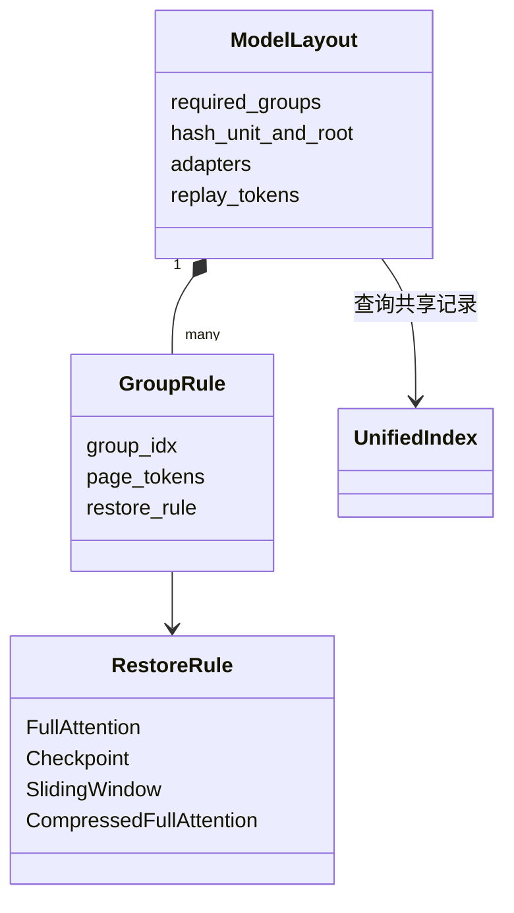
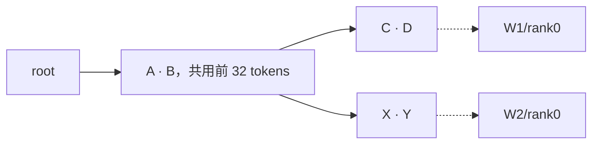
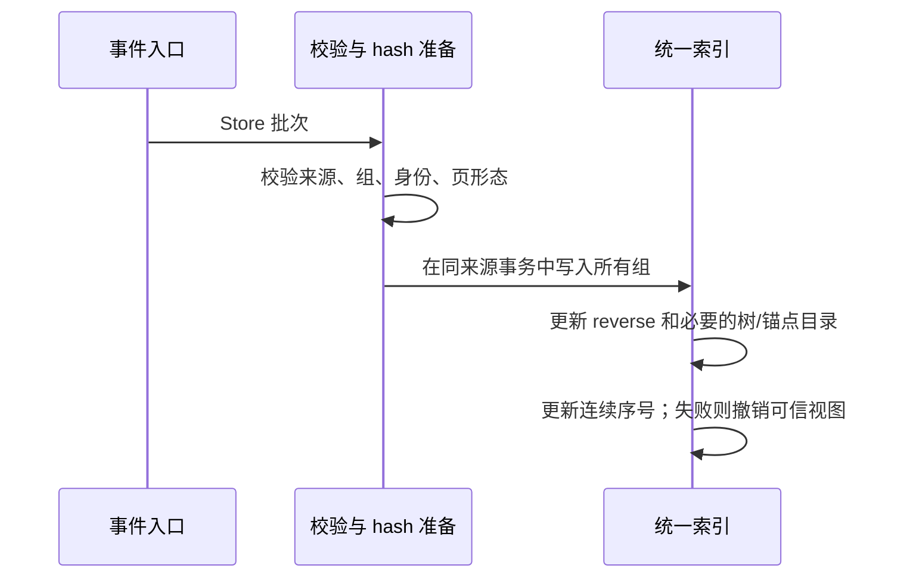
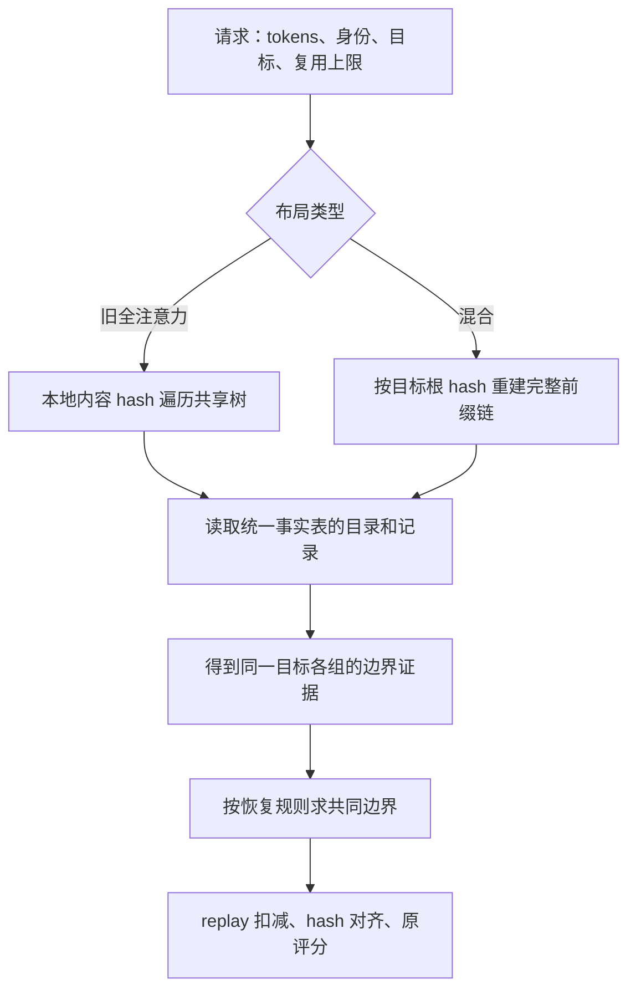
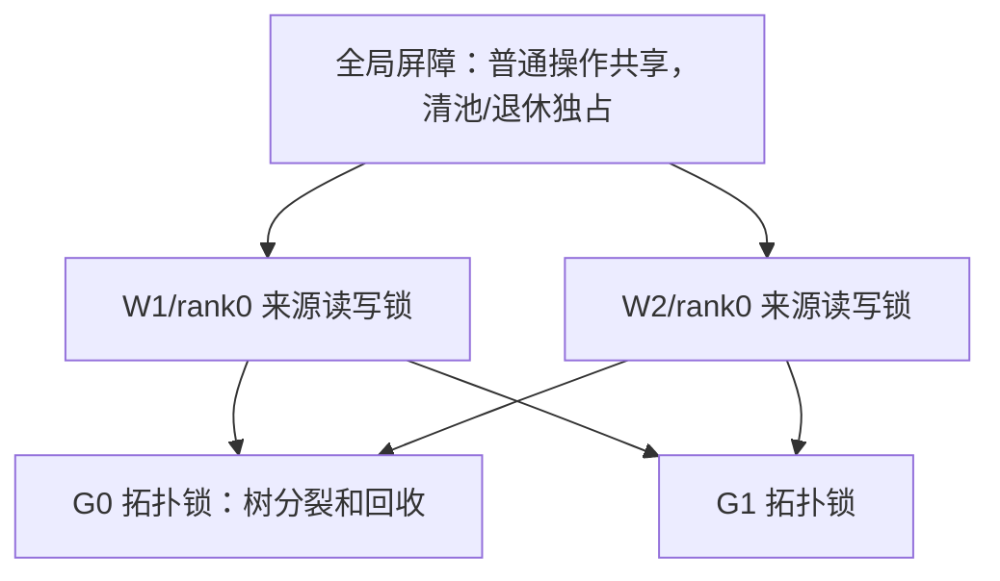
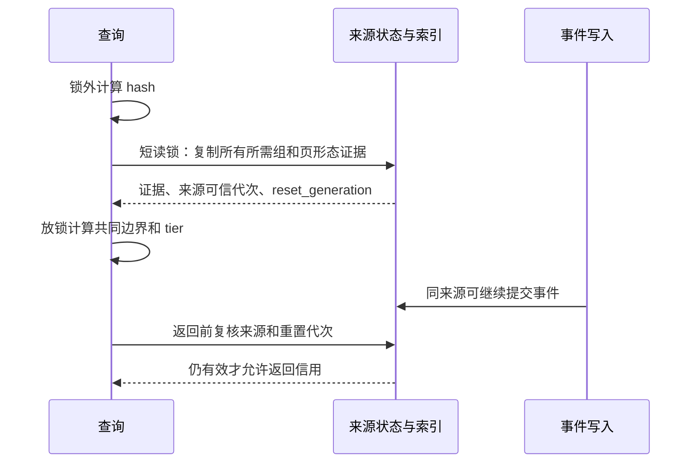
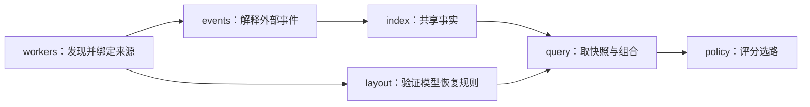

# RFC：用一套 KV 索引支持全注意力与多种混合注意力模型

对应讨论：[Issue #489](https://github.com/vllm-project/router/issues/489) · 实现评审：[PR #493](https://github.com/vllm-project/router/pull/493)

## 1. 设计要解决什么

**不同模型用不同缓存状态恢复前缀，但不需要为每个模型维护一套索引。** 本方案把模型差异表达为“缓存组及其恢复规则”，让旧全注意力与混合注意力共用一份缓存记录。旧前缀树保留，继续加速连续内容路径的查找。

Router 保存缓存位置的元数据，实际 KV 张量仍在引擎中。它要回答的是：**同一个 worker/rank 的哪些状态，能共同恢复这个请求的多长前缀？**

先看三个模型布局。每格代表 16 tokens，字母表示已缓存的状态：

```text
前缀边界             16    32    48    64

全注意力模型
  G0 连续 KV          A     B     C     D    → 连续覆盖到 64

混合模型甲
  G0 连续 KV          A     B     C     D
  G1 检查点            ·    M32    ·    M64   → 两组都支持 64

混合模型乙
  G0 压缩状态          按声明的比例、页面和对齐规则恢复
  G1 滑动窗口          只保留恢复边界所需的末尾窗口
```

混合模型不能只看 G0。例如甲删除 M64 后，即使 A–D 全在，也只能使用 M32 对应的 32-token 边界。

| 名词 | 本文含义 |
|---|---|
| worker / rank | 可派发的引擎实例及其 **数据并行 DP rank**。TP rank 不自动等于独立路由目标。 |
| group，简称组 | 必须按独立规则检查的一类缓存，例如连续 KV、检查点或滑窗状态。 |
| 物理页 | 引擎管理缓存的单位，可能覆盖多个 hash 单元。 |
| 内容 hash / 前缀 hash | 前者标识一个内容块；后者标识从起点到某个边界的完整前缀。两者用途不同。 |

## 2. 怎样与旧全注意力结构融合

融合点是旧索引的**缓存记录层**，而不是强行把所有检查点补成一棵连续树。



- 旧全注意力保留按本地内容 hash 遍历共享树的能力，包括可验证的旧 hash/parent 语义。
- 混合模型按该来源可重建的前缀 hash 查询同一事实表；检查点没有父路径时不编造祖先。
- 两个入口共用存储、删除、来源隔离和生命周期；不再维护 hybrid 的第二份驻留集合。

**统一的是事实与操作，不要求所有模型使用相同的查询算法。** 连续树适合一次收集多个目标；稀疏 hash 适合不连续检查点和真实部分页。

## 3. 模型差异放在哪里

每个已验证布局描述：需要哪些组、每组的页大小、恢复规则，以及全局 replay 扣减。索引本身不判断模型名称。



图中的 `ModelLayout` 是布局概念；代码对应 `HybridCapabilities`、`HybridEventGroup` 与 `HybridGroupKind`，不额外新增同名对象。

| 恢复规则 | 需要的证据 | 不能做什么 |
|---|---|---|
| 连续全注意力 | 从起点到边界的连续页；尾部按已验证的部分页规则处理 | 中间缺页时跳过去 |
| 检查点 | 选中边界本身的检查点 | 用 64 的检查点冒充 48 的检查点 |
| 滑动窗口 | 该边界所需的尾部窗口，含引擎的起点和对齐语义 | 只取最大的单个 hash |
| 压缩全注意力 | 连续状态、每状态覆盖 token 数及其对齐 | 把压缩状态数当成普通 token 数 |
| 有界重建 | 引擎允许从其他组重建，最终信用扣除 replay 窗口 | 省略重建成本 |
| 请求私有 scratch | 经明确验证后不参与可共享缓存判断 | 因为没事件就认定可忽略 |

模型通过组合这些规则接入。下表是需要覆盖的配置类型，**具体 group 编号和参数以真实引擎配置为准**：

| 模型范围 | 布局需要表达的内容 |
|---|---|
| 原有全注意力模型 | 连续路径、parent、分层缓存和旧评分 |
| Qwen3.5 / 3.6 / 3.8 | 全注意力 + Mamba 检查点；支持相应引擎发布的部分页 |
| Qwen4 / Qwen4Exp | 检查点、MLA/压缩状态，以及经验证可排除的 scratch 组 |
| DeepSeek V4 Flash / Pro | MLA、滑窗、不同组页大小与实际压缩参数 |
| DeepSeek V4.1 Flash | 可寻址缓存组 + 未发布状态的有界重建及 replay 扣减 |
| 后续混合模型 | 优先组合已有规则；出现新恢复语义时增加规则及引擎对照用例 |

不能按家族名称硬编码页大小，也不能从“目前观察到几个组”推导“总共只有几个组”。如果某组不发事件，仍必须在布局中说明它是必需、可重建，还是不可共享。

## 4. 一套索引到底保存什么

### 4.1 不是一个 worker/rank 一棵树

当前共享索引按 `CacheKey(model, hash_mode, block_size)` 创建；在这个容器里，**每个 group 最多一棵内容树，多个 worker/rank 共享路径**。具体来源的布局、根 hash、身份与可恢复性仍分别验证；共享容器不等于权重或恢复契约已经兼容。

```text
KvBlockIndexer：共享容器
├── G0：一棵内容树 + 本组缓存记录
├── G1：一棵可选内容树 + 本组缓存记录
└── 来源锁、可信状态与清理目录

W1/rank0 ─┐
W1/rank1 ─┼── 共用容器；每条缓存记录仍区分持有者
W2/rank0 ─┤
W2/rank1 ─┘
```

混合事件可以只产生表记录，树根下没有对应路径。这样无需为稀疏检查点再养一棵“混合专用树”。模型、权重、LoRA、salt 等身份必须由请求准入和来源契约正确隔离，不能只凭同名模型或同值 hash 授予信用。

### 4.2 真实的记录结构

下面按现有代码简化类型，保留真实字段名；不是另一套待实现的 `CacheRecord` 结构。

```rust
struct KvBlockIndexer {
    shards: Map<GroupId, GroupShard>,
    source_locks, suspended_sources, domain,
    sparse_namespaces, sparse_counts,
}

struct GroupShard {
    root: TreeNode,
    reverse: Map<(ResidencyOwner, StorageTier), Set<HashKey>>,
    scoped_anchors: Map<EngineHash, Map<RoutableTarget, Anchor>>,
    topology,
}

struct TreeNode {
    edge,       // 一段连续内容块及来源限定的历史 hash 别名
    claims,     // 每块的 owner/tier 查找目录，由 reverse 派生
    children,   // 下一段按首块内容 hash 寻址
}

struct Anchor { node, offset } // 指向压缩边中的具体块
```

`reverse` 虽沿用旧名字，现在就是唯一的缓存观察事实表。它按持有者归集 hash，适合来源清理；不是另有一个逐块记录对象再由它引用。

| 字段 | 保存什么 | 为什么需要 |
|---|---|---|
| `shards` | `组号 → 本组树和表` | 同一个前缀 hash 在 G0、G1 可独立删除 |
| `reverse` | `(持有者, 存储层) → hash 集合` | 判断该持有者是否有该项观察；按 owner 清理 |
| `root / edge / children` | 共享的内容路径 | 一次遍历收集连续前缀，复用旧树 |
| `claims` | 树上每块对应的 owner/tier 目录 | 遍历时直接得到目标；与事实表在同一事务维护 |
| `scoped_anchors` | `引擎 hash + 来源 → 树位置` | 仅有 parent/hash 的后续事件可定位；分裂时迁移位置 |
| `source_locks` | 每个 worker/DP rank 的读写锁与可信代次 | 同来源跨组原子提交，不把所有 worker 串行化 |
| `domain` | 全局读写屏障 | 普通操作共享；全池清理、退休时独占 |
| `sparse_namespaces` | owner 发布过哪些 LoRA 名称 | 删除事件缺少名称时，限定范围寻找相同 hash |
| `sparse_counts` | 可重算的容量计数 | 准入预算；不是物理副本计数 |

### 4.3 一条记录怎样区分 W1 和 W2

例如 G0 中：

```text
reverse[(Worker{source=W1, dp_rank=0, incarnation=7}, GPU)]
    = {h1, h2, h3, h4}

reverse[(Worker{source=W1, dp_rank=1, incarnation=8}, GPU)]
    = {h1, h2}
```

| 部分 | 本例 | 作用 |
|---|---|---|
| `source` | W1 | 谁发布这条观察 |
| `dp_rank` | 0 | 该 worker 的哪个独立 DP 缓存 |
| `incarnation` | 7 | Router 本地订阅生命周期，隔离旧清理；不是引擎认证 epoch |
| `StorageTier` | GPU | 删除 GPU 时不顺带删 CPU/Disk |
| 所在 `GroupShard` | G0 | 不与 G1 的同值 hash 混用 |
| `HashKey` | h2 | 经类型区分、必要时带 LoRA 命名空间的前缀编号 |

共享池使用另一种 owner：`CacheOwner{pool_id, source, dp_rank}`，保留池与发布者归属。不能因为某个 worker 重启，就推断池中数据已经消失；也不能自动授予其他 worker 访问资格。

## 5. 插入：旧树如何继续复用

先看全注意力入口。每块 16 tokens，W1/rank0 写入 A–D，W2/rank0 写入 A、B、X、Y。A–D 是内容块编号；h1–h4 是 W1 的前缀编号，x3、x4 属于分支前缀。



| 步骤 | 树的变化 | 事实表变化 |
|---|---|---|
| 初始 | 只有 root | 空 |
| W1/rank0 Store A–D | `root → [A B C D]` | G0/W1/rank0/GPU 加 h1–h4 |
| W2/rank0 Store A B X Y | 在 B 后分裂为 `[A B] → [C D] / [X Y]` | G0/W2/rank0/GPU 加 h1、h2、x3、x4 |
| W1/rank1 Store A B | 不复制 A B | 该 rank 独立加 h1、h2 |
| W2/rank1 Store A B | 不复制 A B | 该 rank 独立加 h1、h2 |

压缩边分裂时，`Anchor.node + offset` 一起迁移。删除或分裂不能让 h2 错指 C/D，也不能把某来源的整数 parent 借给另一来源。

混合入口写入 G0 页、G1 检查点时，更新的仍是各组同一个 `reverse`。已知可信路径时可维护树目录；未知路径时直接保留稀疏记录，查询通过完整前缀 hash 定位。



重复 Store 是幂等集合写入，不因重复公告增加“物理副本数”。外部 ownership、未知页形态和不可重建身份不能冒充本地缓存。

## 6. 查询：多种缓存规则怎样得到同一个答案

### 6.1 先拿同一个目标的证据

以下是一个双组混合布局的事实表展开。四个目标互相独立；假设示例 hash 契约相同，每块 16 tokens，请求 A B C D E 共 65 tokens，复用上限为 64。

| 目标 | G0：连续 KV 的 GPU 记录 | G1：GPU 检查点 | 共同可恢复边界 |
|---|---|---|---:|
| W1/rank0 | h1、h2、h3、h4 | h2、h4 | 64 |
| W1/rank1 | h1、h2 | h2 | 32 |
| W2/rank0 | h1、h2、x3、x4 | h2、x4 | 32，分支不同 |
| W2/rank1 | h1、h2、h3、h4 | h2 | 32 |

不能拿 W2/rank1 的 G0 和 W1/rank0 的 G1 拼成一个命中。实际来源的根 hash 不同时，各算各的 hash 链，不要求它们都使用示例中的 h2。

### 6.2 两个入口，最终仍按同一事实判断



请求级禁读、prompt scoring、LoRA、salt 等先经过原有准入判断。混合布局失信时返回无缓存信用，不能落回单组全注意力查询而绕过其他必需组。

### 6.3 不能只算一次最小值

某组把边界压低后，其他组必须在新边界重新检查。算法从请求上限向下收敛，每组返回“不超过当前上限、且真正可恢复的最大边界”。

```text
初始候选 64
  G0 连续 KV：支持 64
  G1 检查点：只有 32，候选降到 32
  G2 32-token 滑窗：只保留 48、64 的页

在 64，G2 的窗口完整；在 32，所需窗口并不在。
因此重新检查后得到 0，不能直接返回 min(64,32,64)=32。
```

```text
candidate = 请求及引擎允许的上限
反复执行：
    next = 各必需组在 candidate 下可恢复边界的最小值
    next == candidate → 返回；next == 0 → 无信用
    否则 candidate = next，继续检查
```

检查点候选和连续区间使用查询内的前驱游标向左移动，不为每次降低边界重新扫描全部历史。新模型若存在这些规则无法表达的跨组依赖，必须增加已验证的组合规则，不能直接套最小值。

## 7. 删除与更新：改变谁，保留谁

继续第 6 节的混合布局，初始 W1/rank0 支持 64：

| 操作 | W1/rank0 的 G0 | W1/rank0 的 G1 | 返回边界 | 其他 rank |
|---|---|---|---:|---|
| 初始 | h1–h4 | h2、h4 | 64 | 不变 |
| Remove G1/h4/GPU | h1–h4 | h2 | 32 | 不变 |
| 再 Remove G0/h2/GPU | h1、h3、h4 | h2 | 0；G0 只连续到 16 | 不变 |

G0 中 h3、h4 可以仍在，内容路径也可以仍在，但不能跨过 h2 的洞。删除只撤销指定 owner/group/hash/tier；由同一事务维护树目录，其他持有者仍用得到的节点不得回收。


“更新”使用同样的增删操作：经验证可独立恢复的 CPU 副本先 Store，GPU 副本再 Remove；只保留 CPU 后按原有传输成本评分。不能把任意 CPU placeholder 或 chunk 内成员 hash 当作独立可恢复副本。

例如旧全注意力 GPU 连续命中 48 tokens，CPU 可继续 16、系数 0.5，信用仍为 `48 + 16×0.5 = 56`，不把整段都改成 CPU 计价。

## 8. 部分页：共享记录，但不扩大证据

物理页与 hash 单元分开。例如一个 Qwen3.5 配置的物理页为 576 tokens、hash 单元为 16：

```text
0 ───────── 576 ────── 1040 ─ 1056 ───── 1152
       完整物理页       ↑      ↑
                    实际发布的部分页边界
```

| 已发布的共同记录 | 查询上限 | 可计入的边界 |
|---|---:|---:|
| 两组均有 1056 | 1056 | 1056 |
| 只有 1056，没有 1040 | 1040 | 不能凭 1056 推出 1040；继续找真实较早边界 |
| 两组另有 1040 | 1040 | 1040 |
| G1 删除 1056，两组仍有 1040 | 1056 | 1040 |

连续全注意力的部分尾还必须有其前方完整页；检查点按边界自身恢复。只有经过验证的 full-attention/Mamba hash 单元 Store 才能作为部分页，压缩组发布的其他页大小不能自动获得这种含义。

完整页不拆成所有 16-token 树节点；真实部分边界直接进入同一事实表。部分位置从请求 hash 链及其下标推导，不重复保存一套页对象。

## 9. 并发与效率：哪些操作互相等待

### 9.1 同来源跨组原子，不全局串行



锁序为 `来源 lease → hybrid 流状态 → 全局屏障 → 来源 gate → 组拓扑`，只取得本操作所需的锁。全注意力多来源查询以固定顺序取得来源读锁；树结构修改仍受每组拓扑写锁保护。

W1 的一批 G0/G1 更新整体提交，查询看到完整旧批次或完整新批次。W2 的稀疏事件可与 W1 并行；两者同时修改 G0 树拓扑时仍会互斥。

### 9.2 复制证据后放锁，返回前复核生命周期



`HybridEventIndex.state` 只保存 `next_seq`、`visible`、`reset_generation`、`page_evidence`。`page_evidence` 表示某组是否发布可寻址页面，不保存“有哪些缓存”。清空、重放、失信会推进重置代次，避免“清空后又恢复到相同序号”的旧快照混入新视图。

普通 Store/Remove 可发生在查询计算期间，返回的是该次受保护快照；该快照不预留引擎物理页。断流、来源退休和身份替换则必须使旧快照失效。

### 9.3 查询成本与保留的加速

令 `W` 为候选目标数、`G` 为组数、`N` 为请求 tokens、`g` 为 hash 单元、`T` 为存储层数：

| 工作 | 成本与控制方式 |
|---|---|
| 旧全注意力查找 | 沿匹配路径一次遍历收集目标；保留树的多目标共享收益，不退成每个 worker 扫整棵树 |
| 混合事实查询 | 每目标约 `O(G×T×N/g)` 次集合检查；各层表 guard 取得一次，再批量检查 hash |
| hash 准备 | 锁外计算；来源根、算法和身份相同才可复用计算结果 |
| 共同边界 | 查询内前驱游标递减，避免多次从头扫描候选 |
| parent 定位 | 来源限定的 `Anchor(node,offset)`，避免每次重扫压缩边 |
| 内存 | 一份观察事实 + 必需的派生目录；不引入永久边界表、物理副本表或多版本快照 |

活跃来源的历史路径/别名仍需长期 churn 验证与容量策略；不能因设置了稀疏记录上限就宣称整棵树内存有界。性能以同环境基线对照为准，不以复杂度公式代替测量。

## 10. 代码怎样解耦与扩展

按职责分组，不按 Qwen/DeepSeek 各建一套实现。下面是职责迁移的目标目录；文件移动分批完成，不要求为了目录外观一次性重命名。

```text
src/kv_index/
├── mod.rs                   # 对外兼容导出
├── types.rs                 # target、owner、tier、查询结果
├── query.rs                 # 准备请求 → 取证据 → 调规则 → 返回结果
├── index/
│   ├── mod.rs               # 统一事实层、来源事务和锁
│   ├── prefix_tree.rs       # 复用旧树、分裂、锚点与回收
│   └── records.rs           # 唯一记录表及派生清理目录
├── layout/
│   ├── mod.rs               # 布局准入与规则组合
│   ├── config.rs            # 真实 group、页面、hash 与 replay 声明
│   └── rules.rs             # 连续 / 检查点 / 滑窗 / 压缩及共同边界
├── events/
│   ├── mod.rs               # 接收批次、调用统一写入
│   ├── wire.rs              # 外部消息字段
│   ├── decode.rs            # 解码
│   ├── validate.rs          # 来源、身份、组与页形态校验
│   └── subscriber.rs        # 顺序、重放、失信和取消
└── workers/
    ├── mod.rs
    ├── discovery.rs         # 发现模型与事件能力
    ├── binding.rs           # 来源绑定和生命周期
    └── endpoints.rs

src/policies/kv_aware.rs      # 保留路由评分，调用查询接口
src/kv_hash.rs               # 复用现有 hash 算法
```



| 层 | 负责 | 不应承担 |
|---|---|---|
| `index` | 树、记录、事务、清理 | 模型名字和网络请求 |
| `layout` | 验证组及恢复规则 | 修改缓存驻留、执行 I/O |
| `events` | 解释 producer 语义并提交索引 | 给某模型另开驻留表 |
| `query` | 证据快照、规则组合、结果适配 | 改变原有负载/传输成本评分 |
| `workers` | 来源能力、身份与订阅生命期 | 猜测未声明的模型缓存组 |

增加模型的顺序：核对引擎布局 → 组合已有规则 → 补真实事件/引擎查找对照 → 性能及并发验收。只有新缓存语义才增加规则；只有新 producer 语义才改事件适配。当前规则用枚举与 `match`，不新增动态插件框架。

现有代码的主要对应为 `indexer.rs → index/`，`hybrid/layout.rs → layout/`，`hybrid/ingest.rs → events/validate.rs`，发现与绑定代码迁入 `workers/`。`hybrid/residency.rs` 的驻留事实已融合进统一表，剩余流状态保留在来源控制层，不再迁出一份缓存表。

## 11. 保证范围与不能隐藏的输入歧义

组/owner/rank/tier 隔离、事务和生命周期复核保证 Router 的本地读取不串状态。要保证它等于引擎真实可复用状态，还必须核对 producer 的实际语义。

```text
同一组消息：Store(h), Store(h), Remove(h)

情况 A：一份物理块，第二次只是重复公告，删除后剩 0。
情况 B：两份物理块，删除一份，仍剩 1。
```

原生消息缺少物理副本身份且允许重复公告时，Router 不能从这三条消息自动区分 A/B。简单累加和集合删除各有错误情形。本方案不增加用户计数开关，不把 `sparse_counts` 冒充副本数，也不把未知包装成精确命中。

事件异步与引擎调度也存在时间差：查询之后可能驱逐、等待重查或抢占。缩短锁和消费延迟能改善新鲜度，不能据此证明执行时零误差。full-report、CPU/offload、P/D 的可恢复语义分别验证，不能因为记录在同一张表就默认精确支持。

这些约束属于验收输入和端到端契约，不改变“一份事实表 + 共享旧树 + 布局规则”的融合方向；未关闭的问题不能作为降低精度要求的理由。

## 12. 如何验收这套设计

兼容基线为 [#554](https://github.com/vllm-project/router/pull/554)；覆盖第 3 节全部模型及旧全注意力路径，不用其他规模、dummy 或历史二进制代替。

| 验收项 | 必须验证 |
|---|---|
| 复用正确性 | 冷/热/分支前缀、上限、部分页、检查点、滑窗、压缩、replay、同 hash 多副本与最终驱逐；对照引擎各组及联合查找 |
| 旧行为兼容 | 原有 parent/alias、tier 分段评分、请求身份/禁读、HTTP/gRPC 与 P/D 行为 |
| 并发安全 | 插删查、树分裂、来源清理/替换、跨组原子性、多 worker/DP rank、取消和重试 |
| 性能不退化 | 与基线交替配对，比较查询/写入 p50/p95/p99、吞吐、锁等待、事件积压、内存、长期 churn 和端到端 TTFT |

每次固定 Router SHA、模型/config/权重身份、vLLM、组布局、hash 单元、页大小及并行/connector 配置。精度、性能、并发三项必须同时通过；保守地一直返回 0 不能当作支持。

实验结果与未通过项随 [PR #493](https://github.com/vllm-project/router/pull/493) 的验证记录维护；本文只定义设计及其验收方式。
