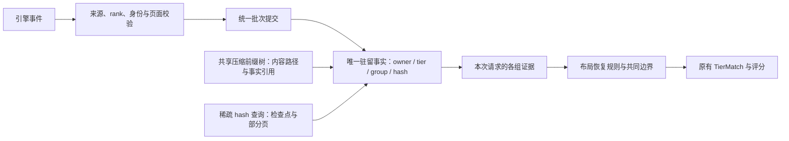
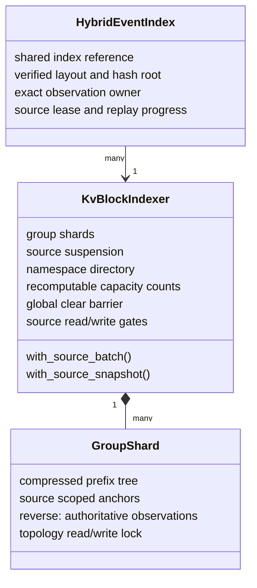
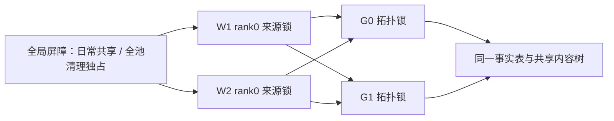

# 统一 KV 索引：实现与验证范围

实现基于 #493 完整备份 `ef836ef`。目标是让全注意力和混合注意力共用缓存事实，保留已有请求准入、路由目标和评分语义。

## 一份事实，两个查找入口



树上的路径不代表缓存存在；不同 worker/rank 共用内容路径，各自的驻留事实保持隔离。没有可信父路径的检查点直接按 hash 定位，不补造祖先节点。



`GroupShard::reverse` 沿用旧字段名，现在同时保存稠密页和稀疏页的唯一驻留事实。树的 owner/tier 引用、命名空间目录和容量计数都是派生信息，不再保留 hybrid 的第二份 `claims`/`TierSet`。

## 增、查、删

| 操作 | 实现约束 |
|---|---|
| 插入 | 校验完整批次；全注意力先在锁外计算本地 hash。写锁内维护事实、树分裂及锚点。 |
| 查询 | 全注意力仍一次遍历收集多个目标。两类查询都在受保护的视图复制本请求所需证据，再在锁外汇总。 |
| 删除 | 只删除对应 owner、group、hash、tier；最后一个相关别名消失后撤掉树引用。 |
| 来源失效 | 撤销该来源的观察、锚点和历史别名；只回收没有其他来源引用或后代的空叶。 |

缓存布局规则保留连续前缀、检查点、滑动窗口与压缩状态。共同边界用临时前驱游标收敛，避免每次下降都从头扫描历史候选；真实部分页只证明自己的边界。

```text
G0 连续页支持 64；G1 只在 32 有检查点 → 共同边界降到 32
G2 滑窗原来在 64 完整 → 必须重新检查 32 的窗口，不能直接返回 32
```

## 并发与生命周期

锁顺序为 `source lease → hybrid stream state → global barrier → source gate → group topology`。同一 worker/rank 的所有组原子提交；不同来源的稀疏查询与事件提交可并行。同一组的稠密插入、树分裂与回收仍通过拓扑写锁串行。全池清理通过全局写屏障排斥查询和提交；全注意力多来源查询按固定次序取得来源读锁，任一来源的长批次仍可能阻塞它，复制证据后立即放锁。



来源锁只控制访问顺序，不复制树或缓存记录。过期视图的可信状态与 worker 的退休状态分开；退休的订阅者不能重新启用来源，重复退休也不能删除替代订阅的数据。

两条摄取路径共用本地 owner 代次分配器，避免 full/hybrid 切换时清理相同数值代次的另一条路径。本地代次只用于本进程隔离，不是引擎认证的 epoch。

同一来源的同一外部 hash 绑定不同内容位置时，拒绝写入并使该来源失效。跨来源父锚点只在完整 digest 或旧 opaque ID 的所有候选都指向同一位置时复用拓扑，不授予驻留。

**有意收紧：** 未知的跨来源整数 parent 不再借用别人的路径。相同本地内容不能证明两个来源的整数 hash 同义；本来源已删除的历史 alias 仍可定位。对应正、负回归分别保留。

## 保留的评分行为

- 全注意力保持 GPU 连续前缀加外层续段的分段计价。
- 混合模型保持已有按组恢复、replay 扣减及 tier 适配。
- 查询结果始终绑定同一个 worker/rank，派发不跨 rank 拼接证据。
- 未验证的请求级禁读、prompt scoring 和嵌套 salt 不给缓存信用，但保留 tokens 用于负载与会话处理。

例如 GPU 48 tokens 加 CPU 16 tokens，CPU 系数 0.5，原有信用仍为 `48 + 16 × 0.5 = 56`，不改成整段 64 都按 CPU 计价。

## 已验证与剩余边界

真实 GPU 验证覆盖 Qwen3 全注意力、Qwen3.5 混合注意力、部分页、两个 worker 隔离和并发驱逐；NIXL P/D 另有真实传输证据。模型、引擎版本、并行模式和 connector 的支持范围仍需逐配置验证，不能由模型名称或单测通过推导全部支持。

尚未关闭的边界：

1. **异步执行窗口。** Router 查询后引擎仍可能驱逐；执行时严格一致需要引擎原子查询并预留状态。
2. **外部恢复契约。** Native CPU placeholder 缺少可准入元数据；一个 offload chunk 的成员 hash 也不等于多个独立可恢复 key。外部加载还受 chunk 大小、本地前缀及 partial-tail 计划影响，不能直接把 CPU/GPU 记录求并集当作精确恢复方案。
3. **活跃来源的历史路径。** 退休会清理其锚点和来源锁，但长期活跃来源的历史路径及别名仍可能增长。安全设置容量上限需要兼顾已删除 parent 的合法续写与可信重建，当前不声明这项预算已经闭环。

本轮不增加动态模型插件、传输调度框架或未被上游协议支持的物理页表。未来扩展优先增加经过验证的恢复契约和规则，继续复用同一事实层。

## 可复现检查

```bash
cargo fmt --all -- --check
cargo test --no-default-features --features cpu,ready --lib -- --test-threads=8
cargo test --no-default-features --features cpu,ready \
  --test kv_device_consumer --test kv_endpoint_worker_hosts \
  --test kv_index_prefix_contiguity --test kv_index_sequence_lifecycle \
  --test completion_preparation
cargo clippy --all-targets --all-features -- -D warnings
```

CPU 基准与真实事件回放位于 `src/kv_index/benchmarks.rs`。新旧版本必须使用独立 `CARGO_TARGET_DIR`、相同 profile/CPU 亲和性，并检查输出的 baseline 标识；不能共用可执行测试产物。

B300 的 Rust 1.99 严格 Clippy 被基线已有的 `result_large_err` 和测试辅助代码的 deprecated atomic API 拦住。基线可复现；额外排除这两类警告的检查用于确认本次修改，不能记为严格 Clippy 已通过。
